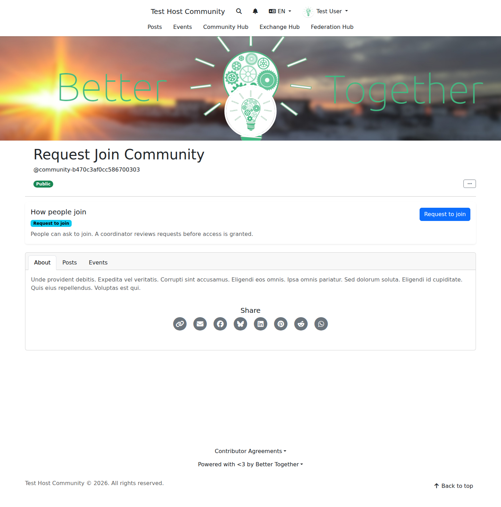

# Better Together Community Engine

[➡️ View the Documentation Index](docs/README.md)

## Overview

The Better Together Community Engine is a transformative platform designed to unite communities through the power of collaboration and shared resources. Our core intention is to provide an inclusive, accessible space where individuals and groups from diverse backgrounds can come together to share knowledge, engage in meaningful dialogue, and develop innovative solutions to common challenges. By leveraging the collective wisdom and experience of its members, the platform aims to foster a culture of mutual support, learning, and sustainable growth.

At the heart of our mission lies the commitment to empower communities. We believe that by facilitating connections and encouraging collaboration, we can unlock the immense potential within communities to drive positive change. The platform is more than just a tool for communication; it's a hub for inspiration, a catalyst for innovation, and a foundation for building stronger, more resilient communities. Whether it's addressing environmental concerns, promoting social welfare, or supporting economic development, the Better Together Community Engine is dedicated to creating a brighter, more connected future for all.

This project embodies our vision of a world where collaboration leads to greater understanding, innovation, and collective action. We invite you to join us in this journey, to contribute your unique perspectives and skills, and to be a part of a community that believes in the power of working better, together.

This project is the core community building portion of the Better Together platform.



Community Engine 0.11.0 adds multi-tenant platforms, federation, member data rights, stronger safety and privacy controls, and a larger content toolkit. See the [0.11.0 release notes](docs/releases/0.11.0.md).

## Documentation

For system overviews, flows, and diagrams, see the docs index:

- docs: docs/README.md

## Dependencies

In addition to other dependencies, the Better Together Community Engine relies on Action Text and Action Storage, which are part of the Rails framework. These dependencies are essential for handling rich text content and file storage within the platform.

### Action Text
[Action Text](https://guides.rubyonrails.org/action_text_overview.html#installation) brings rich text content and editing to Rails. It includes a WYSIWYG editor for writing rich text content stored in a manner compatible with Rails applications.

To set up Action Text, run the following commands:

```bash
rails action_text:install
rails action_text:install:migrations
```

Ensure that you follow the guide linked above to fully configure Action Text in your host app, including adding the required css and JavaScript files for the Trix editor and Action Text.

### Active Storage
[Active Storage](https://guides.rubyonrails.org/active_storage_overview.html#setup) facilitates uploading files to a cloud storage service like Amazon S3, Google Cloud Storage, or Microsoft Azure Storage, and attaching those files to Active Record objects.

To set up Active Storage, run the following command:

```bash
rails app:active_storage:install
```

Ensure that you follow the guide linked above to fully configure Active Storage in your host app, including creating and configuring your `storage.yml` file and setting storage defaults for your environments.

### UUID Primary Keys

The community engine uses UUIDs as primary keys with all tables using `id` as their UUID primary key. To ensure that the Active Storage and Action Text migrations use uuid as the foreign keys for records, set the following configuration in your host app's `application.rb` file or an initializer.

```ruby
config.generators do |g|
  g.orm :active_record, primary_key_type: :uuid
end
```

## Installation

Start a fresh Rails 8.1 app without the default asset pipeline. Rails 8.1 has no `--asset-pipeline=sprockets` option (it is silently ignored and you get propshaft plus dartsass, whose `application.css` clashes with sprockets), and this engine requires sprockets, which it brings in itself:

```bash
rails new my_app -d postgresql -A -T --skip-kamal --skip-solid --skip-jbuilder
```

The engine needs PostgreSQL with PostGIS, so the database adapter must be `postgis`. The installer switches it for you; if you prefer to do it by hand (or your `database.yml` is customised), set it before running `db:create`:

```yaml
# config/database.yml
default: &default
  adapter: postgis
```

Add this gem and the forks it needs to your Gemfile. Use `branch: 'main'` only to try it out; pin `ref:` to a reviewed commit for anything you deploy (the installer output depends on the gem version, so use a commit that contains the installer):

```ruby
gem 'better_together', '~> 0.11.0',
    github: 'better-together-org/community-engine-rails',
    branch: 'main'
gem 'pundit-resources', git: 'https://github.com/better-together-org/pundit-resources.git', branch: 'master'
gem 'storext', github: 'better-together-org/storext'
# only if you want the rspec and factory_bot generator defaults (rails new -T leaves them out)
gem 'rspec-rails', group: %i[development test]
gem 'factory_bot_rails', group: %i[development test]
```

Sprockets refuses to boot without a manifest, and the installer is itself a Rails command that boots the app, so create an empty one first:

```bash
bundle install
mkdir -p app/assets/config && touch app/assets/config/manifest.js
```

Run the engine installer. It writes the initializer, mounts the engine in `config/routes.rb`, adds the `s3_compatible` storage service, a `config.hosts` initializer, a head-tag provider stub, uuid/rspec/factory_bot generator defaults, the session middleware (the engine disables the session store, so a host app must mount it), env-driven Active Record encryption keys, the `adapter: postgis` switch in `config/database.yml`, the `app/assets/config/manifest.js` links, a theme stub and `bin/check-engine-migrations`:

```bash
rails g better_together:install            # engine migrations run from the gem (default)
rails g better_together:install --migrations=install   # copy migrations into db/migrate instead
```

If you use Action Text, run `rails action_text:install` before the engine migrations and delete its copied migration; CE ships its own Action Text tables.

Set the Active Record encryption variables (`bin/rails db:encryption:init` prints values): `ACTIVE_RECORD_ENCRYPTION_PRIMARY_KEY`, `ACTIVE_RECORD_ENCRYPTION_DETERMINISTIC_KEY` and `ACTIVE_RECORD_ENCRYPTION_KEY_DERIVATION_SALT`. Seeding enqueues background jobs, so Redis must be reachable (`REDIS_URL`). Create and migrate the database, then seed to create the setup wizard. In the default gem mode nothing is copied; see `docs/developers/host_app_migrations_from_gem.md`.

```bash
rails db:create db:migrate db:seed
```

Open `/<locale>/w/setup_wizard` (for example `/en/w/setup_wizard`) to create the host platform and the first admin. Until the wizard is done every other page redirects there.

## Development: Getting Started

This gem is developed using Docker and Docker Compose. To get the app running, complete the following steps:

Build the application image using the docker convenience scripts:

```bash
bin/dc build
```

Bundle the gems:

```bash
bin/dc-run bundle
```

Setup the database:

```bash
bin/dc-run rails db:setup
```

Run the RSpec tests:

```bash
bin/dc-run rspec
```

Troubleshooting:

- `bin/dc-run rails db:create` only creates the databases. It does not load schema or run migrations.
- If you have already run `db:create`, run `bin/dc-run rails db:migrate` or `bin/dc-run rails db:setup` before `bin/dc-run rails db:seed`.
- Fresh worktrees may not include ignored files such as `spec/dummy/config/master.key`, so local setup must not depend on that file being present.

## Contributing

We welcome contributions from the community.

- Guidelines: See [CONTRIBUTING.md](CONTRIBUTING.md) for how to report issues, propose changes, and submit pull requests.
- Code of Conduct: See [CODE_OF_CONDUCT.md](CODE_OF_CONDUCT.md) for expectations of behavior in our community.

Thank you for helping make Better Together better for everyone.
