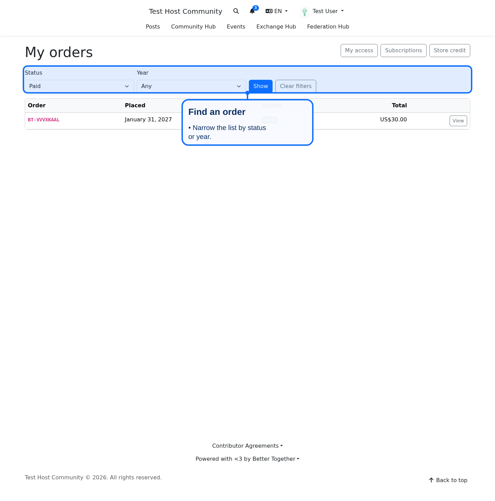
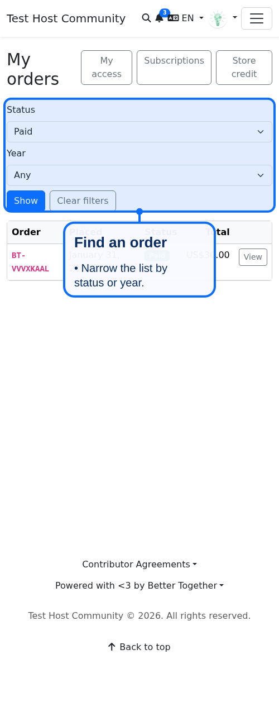
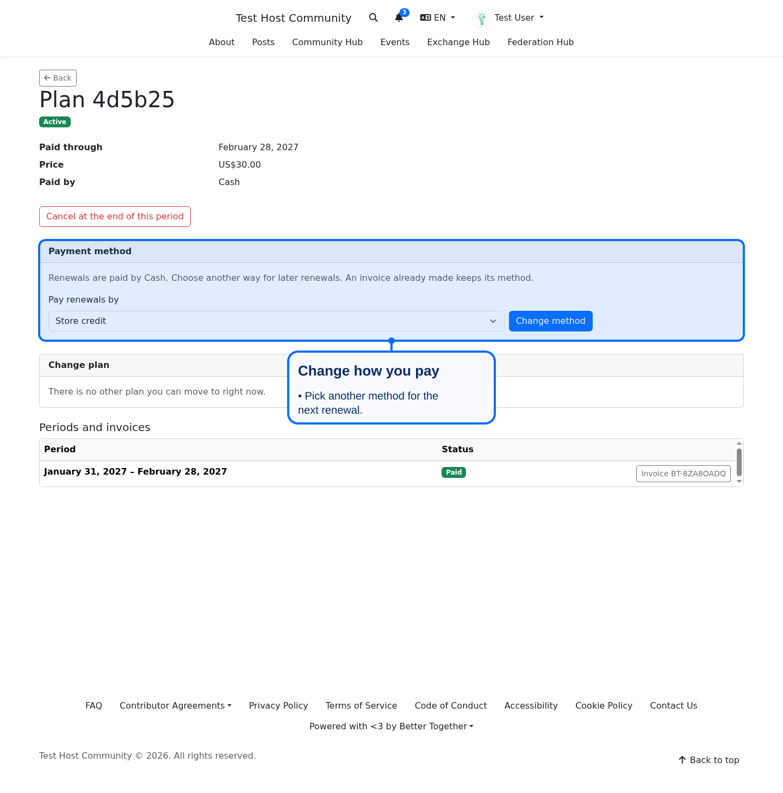
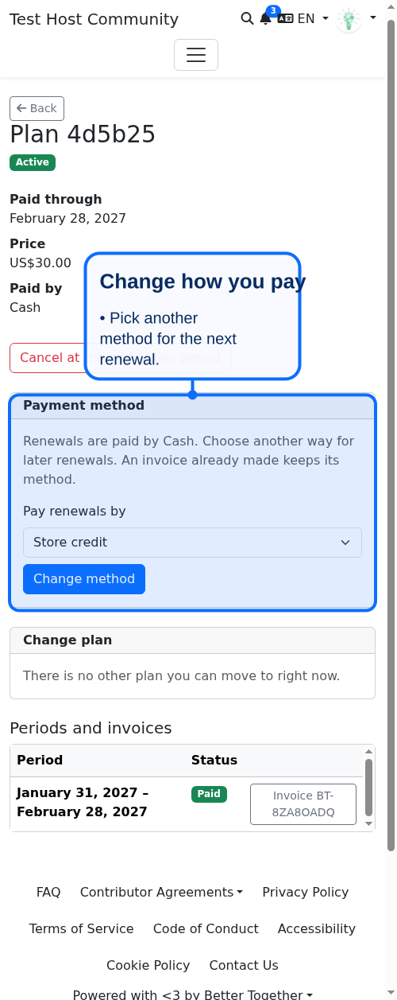
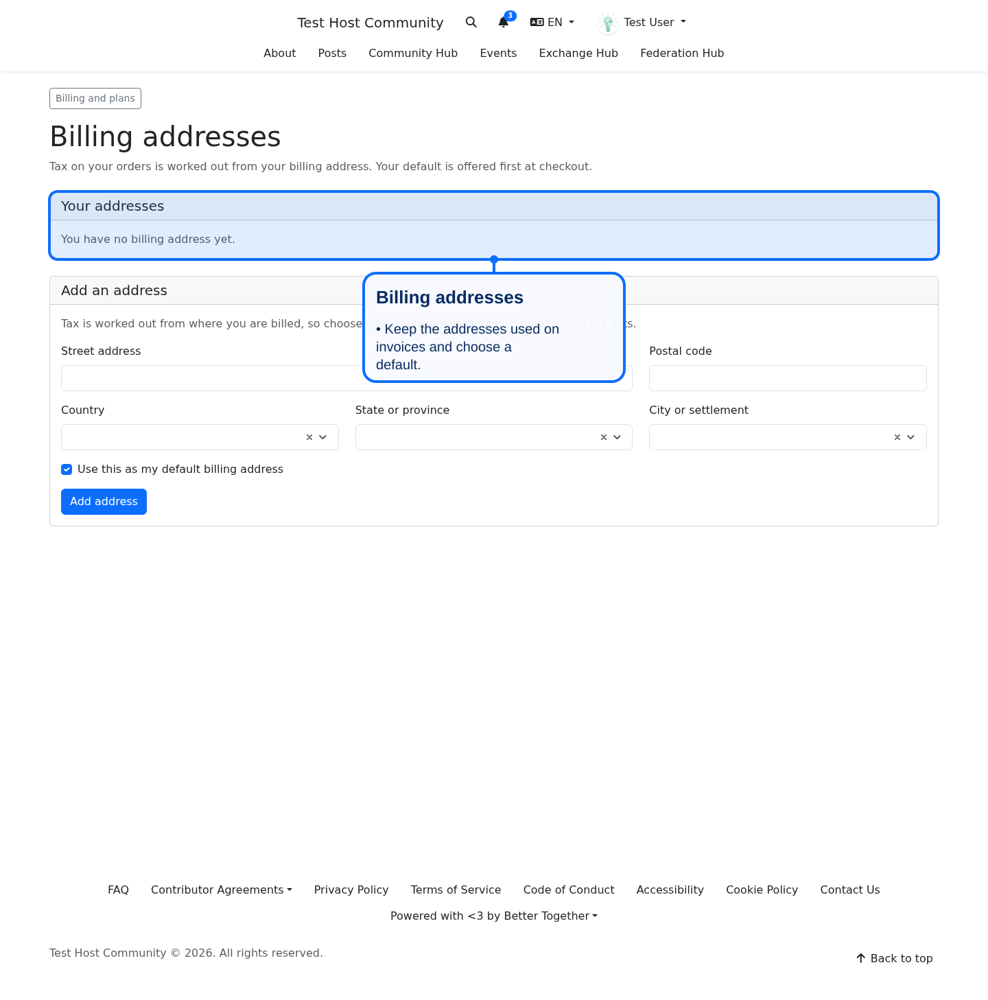
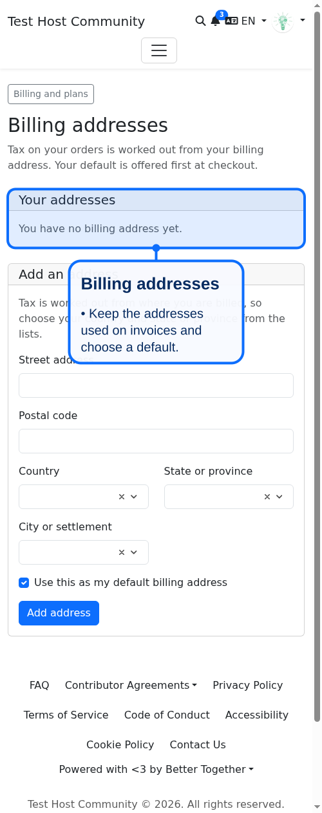
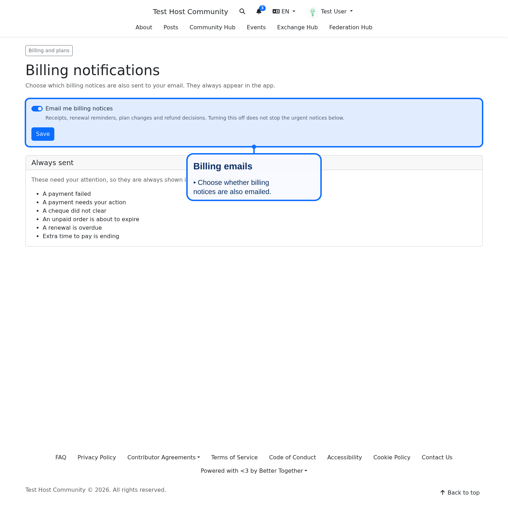
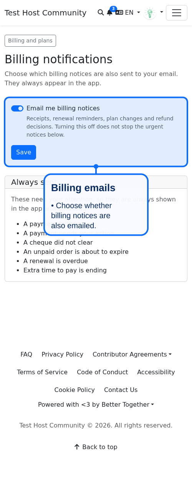
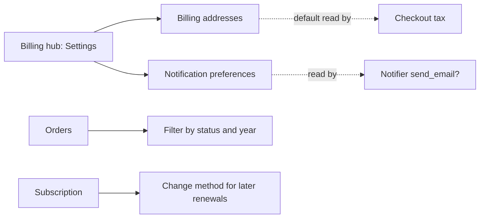

# Billing account polish

Four small things a buyer needs in their own billing area, all reached from the billing hub (`/billing`, "Settings" section) or from the page they belong to. None of them adds a table: the notification choice lives in the person's existing notification preferences.

## Order history filters

`/billing/orders` can be narrowed by status and by year (`?status=paid&year=2027`). Only the buyer's own orders are ever listed; an unknown status or a malformed year is ignored. The year list offers only years in which the buyer has an order. Ids: `billing-orders-filters`, `billing-orders-filter-status`, `billing-orders-filter-year`, `billing-orders-filter-btn`.

## Change how a subscription is paid

On a subscription the payer can choose another method for later renewals (`PATCH /billing/subscriptions/:id/change_method`, `Subscriptions::ChangePlan`'s sibling `Subscriptions::ChangeMethod`). The service refuses when:

- the subscription is not renewed by this platform (`not_local`);
- the method is the one already set (`unchanged`);
- the method is not one the platform offers this payer for a renewable term (`not_offered`).

An invoice already made keeps its method. The payment method column is read-only to ordinary updates, so the service is the one way it moves. Ids: `subscription-method-change`, `subscription-method-change-form`, `subscription-method-change-select`, `subscription-method-change-btn`.

## Billing addresses

`/billing/billing_addresses` lists the buyer's addresses that carry a country and state, marks the default, lets them add one and make another the default. It reuses the checkout address choice (`Checkout::BillingAddressChoice`) and `DefaultAddress`, so tax at checkout reads exactly what is set here. Only the buyer's own addresses can be made the default. Ids: `billing-addresses-page`, `billing-addresses-list`, `billing-addresses-new`.

## Billing notification preferences

`/billing/notification_preferences` lets a person choose whether billing notices are also emailed (`notify_billing_by_email`, default on, kept in `Person#notification_preferences`). The app message is always sent. Critical notices (`Notifications::Catalog.critical?`, such as a failed payment or an overdue renewal) are emailed regardless, and the page lists them. `Billing::Notifier#send_email?` applies the choice together with the person's general email setting. Ids: `billing-notification-preferences-form`, `billing-notify-email`, `billing-notification-always`.

No model or table changes, so there is no schema diagram change.
