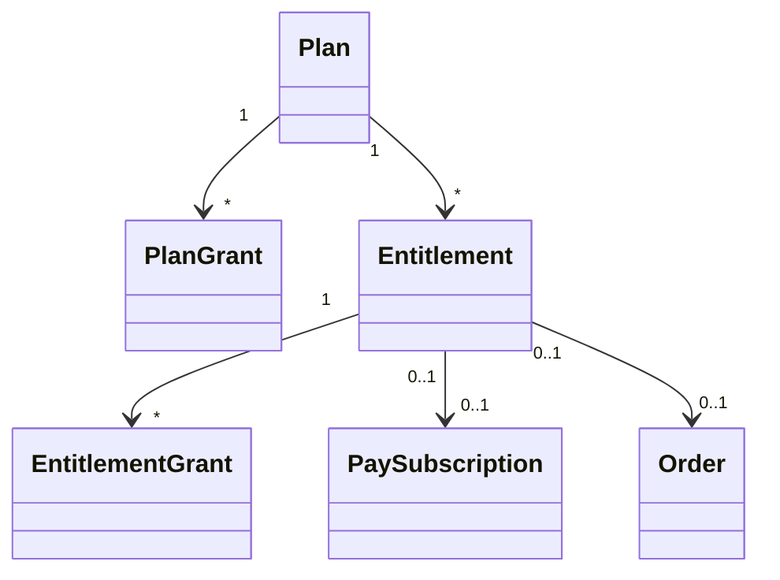

# Billing Entitlements and Quota Allowances

What being subscribed (or having bought a one-time plan) **gives**: a role, access to a gated feature, or more of a quota. It follows the payment exactly: it comes with it, stays through the grace, goes at the lapse, and returns when the person pays again. **Content is never deleted.**

## Model

**Diagram files:**
- 📊 [Mermaid model](../diagrams/source/billing_entitlement_model.mmd) and [lifecycle](../diagrams/source/billing_entitlement_lifecycle_flow.mmd)
- 🖼️ PNG and SVG exports are rendered by the maintainers (`bin/render_diagrams`)

| Table | Holds | Rules |
|---|---|---|
| `billing_plan_grants` | What a plan includes: `kind` (an allow-list: `membership_role`, `feature_access`, `quota_allowance`) and `parameters` | Parameters are validated by the kind's handler. Platform-sold plans only |
| `billing_entitlements` | One per source (a Pay subscription **or** a paid order, never both: CHECK) and who it is for (a person, community or the platform). Status `active`, `grace`, `lapsed`, `revoked`; `ends_at`, `grace_ends_at` | One live (active or grace) entitlement per beneficiary and plan (partial unique index); one entitlement per source |
| `billing_entitlement_grants` | What was **actually applied**: the kind and parameters copied from the plan, `grant_key` (unique per entitlement, so applying twice is one grant), what it made or found, **`owned`**, and for a quota the `quota_type` and `amount` | Composite platform keys. Editing a plan never loses track of what was applied |

## One derivation for every way of paying

`Entitlements::State.call(pay_subscription, term)` is a pure function over **Pay's own vocabulary**, the same for a subscription Community Engine renews and one a processor renews. It is exhaustive over `Pay::Subscription::STATUSES` (a spec proves it).

| Pay status | Entitlement |
|---|---|
| `trialing`, `active` | **active** until the period (or trial, or the date it ends) is over; **lapsed** once an end date has passed |
| `past_due` | **grace** until the terms' `grace_ends_at` (the plan's `grace_days` after the period), then lapsed |
| `unpaid`, `canceled`, `incomplete_expired`, `paused` | **lapsed** (the processor is the authority for a processor's subscription) |
| `incomplete` | pending: nothing is given yet |

Pay's own `on_grace_period?` means a cancelled subscription still paid through its period. The unpaid window above is the *dunning window* (`past_due`) and is a different thing.

## What triggers a sync

| Event | How |
|---|---|
| Any change to a Pay subscription's `status`, `current_period_end`, `ends_at`, `trial_ends_at` or pause | An `after_commit` on `Pay::Subscription` (added through the Pay extension initializer) queues `SyncEntitlementJob`. It is the same hook whether Community Engine's own jobs moved the subscription or Pay synced a webhook |
| A subscription's terms are made (`Subscriptions::Start`, `Adopt`) | The same job, once the terms exist |
| A one-time plan's order is paid or refunded | `SyncOrderEntitlementJob`, queued from `Orders::Settle` after the change commits. Refund (or a bounced cheque) revokes; a **partial refund changes nothing** |
| A plan's grants are edited | `SyncPlanEntitlementsJob` brings every entitlement for the plan up to date, and gives a plan that gained its first grant to those who already pay |

Every sync is idempotent and queued after the change commits, so a failure can be retried and **can never undo a payment**. A grant that fails is reported (`BetterTogether.report_error`), the others still apply, and the job is told to retry.

## Handlers

| Kind | Parameters | Applies | Takes away |
|---|---|---|---|
| `membership_role` | `joinable` (`platform` or `community` + `community_id`), `role` | A membership, made one record at a time (never in bulk) so callbacks run and the person's **permission cache is expired at once**; the platform given explicitly (a job has no current platform); **their "you were added or removed" emails are suppressed** (`suppress_notifications`) | Only a membership the entitlement made, silently. One the person already had (invited, added by hand) is **adopted and never removed** |
| `feature_access` | `feature_key`, `access_level` | A `FeatureAccessGrant` | Revokes only one the entitlement made; an existing grant is adopted |
| `quota_allowance` | `quota_type`, `amount` | An amount on the entitlement grant; `Quotas.sync_limit!` follows | Marks it released and re-syncs the limit |

Guards: a plan can only name a **role with no `manage_*` permission**, only this platform's platform and communities, only features in the feature registry and quota types in the quota registry; a beneficiary of the wrong kind (a role for a community, say) is skipped. Nothing is ever resolved from a string: the kinds are an allow-list of constants.

## Quota allowances

`Entitlements::QuotaAllowances` is registered with `Quotas::Allowances`. It answers the quota framework two questions:

- `amount(owner:, type:)`: the extra on top of the default, the sum of the applied grants of the owner's **live** entitlements (an entitlement in grace still counts: nothing has been lost yet).
- `pool?(owner:, type:)`: true for a **community** whose plan carries an allowance, so what its members upload is charged to the community and not to each uploader.

The limit is written by `Quotas.sync_limit!` on grant, renewal, lapse and plan change. **Usage is never reduced or deleted.** When an allowance goes, the limit drops and only new consumption is refused, if the platform enforces that quota (default `shadow`: nothing is ever refused). See [quota_enforcement.md](quota_enforcement.md). Monthly AI allowances follow the calendar month, not the billing period.

## Screens

| Who | Where | What |
|---|---|---|
| A person | `/:locale/billing/entitlements` ("My access") | Each plan they pay for or that is paid for them: status, until when, the extra time if past due, and each allowance with a usage meter. Linked from the orders list |
| A steward | a platform plan's page | "What this plan includes": the list, remove buttons, and one small form per kind. Editing brings current subscribers up to date |
| A steward | `/:locale/billing/allowances` | Choose `off`, `shadow`, `soft` or `hard` per quota type; the owners with a paid allowance and anyone over a limit, with usage. Linked from the payment methods list |

## Limits

Not built (the registry is open to them): a `hosted_platform` grant with a banner and a block on new paid-capacity resources, and full read-only suspension; quota-holder notices when over a limit; entitlements for seller-sold plans (a seller's plan cannot give roles or quotas on the platform).
