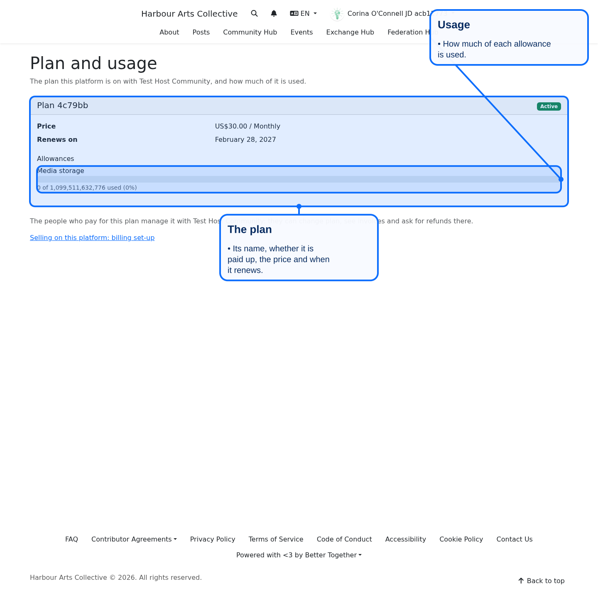
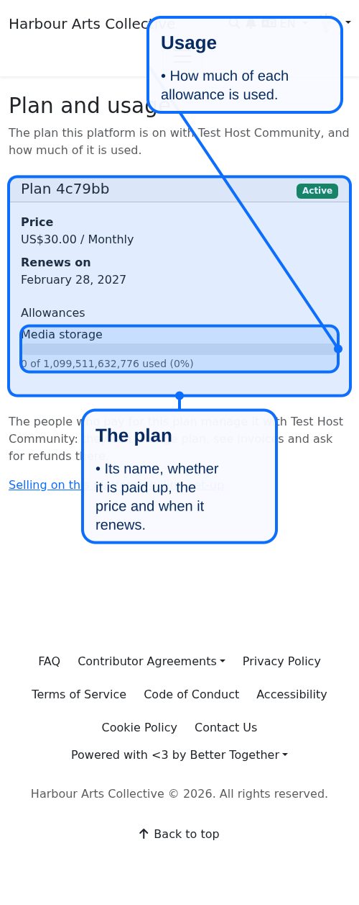
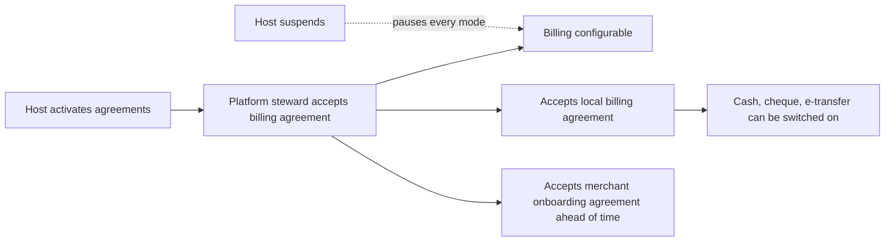

# Hosted billing enablement

A platform the host serves (a hosted platform) cannot bill anyone until its steward has accepted the host's billing agreements. Each agreement unlocks one thing, is recorded through the shared agreement mechanism, and is enforced on the server, not only on the screen.

## The three agreements

They are owned by the host platform and seeded as drafts with placeholder wording (`Billing::HostedAgreementSeeds`). The wording needs legal review, and the host must activate each one, before any hosted platform can accept it.

| Agreement | Identifier | Unlocks | Needs first |
|---|---|---|---|
| Hosted platform billing agreement | `hosted_platform_billing_agreement` | Any billing at all on the platform (`Billing.enabled?`, `Billing.configurable?`) | nothing |
| Hosted local billing agreement | `hosted_local_billing_agreement` | Cash, cheque and e-transfer. The host does not track, guarantee or hold liability for them. No processor account and no merchant of record needed. | the billing agreement |
| Merchant onboarding agreement | `merchant_onboarding_agreement` | The host collecting as merchant of record. Accepted ahead of time only: the mode itself is not built yet. | the billing agreement |

The host platform itself is never gated. Own processor connections (remote methods through the platform's own account) are a later change.

## What counts as accepted

`Billing::HostedBilling.permits?(platform, mode)` is true only when every needed agreement is **in force** on the host (active, active for consent), the platform has accepted it **as it reads now** (a changed agreement needs accepting again), and the host has **not suspended** the platform. Withdrawing or replacing an agreement pauses that mode and deletes nothing; the old acceptance stays as evidence.

Acceptance is recorded with `AgreementAcceptanceRecorder`: the platform is the participant, and the steward who acted is named in the evidence.

## Where the gates are

- `Billing.compute_enabled?` and `Billing.configurable?`: the billing agreement.
- `Configuration.context_for`: a local method has a context for a hosted platform only with both agreements.
- `ProcessorSetting` validation: a local method cannot be switched on without both (`hosted_local_billing_not_agreed`).

## Screens

- **Hosted billing** (`/billing/hosted_billing`, hosted platform stewards): the three agreements, each readable in the shared modal and accepted with its own box. Not reachable on the host platform.
- **Hosted platforms** (`/billing/hosted_platforms`, host stewards): every hosted platform, what it has accepted, whether its billing is on, and a suspend or resume control. Suspending needs a reason, pauses billing at once and keeps all data.

Both appear in the platform navigation only for the right kind of platform.

## Audit trail

Suspending and resuming each write a billing event on the hosted platform (`hosted_billing.suspended`, `hosted_billing.resumed`) naming who acted. The reason text is kept on the hosted account for stewards and never copied into the event.

## Data

`better_together_billing_hosted_accounts`: one row per hosted platform the host has acted on (`status` active or suspended, `suspended_at`, `suspended_by_id`, `suspension_reason`). What a platform accepted is in agreement acceptances, not here.

## Plan and usage

A hosted platform's steward also sees what the platform gets for its money: `/billing/hosting_plan`, reached from the platform's operations buttons ("Plan and usage"). It reads the host's billing records for the plan held for the platform (or its community): the plan, whether it is paid up or late, the price, the renewal date, and a usage bar for each allowance. It needs no billing agreement, because the plan is the host's, not the platform's own selling. Nothing is changed here: the people who pay manage the plan (change, invoices, refunds) with the host. With no plan it says so and points to the host's plans.

Access is the hosted steward rule used above (`HostedBillingPolicy#plan?`); a visitor is asked to sign in, anyone else sees nothing. Ids: `billing-hosting-plan-page`, `billing-hosting-plan-none`, `billing-hosting-plan-manage`, `billing-hosting-plan-billing-link`, and per plan `hosting_billing_entitlement_<id>`, `hosting_details_...`, `hosting_usage_...`.

**Diagram files:** [Mermaid source](../diagrams/source/billing_hosted_enablement_flow.mmd), [PNG](../diagrams/exports/png/billing_hosted_enablement_flow.png), [SVG](../diagrams/exports/svg/billing_hosted_enablement_flow.svg)
