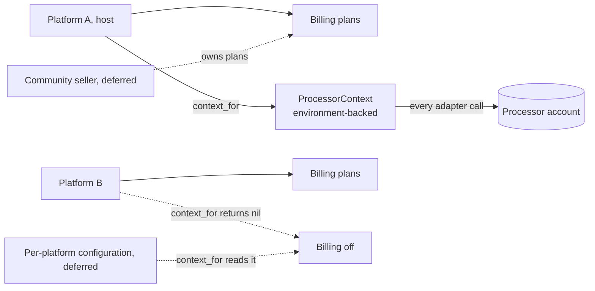

# Hosted billing roadmap

The billing foundation is designed so two later capabilities fit without reworking it.
Neither is implemented yet. This page records what is already in place for them and what
is deliberately left for later.

1. **A different processor configuration per platform.**
2. **Member communities that bill through the platform defining and managing their own
   plans** (hosted billing).

## Already in place

- **A tenant on every billing record.** Plans, events and the Pay tables carry a required
  `platform_id` with no ambient default ([platform_isolation.md](platform_isolation.md)).
- **A processor context on every adapter call.** `BetterTogether::Billing::ProcessorContext`
  names the platform and processor account; adapters never read global environment
  variables. Today `Billing::Configuration.context_for(platform, processor)` returns an
  environment-backed context for the host platform only. Later it can return a
  database-backed per-platform configuration.
- **Per-platform enablement.** `Billing.enabled?(platform)` and
  `Configuration.processors_for(platform)`; a platform with no context has billing off.
- **Owner-shaped management.** Routes, controller scoping and policies are written
  against a *billing owner*, which is the current platform today. Everything goes through
  one policy question, `manage_billing?(owner)`.
- **Per-platform uniqueness.** A plan `identifier` is unique per platform, not globally;
  processor price ids stay unique per processor so one tenant cannot claim another's.
- **Attributable webhooks.** Events carry `platform_id`; an adapter's `normalize_webhook`
  can return `platform_id:` or an `account_ref:` that core maps to a platform.

The agreement gates for a hosted platform to bill at all, with local methods first, are built: see [hosted_billing_enablement.md](hosted_billing_enablement.md).

## Left for later

| Capability | What it needs |
|---|---|
| Per-platform processor configuration | Per-platform processor keys, merchant identity and signing secrets come from the shared encrypted per-platform integration store that platform tenancy (Phase 3) is building, read through `context_for`. Billing adds no credentials table of its own and keeps only the settings that are not secrets. Until then hosted platforms stay on offline payments only. |
| Per-platform webhook endpoints | One signed endpoint and secret per platform (secret from the same integration store), so the tenant comes from the endpoint and never from payload fields. A spec that cross-attribution between two contexts is refused lands with it, and before a second platform gets a vendor context. |
| Per-platform seller identity | Business name, address, registration numbers, support and from addresses resolved from the order's platform. Today a hosted platform's invoices and emails name the platform and carry no host address or support email; the Pay business details are used for the host platform only. |
| Per-platform quota rows | Allowances keyed by (owner, platform, quota type) and granted by the granting platform. Today they are summed per person; platform tenancy moves to one account per platform, which removes the overlap by construction. |
| Person platform binding | One helper that says which platform a buyer or beneficiary belongs to, with `Person` declared platform bound, replacing the `billing_bound_platform_id` / `platform_id` fallbacks. Lands with one account per platform. |
| Row level security | Name the sanctioned cross-tenant reads (event ingest, webhook dispatch, pruning, `Configuration` lookups) behind one helper so each can take an explicit bypass. |
| Platform-scoped unique indexes | `(processor, event_id)`, `(processor, processor_price_id)` and `pay_customers (processor, processor_id)` are global, correct for one processor account. They become `(platform_id, ...)` or account scoped when per-platform credentials arrive. |
| Accessible, tagged PDFs | Language, structure tree and tagged tables for invoices and receipts, and the buyer's billing address on them once the legal requirement is confirmed. |
| Community-defined plans | The data shape is in place: a nullable polymorphic `seller` on plans with identifier uniqueness per seller, and the platform's screens already manage only platform-sold plans. Still needed: a community-scoped route using the same `concern :billing_plans` in `config/routes/billing.rb`, a community UI, and the community branch of `manage_billing?`. |
| A community billing permission | `manage_community_billing`, separate from broader community editing or member management, used by `manage_billing?(community)`. The platform equivalent today is `manage_platform`. |
| Connected / merchant accounts and fee splits | The merchant account chunk (A9) and the processor extension's Connect support. |

## Rules to carry forward

- Never expose Pay's unscoped `payment_processor`: a person's `payment_processor` is refused, and `payment_processor_for(platform)`, `add_payment_processor(name, platform:)` and `set_payment_processor(name, platform:)` (see `Billing::PayCustomerOwner`) require a platform and never touch another platform's customers.
- Every new billing table is platform-bound and ties children to parents with composite
  foreign keys.
- Keep maintenance sweeps per record; they are the only cross-tenant operations.

## Diagram

**Diagram Files:**
- [Mermaid source](../diagrams/source/billing_tenancy_and_ownership_model.mmd) - editable source (with the steward permissions)
- [PNG export](../diagrams/exports/png/billing_tenancy_and_ownership_model.png) - high-resolution image
- [SVG export](../diagrams/exports/svg/billing_tenancy_and_ownership_model.svg) - vector graphics

Plan screens and rules: [plan_catalog.md](plan_catalog.md).

For who needs what from billing, what exists today and what is still to build, see [user_stories_and_coverage.md](user_stories_and_coverage.md).
