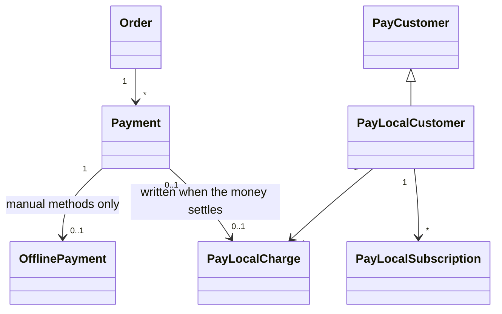

# Payments Community Engine settles itself, as Pay records

Cash, a cheque, an e-transfer and store credit have no payment vendor: the seller says the money arrived, or credit is spent. They are still payments, and Pay is where Community Engine keeps customers, subscriptions and charges, so these methods have a Pay processor of their own, **`local`** (`Pay::Local`). This page says what it holds and what it deliberately does not. The workflow it sits beside is in [offline_payment_methods.md](offline_payment_methods.md) and [orders_and_payments.md](orders_and_payments.md).

## What is where

**Diagram files:**
- 📊 [Mermaid source](../diagrams/source/billing_local_pay_processor_model.mmd)
- 🖼️ [PNG export](../diagrams/exports/png/billing_local_pay_processor_model.png) - rendered by the maintainers (`bin/render_diagrams`)
- 🎯 [SVG export](../diagrams/exports/svg/billing_local_pay_processor_model.svg)

| In Pay (`Pay::Local::*`) | Stays in Community Engine |
|---|---|
| The **customer**: one per buyer and platform, created with `person.add_payment_processor(:local, platform: platform)` | The **order**, its lines, holds and expiry |
| The **charge**: written when the money has settled (the seller confirmed it, a cheque cleared, credit was spent), with how it was paid (`payment_method_type`) and the order and payment ids in its metadata | The **pending** part: `Billing::Payment` and `Billing::OfflinePayment` (awaiting, claimed, received...). Pay has no pending charge, so waiting for the seller cannot live there |
| `amount_refunded`, kept equal to what the payment says was given back | The **refund ledger** (`Billing::Refund`), agreements, settings, notifications |
| The **subscription** of a recurring plan paid this way (`Pay::Local::Subscription`) | Renewals: generating each period's order and settling it |

The point is one model for every payment: to Pay, and to anything built on Pay's records (entitlements read `Pay::Subscription`), a cash payment is a charge like a card payment. For a payment through a processor the processor is the authority and Pay syncs its own charge; `LocalSettlement` never touches those.

## How it differs from Pay's FakeProcessor

Pay ships a `FakeProcessor` that also keeps records without a vendor. It is a stub: Pay refuses it unless you pass `allow_fake: true`, excludes it from `not_fake_processor`, and its `cancel` ends a subscription at the **end of the month** whatever was paid for. `Pay::Local` is a real processor: a local subscription ends where its **paid period** ends, it can be resumed during that time, it cannot be paused, and Pay's own `active`, `past_due`, `unpaid` and `on_grace_period` scopes work on it (a subscription in its dunning window is `past_due`, one that lapsed for non-payment is `unpaid`). Nothing renews it by itself: Community Engine moves it on with `advance!(starts_at:, ends_at:)` when the next period is paid.

## When the charge is written

`Payments::Succeed` is the single place a payment becomes paid, so it is where `LocalSettlement.record!` runs, under the payment's lock and only once. A cheque with `grant_on: cleared` has no charge while it is merely received. `Refunds::Record` and `Refunds::Resolve` call `LocalSettlement.sync_refunds!`, so a recorded refund, a failed one, and a bounced cheque that had already granted all keep `payment.refunded_cents == pay_charge.amount_refunded`.

## Rules

- Never create the customer through Pay's own `set_payment_processor` / `add_payment_processor`: they are blind to the platform (see [platform_isolation.md](platform_isolation.md)). `Billing::PayCustomerOwner` replaces them and requires `platform:`.
- The customer is the **buyer**, on the platform that sold. The community or platform an order is for (`on_behalf_of`) is not a Pay customer.
- A charge is on the same platform as its payment, and one charge pays for one payment (a unique index and a composite foreign key).
- `Pay::Local` is a coupling to Pay's internals (its STI naming, its load hooks, `Pay::NanoId`). `spec/lib/better_together/pay_gem_compatibility_spec.rb` fails when a Pay upgrade changes what it relies on.
