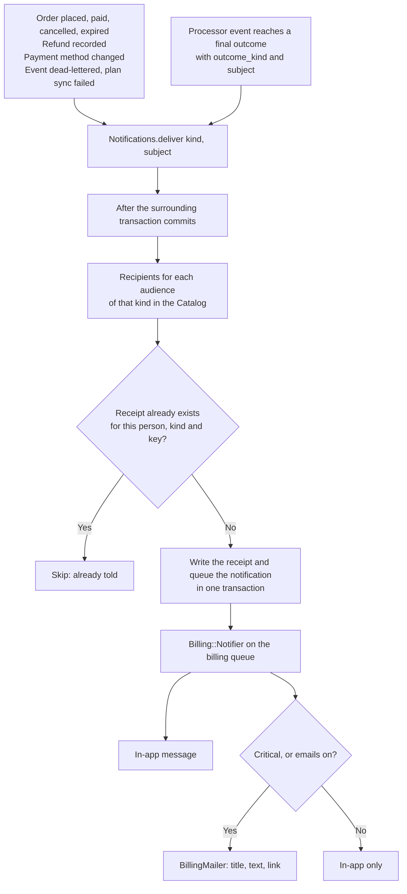

# Billing notifications

Billing tells people what is happening through the same Noticed notifications the rest of Community Engine uses: an in-app message and an email, in the reader's language, honouring their notification choices. Pay's own emails stay off, so nobody gets two messages about the same payment and every message is branded and translated by the platform.

## One notifier, many kinds

`Billing::Notifier` is a single `Noticed::Event` whose `kind` and `audience` choose the words. `Billing::Notifications::Catalog` lists each kind, who hears about it, and whether it is critical:

| Kind | Told | Critical | When |
|---|---|---|---|
| `order_placed` | buyer, seller | | an order is placed |
| `order_paid` | buyer, seller | | the payments cover the total |
| `order_cancelled` | buyer, seller | | an unpaid order is cancelled |
| `order_expired` | buyer, seller | | an order was not paid in time |
| `payment_succeeded` | buyer | | the processor reports a payment (the receipt) |
| `payment_failed` | buyer | yes | the processor reports a failed payment |
| `payment_action_required` | buyer | yes | the processor needs the buyer to act (bank confirmation) |
| `payment_claimed` | seller | | the buyer says they sent a payment made outside the platform (first time only) |
| `payment_confirmed` | buyer | | the seller says the money arrived, whether or not the buyer ever said they sent it |
| `payment_rejected` | buyer | | the seller did not accept the payment |
| `payment_place_gone` | buyer, seller | | a late payment was confirmed but what the order held is gone |
| `cheque_received` | buyer | | the seller has the cheque |
| `cheque_cleared` | buyer | | the cheque cleared |
| `cheque_bounced` | buyer, seller | yes | the cheque did not clear; what it granted is reversed |
| `confirmation_reminder` | seller | | a payment has waited a day for the seller (once a day) |
| `hold_expiring` | buyer | yes | the hold on an unpaid order ends within a day and the buyer has not said they paid |
| `refund_issued` | buyer, seller | | a processor refund |
| `refund_recorded` | buyer | | the seller recorded handing money back |
| `subscription_renewing` | buyer | | a renewal is coming up |
| `subscription_canceled` | buyer, seller | | a subscription ended |
| `trial_ending`, `trial_ended` | buyer | | a trial |
| `dispute_opened` | seller | yes | a buyer disputed a payment |
| `dispute_resolved` | seller | | the dispute was resolved |
| `settings_changed` | operator | yes | a payment method or where buyers pay was changed |
| `event_dead_lettered` | operator | yes | a billing event could not be processed after several tries |
| `plan_sync_failed` | operator | yes | a plan could not be sent to the processor |

The offline payment kinds are written about in [offline_payment_methods.md](offline_payment_methods.md). An order that lapses is told to both sides by `order_expired`, so an expiring offline payment does not send a second notice. Neither side's notice gates the other's action: a seller is told of a new order the moment it is placed, and a buyer is told of a confirmation even if they never claimed.

**Audiences.** `buyer` is the person who placed the order. `seller` is whoever may manage billing for the platform that sold it, found by the `manage_platform` permission (the question `PlanPolicy` asks), not by a role name. `operator` is the same people, for something about how billing itself is working. The person who just did the thing is left out. A person who is both buyer and steward is told once per thing, not twice. Orders sold by a community or person have no platform managers to tell; their sellers will be told when community billing exists.

**Critical.** A critical notice always shows in the app and is emailed even to someone who turned emails off: a failed payment, a payment that needs their action, a dispute, a changed payment destination, a broken pipeline. Everything else follows `notify_by_email`.

**Diagram Files:**
- [Mermaid source](../diagrams/source/billing_notification_flow.mmd) - editable source
- [PNG export](../diagrams/exports/png/billing_notification_flow.png) - high-resolution image
- [SVG export](../diagrams/exports/svg/billing_notification_flow.svg) - vector graphics

## When a notification is sent

There is one way in, `Billing::Notifications.deliver(kind, subject:, dedupe_key:, actor:)`, and three places it is called from. None of them is a Pay model callback or Pay's webhook delegator.

1. **The event pipeline.** After `EventProcessor` records a final outcome it tells the people the outcome concerns, using the neutral `outcome_kind` and `subject` the adapter reported ([processor-adapters.md](processor-adapters.md#what-an-outcome-says-happened)). A vendor's own event names never reach this code. The key is the event, so replaying an event does not notify again. Outcomes with no subject, or kinds core does not announce, are ignored.
2. **Core services.** `Orders::Place`, `Settle`, `Cancel`, `Expire`, `Refunds::Record`, the payment method audit, `Event#dead_letter!` and `SyncPlanJob` call it themselves.
3. **Scheduled jobs.** Reminders and digests arrive with the offline payment methods.

It runs **after the surrounding transaction commits**, so nobody is told about something that was then rolled back, and a failure to notify is logged and reported and never fails the work that triggered it.

### Never twice

Each person gets a `Billing::NotificationReceipt` (platform-bound, unique on person, kind and key) in the same transaction as the notification itself. A replayed webhook, a retried job and a double click find the receipt and do nothing. The key says what the notification is about (an order and what happened to it, a processed event, a settings change) and never holds personal data. A thing that can legitimately happen again, such as a second failed payment, passes its own key.

## Pay's own emails

Pay's webhook handlers would email receipts, refunds, renewal notices, failed-payment and action-required notices, and trial notices through `Pay::UserMailer`, unbranded and untranslated, to whatever email Pay has on file. `config/initializers/pay.rb` sets `Pay.send_emails = false`, and specs guard that and that no billing code calls `Pay.mailer`. The seven messages Pay would have sent exist here as `payment_succeeded`, `refund_issued`, `subscription_renewing`, `payment_failed`, `payment_action_required`, `trial_ending` and `trial_ended`. Pay's receipt attached the processor's PDF; here a receipt links to the order, and an adapter can add a processor receipt link later.

## What a notification contains

Names, amounts, dates, and a link to the order (for the buyer) or the sale (for a steward) or the screen where the thing is managed. **Never** payment instructions, a payee's email, phone or address, what a buyer typed as a reference, a processor's own text, or an event payload. Those could be used to redirect a payment, and an email can be forwarded. The email says as much: it never includes payment details, and to pay or change anything the person signs in and opens the link.

## Platform and queue

A notification is stamped with its **record's** platform, not the platform the request or job happens to be running as, so a seller's notifications are never filed under the host. Deliveries run on the `billing` queue so a payment message never waits behind other jobs.

## Data

`better_together_billing_notification_receipts` (see [billing_schema_erd.mmd](../diagrams/source/billing_schema_erd.mmd)): `platform_id NOT NULL`, `recipient_id` (a receipt goes with the person), `kind`, `audience`, `dedupe_key`; unique on `(platform_id, recipient_id, kind, dedupe_key)`.
