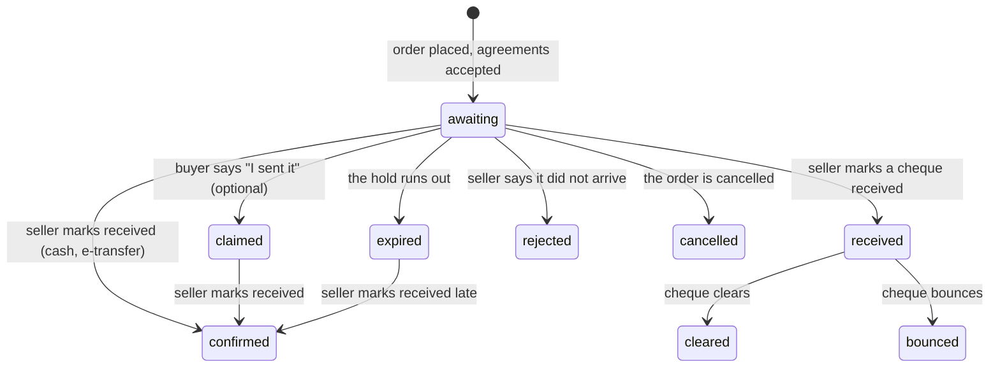

# Billing offline payment methods

Cash, a cheque and an Interac e-Transfer are paid **outside the platform**: the buyer hands the money to the seller, or sends it to them, and the platform never sees it. This page describes what happens to an order paid that way, what each side sees and may do, and the limits we tell people about. Turning a method on is in [payment_methods.md](payment_methods.md); the agreements a buyer accepts first are in [purchase_agreements.md](purchase_agreements.md); the order they belong to is in [orders_and_payments.md](orders_and_payments.md); who is told what is in [notifications.md](notifications.md).

## The one rule that shapes everything

**The seller's word is what makes an offline payment paid, and it never depends on the buyer.**

- The seller can mark a payment received from `awaiting`, `claimed` or `expired`. Nothing in the code reads "the buyer claimed" as a condition. A buyer who paid in person, or sent a transfer without telling anyone, is paid like any other.
- The buyer's "I sent it" is a courtesy. It flags the payment for the seller and tells them once. It changes nothing the seller may do. Sent after the seller confirmed, it is ignored without an error; sent after the hold ran out, it is recorded without changing the status so the seller can still confirm.
- Neither notice gates the other side. A seller learns of a new order when it is placed (not when the buyer chooses to say anything), and a buyer is told of a confirmation even if they never claimed.

## Process flow

**Diagram files:**
- 📊 [Mermaid source](../diagrams/source/billing_offline_payment_state_machine.mmd) - the full machine, with the notes
- 🖼️ [PNG export](../diagrams/exports/png/billing_offline_payment_state_machine.png) - rendered by the maintainers (`bin/render_diagrams`)
- 🎯 [SVG export](../diagrams/exports/svg/billing_offline_payment_state_machine.svg)

## What is stored

`Billing::OfflinePayment` (`better_together_billing_offline_payments`) sits beside the order's core `Payment`, one per payment. It is platform-bound and tied to its order and payment by composite foreign keys that include the platform, so it cannot belong to another platform than its order.

| Field | What it holds |
|---|---|
| `status` | `awaiting`, `claimed`, `received`, `confirmed`, `cleared`, `bounced`, `rejected`, `expired`, `cancelled` |
| `grant_on` | `confirmed`, `received` or `cleared`: when the buyer's payment counts as paid. Copied from the seller's setting when the order is placed, so a later change cannot alter an order already placed |
| `instructions_snapshot` | **Encrypted.** What the buyer was told about how to pay, as it was when the order was placed |
| `buyer_reference`, `seller_reference` | **Encrypted.** Optional notes from each side (limited to 200 characters) |
| `confirmed_by`, `received_on` | Who said the money arrived, and the date they say it did |
| `claimed_at`, `confirmed_at`, `received_at`, `cleared_at`, `bounced_at`, `rejected_at`, `expired_at`, `cancelled_at` | When each thing happened |
| `seller_assisted` | The sale was made in person (see below) |
| `platform_fee_cents` | Always `0`: the platform cannot take a fee on money it never sees. Validated, and shown to the seller as "uncollected" |

Because the instructions are copied, a seller who edits their payment details cannot redirect a buyer who is already part-way through paying, and the record shows what each buyer was told. The pay screen shows the copy, never the live setting.

## Placing the order

`Orders::Place` checks, on the server, that the chosen method is switched on for the seller, allowed for this kind of purchase (subscription, one-time, ticket, exchange) and works in the order's currency (an e-transfer is Canadian dollars only). It then opens the payment (`OfflinePayments::Open`): a **pending** `Payment` for the whole balance and an `awaiting` offline payment, held for the seller's own `hold_hours` (72 hours if they have not chosen).

The agreements come first and are enforced in `Place`, whatever the screens did. The instructions are shown only on the buyer's own order page, which exists only after the order was placed with the agreements accepted.

## What the buyer sees

The buyer's order page (`/billing/orders/:id`) gains a card for the offline payment:

- **How to pay**: the instructions the seller wrote for that method (a payee name and address for a cheque; an email or phone for an e-transfer), the amount, and how long the order is held. Shown only while the payment is waiting.
- **Before you pay**: the same disclosures every time, translated: you pay the seller directly, outside the platform; the platform cannot see, track or protect the payment and there is no automatic receipt, refund or dispute process; the order is paid only when the seller confirms; the hold length; and one note per method (cash is handed over in person; a cheque can take days and can bounce; an e-transfer needs a Canadian bank account and is in Canadian dollars).
- **I sent it** (optional): a note field and a button. The text says plainly that telling the seller is optional.
- After it is settled: the status in words, the seller's reason if the payment was not accepted, and no instructions.

Stable ids: `billing-offline-heading`, `billing-offline-status-message`, `billing-offline-instructions`, `billing-offline-amount`, `billing-offline-disclosure`, `billing-offline-claim-form`, `billing-offline-claim-hint`, `billing-offline-claim-reference`, `billing-offline-claim-btn`, `billing-offline-claimed-note`, `billing-offline-rejection-reason`.

## What the seller sees and does

Stewards reach the seller side from **Sales** (`billing-sales-offline-queue-link`, `new-walk-up-sale-btn`).

- **The queue** (`/billing/offline_payments`): everything waiting for the seller, a cheque not yet cleared, and payments that lapsed in the last 30 days (a late payment can still turn up). Payments the buyer said they sent come first and are marked (`billing-offline-claimed-badge`), but **unclaimed ones are listed and confirmable too**. Each row has a one-click *Mark received* (`billing-offline-confirm-btn-<order id>`).
- **The sale page** (`/billing/sales/:id`): whether the buyer said they sent it and their note; the fee shown as uncollected; forms to mark it received (with an optional reference and date) or to reject it with a reason the buyer sees; for a cheque *received*, buttons to mark it cleared or bounced; and, once money was paid, **Record a refund** (below).
- Every action is a plain `PATCH` that redirects back with a notice, or an alert saying why it could not be done. A repeated click is harmless.

### Marking received

`OfflinePayments::Transition.receive` moves the payment to `confirmed` (cash, e-transfer) or `received` (cheque), records who and when, and, if `grant_on` says the money now counts, succeeds the payment so the order settles and is paid. It writes a billing event (`cash.payment_confirmed`, `cheque.cheque_received`, …) naming the actor and never a reference or instruction, and tells the buyer.

- **Idempotent**: confirming twice confirms once, logs once, tells once.
- **Late payment**: from `expired` it takes the place the order held again (each line's `reserve!`), opens a fresh payment for the balance and confirms it. The expired payment stays as history (cancelled). If the place is gone, nothing is recorded, the seller is told what to do (give the money back) and the buyer is told too (`payment_place_gone`).
- **Not your own purchase**: a person cannot confirm a payment for their own purchase (as the buyer, or the person it is for) unless they are a steward of the platform, who is accountable for it and recorded as the person who confirmed.

### Rejecting

The payment fails, the order is cancelled so what it held is released, and the buyer is told with the seller's reason. If another payment has money against the order, the order stays open.

### Cheques

A cheque is received, then cleared or bounced. The seller's setting decides when it counts: `cleared` by default (the safe choice), or `received` if they accept the risk.

- Received with `grant_on: cleared`: the order stays awaiting payment, and **a received cheque holds the order open** (it does not expire or get cancelled while it waits to clear).
- Cleared: the payment succeeds (if it was waiting for clearing) and the buyer is told.
- Bounced after it granted: a full refund is recorded (`reason: bounced`) so the order settles to refunded. Bounced before it granted: the payment fails and the order is cancelled. Both tell the buyer and the seller (`cheque_bounced`, critical).

### Refunds

The platform cannot move cash or a cheque. **Record a refund** records that the seller gave money back: a full or partial amount, a reason, and an idempotency token so a double click records once. It goes through `Refunds::Record`, settles the order, and tells the buyer (`refund_recorded`). Refunds for payments through a vendor are made at the vendor and are not recorded here.

## A sale in person

A seller who takes cash across a counter does not want the buyer to have to do anything. **Sale in person** (`/billing/walk_up_sale/new`) lets a steward choose the plan, the way of paying and the buyer (by exact handle; the buyer must already be a member of the platform, and nothing searches members), tick that the buyer read and accepted the purchase agreements with them, and optionally tick that the money has already changed hands.

- The agreements are **still required**. They are recorded as accepted in person (`acceptance_method: seller_assisted`, with the steward who recorded it), so they are never mistaken for the buyer's own acceptance. Without the tick, nothing is recorded at all.
- The order is placed for the buyer (`seller_assisted: true`); if the money has changed hands it is confirmed at once. The buyer is told afterwards.

## Expiry and reminders

| Job | Schedule | What it does |
|---|---|---|
| `ExpireOfflinePaymentsJob` | hourly at :20 | Lets orders whose hold ran out lapse (which closes their waiting payments and gives back what they held). If an order was closed some other way and its payment was left waiting, closes the payment too |
| `RemindOfflineConfirmationsJob` | daily 14:15 UTC | Reminds the seller once a day of a payment that has waited a day; warns the buyer once when their hold ends within a day and they have not said they paid |
| `ExpireOrdersJob` | hourly at :10 | The order-level sweep; closing an order also closes its waiting offline payment |

All run on the `billing` queue, act on one record at a time, and survive one bad row. The reminders carry no payment instructions. The daily seller reminder is per payment, not a digest; a digest across payments is a later improvement.

## Limits we tell people about

- The platform cannot see, track, protect, refund or take a fee on these payments. Sellers acknowledge this when they switch a method on; buyers read it before they pay.
- Reconciliation is manual and there is no chargeback protection.
- An e-transfer is Canadian dollars and a Canadian bank account only, and the platform never holds the funds (seller-direct only; an e-transfer the platform receives on a seller's behalf is for the payouts work).
- Hosting subscriptions can be paid this way with manual renewal; the renewal invoices arrive with entitlements and are not part of this work.

## Security and privacy

- Instructions, references and the snapshot are encrypted at rest (`encrypts_billing_attribute`); the pay screen is reachable only by the buyer, and every controller reaches records through the current platform, so another buyer's or platform's payment is a 404.
- Notifications and emails never contain instructions, payee details, references or event payloads. A spec scans what the reminder jobs send for them.
- Claims are limited per payment (five) and per IP (Rack::Attack, 20 a minute), so a buyer cannot flood a seller.
- Billing events carry identifiers, the neutral outcome and the actor only.
- The legal wording of the offline-payment terms, and the Interac and cheque-clearing assumptions above, need review by someone who operates in Canada before launch.

## Tests

`spec/services/better_together/billing/offline_payments/{open,transition}_spec.rb` (every transition and illegal transition; seller confirms with no claim, after a claim and after expiry; late claims; the self-confirmation guard; cheques; events and notices), `spec/models/.../offline_payment_spec.rb`, `spec/jobs/.../{expire_offline_payments,remind_offline_confirmations}_job_spec.rb`, request specs for each controller, `spec/policies/.../offline_payment_policy_spec.rb`, the DOM contract (`spec/dom_contracts/billing_offline_payments_spec.rb`) and a prepared screenshot spec (`spec/docs_screenshots/better_together/billing_offline_payments_spec.rb`, run with `RUN_DOCS_SCREENSHOTS=1`).
