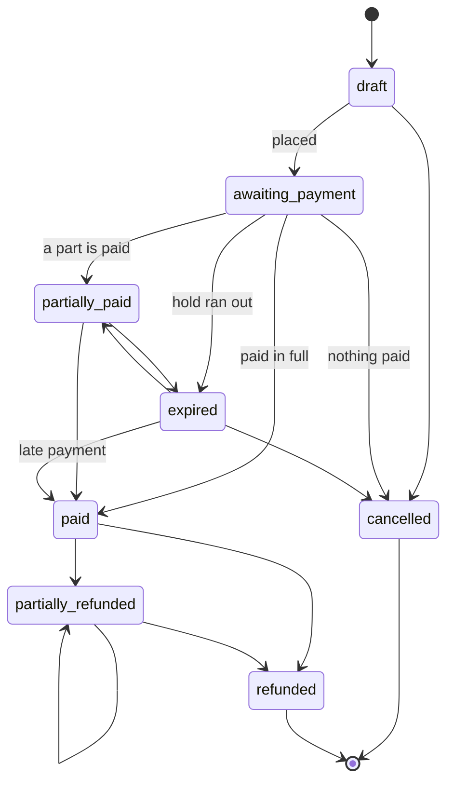

# Orders and payments

An **order** is what a person is buying, from the platform or one of its sellers, and where it stands. It is processor-neutral: it has **lines** (what is bought), **payments** (how it is being paid, possibly in parts by different methods) and, if money goes back, **refunds**. The same records serve a vendor processor, cash, a cheque, an e-transfer and later store credit, event tickets and paid exchanges, so none of those needs its own bookkeeping.

## Records

| Record | What it is | Notes |
|---|---|---|
| `Billing::Order` | The purchase | Platform-bound; an optional `seller` (community or person; empty means the platform); the `buyer` (a person); an optional `on_behalf_of` (a community or person the purchase is for); a `purpose`; a `number` such as `BT-7Q2K9XMA`, unique per platform; totals; `placed_at`, `expires_at`, `paid_at`, `cancelled_at`; an optional `subject` (what it is about) |
| `Billing::OrderLine` | One thing on the order | A polymorphic `purchasable` limited to models that opt in with `Billing::Purchasable`. It **copies** the description and price when the order is placed, so changing a plan later never changes an order that exists |
| `Billing::Payment` | One payment against an order, through one method | `processor` is the method (a vendor, `cash`...); an **idempotency key** unique per platform makes a repeated request find the payment it already made |
| `Billing::Refund` | Money given back against one payment | A vendor refund is `succeeded`; for cash, a cheque or an e-transfer the seller says they handed it back (`recorded`). Cannot exceed what is left to refund |

Every table carries `platform_id NOT NULL`, and each child is tied to its parent's platform by a **composite foreign key** `(parent_id, platform_id)`, so a line, payment or refund can never belong to a different platform than its order, even if code tried. A child takes its platform from its parent, never from the request. Money is whole minor units plus an ISO currency; there is no default currency.

**Diagram Files:**
- [Mermaid source](../diagrams/source/billing_order_lifecycle_flow.mmd) - editable source (with the payment states)
- [PNG export](../diagrams/exports/png/billing_order_lifecycle_flow.png) - high-resolution image
- [SVG export](../diagrams/exports/svg/billing_order_lifecycle_flow.svg) - vector graphics

## Status moves along set paths

An order's status can only follow the paths above (`Order::TRANSITIONS`), enforced in the model, so a paid order cannot quietly become a draft again and a cancelled or refunded order is final. A **late payment can still pay an expired order**: a cheque that arrives after the hold ran out is not lost. A payment likewise follows `pending` to `succeeded`, `failed` or `cancelled`, then to `partially_refunded` or `refunded`; a failed payment can be tried again.

## Services

All in `app/services/better_together/billing/`. Each is safe to call twice.

- **`Orders::Place`** creates the order and its lines in one transaction, holds what is sold (`Purchasable#reserve!`), and leaves it awaiting payment for 72 hours unless told otherwise. It refuses an order with no lines, something that cannot be bought or is not for sale, something that belongs to another platform or is sold by someone else, and lines in different currencies. If anything refuses part-way, nothing is left behind and nothing stays held. An order that costs nothing is settled at once.
- **`Orders::Settle`** works out where an order stands from its payments and refunds and moves it there, under a row lock, so two payments arriving together settle it one after the other.
- **`Orders::Cancel`** cancels an order nobody has paid for, cancels what was waiting, and gives back what it held. An order with money against it is refunded instead.
- **`Orders::Expire`** lets an order whose hold ran out lapse (re-checked under the lock, so one paid meanwhile is left alone). `ExpireOrdersJob` runs it hourly on the `billing` queue, one order at a time, so one bad row never stops the sweep. It is a maintenance sweep, like the event sweeps, and the only cross-tenant read here.
- **`Payments::Create` / `Succeed` / `Fail`** start, confirm and fail a payment. `Create` refuses more than is owed, counting other payments in flight, so parts cannot add up to more than the total.
- **`Refunds::Record`** records money given back, moves the payment to partly or fully refunded, and settles the order.

## What can be bought

A model opts in with `Billing::Purchasable` and describes itself: `purchasable_description`, `purchasable_amount_cents`, `purchasable_currency`, and `purchasable?` (can it be bought now). It may also hold something back while an order waits: `reserve!(quantity:)` when the order is placed and `release!(quantity:)` when it is cancelled or expires. A plan holds nothing. A ticket type will hold a place. The registry means an order line never resolves a type from a string.

## Who sees what

| Page | Who | Reached through |
|---|---|---|
| `/:locale/billing/orders` | A buyer, for their own orders | `billing_owner.billing_orders.bought_by(person)` |
| `/:locale/billing/sales` | A steward of the platform, for what the platform itself sells | `billing_owner.billing_orders.sold_by_platform` |

Another buyer's order, another platform's order, and an order a community or person sold are all a 404 on these pages. Both pages answer 404 while billing is off for the platform, and a visitor is sent to sign in. The pages are read-only: orders are created by the services above, and the checkout and the pay screens arrive with the purchase agreements and the offline payment methods ([purchase_agreements.md](purchase_agreements.md), [offline_payment_methods.md](offline_payment_methods.md)).

## Data

See the order tables in [billing_schema_erd.mmd](../diagrams/source/billing_schema_erd.mmd). Guarantees held by the database: `platform_id NOT NULL` with a foreign key on all four tables; the composite keys above, backed by unique `(id, platform_id)` indexes; `(platform_id, number)` unique; `(platform_id, idempotency_key)` unique for payments and for refunds.
