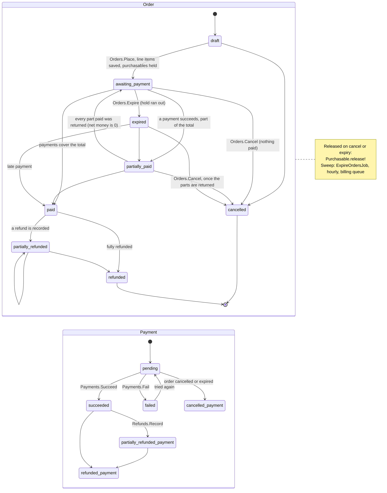
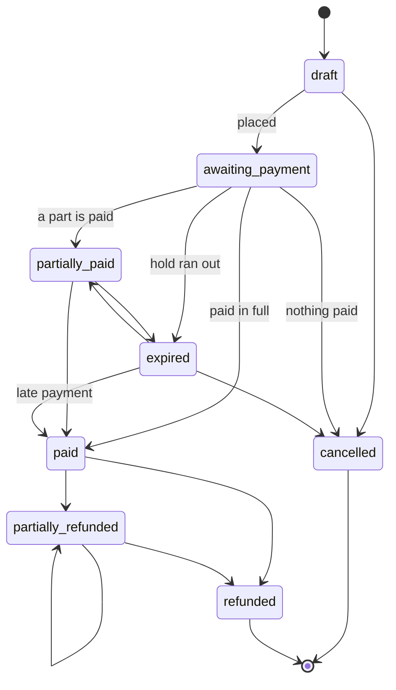

# Orders and payments

An **order** is what a person is buying, from the platform or one of its sellers, and where it stands. It is processor-neutral: it has **line items** (what is bought), **payments** (how it is being paid, possibly in parts by different methods) and, if money goes back, **refunds**. The same records serve a vendor processor, cash, a cheque, an e-transfer and later store credit, event tickets and paid exchanges, so none of those needs its own bookkeeping.

## Records

| Record | What it is | Notes |
|---|---|---|
| `Billing::Order` | The purchase | Platform-bound; an optional `seller` (community or person; empty means the platform); the `buyer` (a person); an optional `on_behalf_of` (a community or person the purchase is for); a `purpose`; a `number` such as `BT-7Q2K9XMA`, unique per platform; totals; `placed_at`, `expires_at`, `paid_at`, `cancelled_at`; an optional `subject` (what it is about) |
| `Billing::LineItem` | One thing on the order | A polymorphic `purchasable` limited to models that opt in with `Billing::Purchasable`. It **copies** the description and price when the order is placed, so changing a plan later never changes an order that exists |
| `Billing::Payment` | One payment against an order, through one method | `processor` is the method (a vendor, `cash`...); an **idempotency key** unique per platform makes a repeated request find the payment it already made |
| `Billing::Refund` | Money given back against one payment | A vendor refund is made at the vendor and recorded `succeeded` when the processor reports it; for cash, a cheque or an e-transfer the seller says they handed it back (`recorded`). Cannot exceed what is left to refund |

Every table carries `platform_id NOT NULL`, and each child is tied to its parent's platform by a **composite foreign key** `(parent_id, platform_id)`, so a line, payment or refund can never belong to a different platform than its order, even if code tried. A child takes its platform from its parent, never from the request. Money is whole minor units plus an ISO currency; there is no default currency.

**Diagram Files:**
- [Mermaid source](../diagrams/source/billing_order_lifecycle_flow.mmd) - editable source (with the payment states)
- [PNG export](../diagrams/exports/png/billing_order_lifecycle_flow.png) - high-resolution image
- [SVG export](../diagrams/exports/svg/billing_order_lifecycle_flow.svg) - vector graphics

## Status moves along set paths

An order's status can only follow the paths above (`Order::TRANSITIONS`), enforced in the model, so a paid order cannot quietly become a draft again and a cancelled order is final. (A refunded order is not: a refund can fail after it was recorded, which puts the order back to paid or part refunded.) A **late payment can still pay an expired order**: a cheque that arrives after the hold ran out is not lost. A payment likewise follows `pending` to `succeeded`, `failed` or `cancelled`, then to `partially_refunded` or `refunded`; a failed payment can be tried again.

## Services

All in `app/services/better_together/billing/`. Each is safe to call twice.

- **`Orders::Place`** creates the order and its line items in one transaction, holds what is sold (`Purchasable#reserve!`), and leaves it awaiting payment for 72 hours unless told otherwise. It refuses an order with no line items, something that cannot be bought or is not for sale, something that belongs to another platform or is sold by someone else, and line items in different currencies. If anything refuses part-way, nothing is left behind and nothing stays held. An order that costs nothing is settled at once.
- **`Orders::AddPayment`** adds one payment part (by credit, a manual method or a processor) to an order, from checkout, the order page or a renewal; see [partial_payments.md](partial_payments.md).
- **`Orders::Settle`** works out where an order stands from its payments and refunds (net money) and moves it there, under a row lock, so two payments arriving together settle it one after the other.
- **`Orders::Cancel`** cancels an order with no money against it (net of refunds), cancels what was waiting, and gives back what it held. A part-paid order is cancelled once each part has been returned (`Orders::ReturnPayments`; see [partial_payments.md](partial_payments.md)).
- **`Orders::Expire`** lets an unpaid order whose hold ran out lapse (re-checked under the lock, so one paid meanwhile is left alone). An order with money against it never lapses: its unpaid parts end and it stays open (see [partial_payments.md](partial_payments.md)). `ExpireOrdersJob` runs it hourly on the `billing` queue, one order at a time, so one bad row never stops the sweep. It is a maintenance sweep, like the event sweeps, and the only cross-tenant read here.
- **`Payments::Create` / `Succeed` / `Fail` / `Cancel`** start, confirm, fail and let go of a payment. `Create` refuses more than is owed, counting other payments in flight (`pending` and `processing`), so parts cannot add up to more than the total. `Cancel` also tells the processor (after the change is saved; an unreachable processor is logged and does not stop the order being let go).
- **`Refunds::Record`** records money given back, moves the payment to partly or fully refunded, and settles the order. A refund is recorded **once** whether core asked for it or the processor reported it: it is found by its idempotency key, then by its `processor_reference`. **`Refunds::Resolve`** finishes a `pending` refund as `succeeded` or `failed`; a failed one stops counting, the payment and order go back, and the operators are told.

## Paying through a processor

`Orders::Place` with a processor method (one the platform has configured and that takes a checkout) opens a **pending payment** for the balance, with the key `checkout:<order>:1`. The buyer's order page then shows **Pay now**, which goes to `POST /billing/orders/:id/pay` (a button, so a link or crawler cannot start a checkout; signed in, the order must be theirs, throttled per IP):

1. `Checkout::Start` asks the adapter for a `CheckoutSession` (url, reference, expires_at) for that payment, given the tax core worked out (`tax_cents` added, `included_tax_cents`, `prices_include_tax`; the session may report the `tax_cents` it will charge), with the order, payment and platform ids as metadata, and keeps the session reference on the payment. A payment that needs the buyer to act (`failure_code: action_required`, for example a bank confirmation) is sent to the processor's own page for that instead. Only an **https** address is ever redirected to.
2. The processor brings the buyer back to `GET /billing/orders/:id/checkout_return`. The session id in the address is believed only if it is the one we sent this buyer to for this order (Pay's own `Pay.sync` accepts any id). The adapter syncs the processor's state, which is optimistic; **the webhook decides** whether the payment succeeded.
3. Pay's own payment page stays closed (it is not signed in and calls the processor with a caller-supplied id). This route replaces it as the way back to a payment that needs the buyer.

Because the processor, not our hold, is the authority on whether money arrived, `Payments::Succeed` with a processor `reference` also succeeds a payment we had given up on: a card retried in the same session, or a session that outlived the hold. A late payment pays an expired order. **Money for an order that was cancelled** is recorded (it did arrive), the order stays cancelled, a refund is recorded as `pending` for the processor to make, and the operators are told (`payment_orphaned`). A charge whose `amount_cents` differs from the amount core asked for (the order's total with its tax) is recorded as charged and flagged to the operators once (`payment_amount_mismatch`) for review, never absorbed silently. A payment the processor has **in flight** (`processing`, a bank debit) stops the order expiring. The charge Pay recorded is linked as `payment.pay_charge` (same platform, one payment per charge), and `processor_reference` is the processor's charge id, which equals `Pay::Charge#processor_id`.

For a **trialing or active** Pay subscription an order that began it needs no payment: `Orders::Settle` marks it paid. Stripe renewals are not mirrored into orders: they stay the processor's invoices and `Pay::Charge` rows.

## What can be bought

A model opts in with `Billing::Purchasable` and describes itself: `purchasable_description`, `purchasable_amount_cents`, `purchasable_currency`, and `purchasable?` (can it be bought now). It may also hold something back while an order waits: `reserve!(quantity:)` when the order is placed and `release!(quantity:)` when it is cancelled or expires. A plan holds nothing. A ticket type will hold a place. The registry means a line item never resolves a type from a string.

## Who sees what

| Page | Who | Reached through |
|---|---|---|
| `/:locale/billing/orders` | A buyer, for their own orders | `billing_owner.billing_orders.bought_by(person)` |
| `/:locale/billing/sales` | A steward of the platform, for what the platform itself sells | `billing_owner.billing_orders.sold_by_platform` |

Another buyer's order, another platform's order, and an order a community or person sold are all a 404 on these pages. Both pages answer 404 while billing is off for the platform, and a visitor is sent to sign in. The pages are read-only: orders are created by the services above, and the checkout and the pay screens arrive with the purchase agreements and the offline payment methods ([purchase_agreements.md](purchase_agreements.md), [offline_payment_methods.md](offline_payment_methods.md)).

## Data

See the order tables in [billing_schema_erd.mmd](../diagrams/source/billing_schema_erd.mmd). Guarantees held by the database: `platform_id NOT NULL` with a foreign key on all four tables; the composite keys above, backed by unique `(id, platform_id)` indexes; `(platform_id, number)` unique; `(platform_id, idempotency_key)` unique for payments and for refunds.
