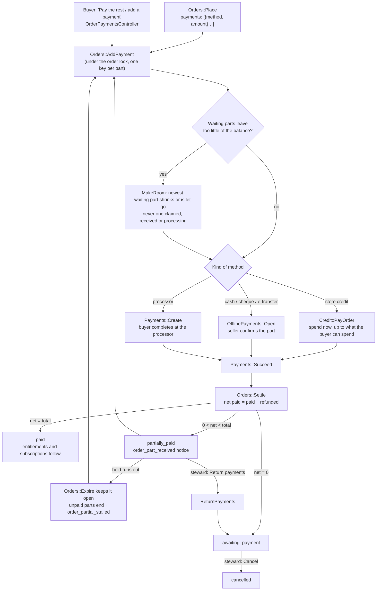

# Billing partial payments

An order can be paid in **parts**, by any way of paying, one after another. Store credit, cash, a cheque, an e-transfer and a processor are all the same kind of thing to an order: a payment of some amount. One part or several complete an order, now or later, in any order. **A part-paid order is a normal, accepted state**, not a problem to unwind.

This page covers how a part is added, how an order's status follows the money, what happens when a part ends or the hold runs out, how a part-paid order is cancelled, and how subscriptions use it. Related: [orders_and_payments.md](orders_and_payments.md), [store_credit.md](store_credit.md), [offline_payment_methods.md](offline_payment_methods.md), [subscriptions_and_renewals.md](subscriptions_and_renewals.md).

## Process flow



**Diagram files:** 📊 [Mermaid source](../diagrams/source/billing_partial_payments_flow.mmd)

## Adding a part: `Orders::AddPayment`

One service for every method and every caller (checkout, the order page, a renewal):

```ruby
Orders::AddPayment.call(order:, payment_method: 'store_credit', idempotency_key: token)           # what credit can cover
Orders::AddPayment.call(order:, payment_method: 'cash', amount_cents: 2500, idempotency_key: t2)  # a part
```

- **Allowed** while the order is `awaiting_payment`, `partially_paid` or `expired` (a late payment can still pay it), with `0 < amount ≤ balance`, and only by a way of paying `PaymentChoice` allows for this order: switched on for the seller and the kind of purchase, in the order's currency, store credit only for what the platform sells.
- **No amount** means "the rest": what the parts already waiting leave of the balance (the whole balance if they leave nothing, which is how a buyer switches the way they pay). For store credit it means as much of the balance as the buyer can spend. An explicit credit amount can never pass what the buyer can spend.
- **Making room.** Credit spends at once, so it counts against the balance immediately. If waiting parts leave too little, `MakeRoom` shrinks (an offline part keeps its place with a smaller amount) or lets go (a processor checkout is cancelled; the buyer pays that part again) the **newest** waiting part first. A part with money on its way is **never** touched: one the buyer said they sent, a cheque received, a payment the processor has in flight. If there is still no room it refuses and changes nothing.
- **By kind.** Credit: `Credit::PayOrder` makes the payment, spends the lots (soonest-expiring first), succeeds it. Manual: `OfflinePayments::Open` for that amount, held for the seller's hours. Processor: a pending `Payment` the buyer completes at the processor (`Checkout::Start`, which takes the payment asked for when several wait).
- **Idempotent** per key (`part:<order>:<key>`): a double click makes one payment. The order is locked, so two requests together cannot put more waiting against it than is left.

`Orders::Place` accepts `payments: [{ payment_method:, amount_cents: }]` (`Orders::PaymentParts`): explicit amounts first, then credit taking all it can, then the one part that takes the rest. A single `payment_method:` still means the whole amount. The agreements that apply are those of **every** way named.

## Status follows net money

`Orders::Settle` works from `net = paid − refunded`:

| Net money | Order |
|---|---|
| ≥ total (or covered by a trialing/active subscription) | `paid` |
| `0 < net < total` | `partially_paid` |
| `0`, never fully paid | `awaiting_payment` |
| Fully paid, then refunded | `partially_refunded` / `refunded` (told apart by `paid_at`) |

`Order#balance_cents` is `total − net`, so a refund of a part raises the rest to pay again. Nothing is granted for the order (entitlements, a started subscription) until it is `paid`; refunding one part of an unpaid order grants nothing.

## A part ending does not end the order

A rejected, bounced or lapsed part only ends **that payment**. The order is cancelled with it only when nothing else is paying for it (no other part in flight, no money against it), which keeps the single-payment behaviour. A bounced cheque on an order other parts already paid leaves the order part paid.

## A part-paid order stays open

`Orders::Expire` **never lapses an order that has money against it**: letting it go would strand what was paid. When the hold runs out, only the **unpaid parts** (a processor session, cash nobody has handed over) end; the place stays held, the buyer is told to pay the rest and the steward to decide (`order_partial_stalled`, once). The order stays open until it is paid in full or a steward returns the parts and cancels it. A late cash confirmation, or the buyer paying the rest another way, still completes it.

## Returning parts and cancelling

`Orders::Cancel` refuses while **net money is against the order** (and while a received cheque has not cleared). The steward's sale page shows a **Return payments** panel (`Orders::ReturnPayments`):

| Part paid by | How it goes back |
|---|---|
| Store credit | One click: `Refunds::Record` + `Credit::Reverse`, to the lots it came from. Idempotent |
| Cash, cheque, e-transfer | The seller hands it back and records it in the refund form (the platform cannot move that money) |
| A processor | Refunded at the vendor; the webhook records it |

When net money reaches zero the order is `awaiting_payment` and a **Cancel this order** button appears; it releases the place.

## Notices

| Kind | To | When |
|---|---|---|
| `order_part_received` | buyer, seller | A part succeeds and the order is still not paid in full ("$X of $Y received, $Z left"). Once per payment. The part that completes the order is told as `order_paid` |
| `order_partial_stalled` | buyer, seller | The hold ran out on a part-paid order. Once per order |

## Subscriptions

- The checkout asks **"renew with"** for a recurring plan: one of the ways the platform settles itself (store credit counts even with no balance today). It is stored on the order (`renewal_payment_method`); with no choice, renewals use the way that paid the largest share of the first order (credit only if nothing else did).
- A subscription **starts only when the first order is paid in full** and every part was settled by Community Engine; a part through a processor leaves the subscription to the processor.
- A renewal invoice paid by store credit spends **what credit has** (never touching a part the payer added themselves), stays `partially_paid` and tells the payer what is short; the daily sweep tops it up. The payer can add parts from the invoice page. The period advances only when the invoice is paid in full, and a part payment does not stop the subscription going `past_due` when the period ends.

## Screens

| Where | DOM ids |
|---|---|
| Checkout | `billing-checkout-parts`, `billing-checkout-part-<method>`, `billing-checkout-part-<method>-cap`, `billing-checkout-renew-with-select` |
| Order page | `billing-order-add-payment-form` (`-method`, `-amount`, `-btn`), `dom_id(order, :balance)`, one offline card per part with ids ending in the payment's id |
| Sale page | `dom_id(order, :return_payments)`, `billing-sale-return-credit-btn`, `billing-sale-cancel-btn` |

## Limits

No minimum part size is enforced (any positive amount, the last part exact). Cash returns stay the seller's recorded action. Processor refunds are initiated at the vendor. Credit never pays a seller's order.
