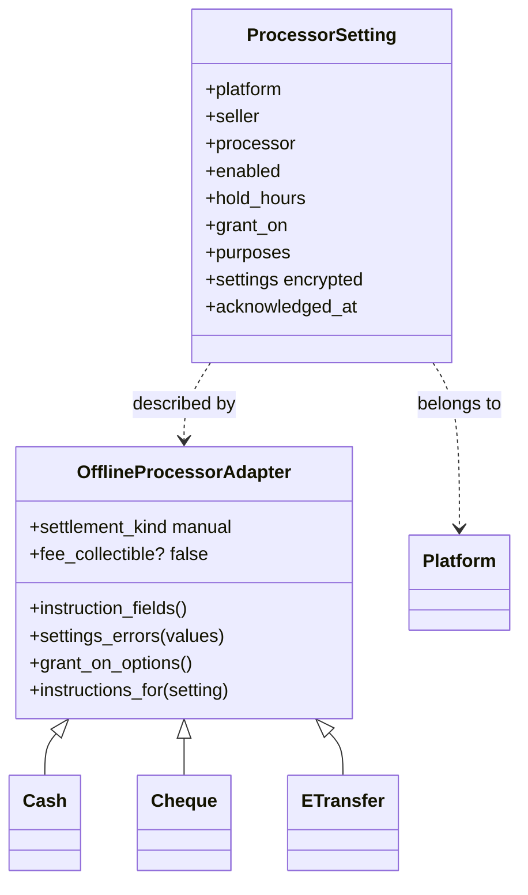

# Payment methods outside a processor

Community Engine installs three ways to be paid that do not go through a payment vendor: **cash**, **cheque** and **Interac e-transfer**. They are installed for every platform, but each works for a seller only after a steward turns it on and accepts what it cannot do. This page describes what ships in this part of the billing work: the methods, the settings, how a method becomes usable, and the limits we tell people about. Orders and the state machine that tracks one payment come in later pages ([orders_and_payments.md](orders_and_payments.md), [offline_payment_methods.md](offline_payment_methods.md)).

## Why they are different

A card payment is seen by a processor, which tells us about it, takes a fee we can build on, and offers the buyer protection. A cash, cheque or e-transfer payment is seen by nobody but the two people. So:

- **The seller says when it was paid.** Core owns the state machine; the method only describes itself.
- **The platform cannot track it or take a fee on it.** Reports show such sales as uncollected, not zero.
- **There is no chargeback or dispute protection**, and no automatic receipt or refund.
- **They are often chosen on purpose** for local transactions, to avoid card and processor fees.

## The methods

| | Cash | Cheque | E-transfer |
|---|---|---|---|
| The seller fills in | where and when to hand it over | payee name, where to send or drop it off, notes | an email and/or a phone number to send to, notes |
| Where it works | anywhere | anywhere | Canada, in Canadian dollars |
| When access starts | when the seller confirms | when it **clears** (default) or is **received** | when the seller confirms |
| Stored about banks | nothing | nothing: never an account, transit or routing number | nothing |

Each is a small class in `app/services/better_together/billing/processors/` that inherits `Billing::OfflineProcessorAdapter` and only **describes** the method: its `instruction_fields`, `supported_countries` / `supported_currencies`, `grant_on_options`, and `settings_errors` for rules that span fields (an e-transfer needs an email or a phone). Adding Zelle (United States, US dollars) or another method is one more class like these. The adapter contract is in [processor-adapters.md](processor-adapters.md#settlement-kinds-remote-manual-and-internal).

**Diagram Files:**
- [Mermaid source](../diagrams/source/billing_payment_methods_model.mmd) - editable source (the full model)
- [PNG export](../diagrams/exports/png/billing_payment_methods_model.png) - high-resolution image
- [SVG export](../diagrams/exports/svg/billing_payment_methods_model.svg) - vector graphics

## Turning a method on

`Billing::ProcessorSetting` holds one row per method for the platform itself, and one per method for each seller (a community or person) later. It is created off. To enable it a steward:

1. Fills in what buyers are told. Stored **encrypted** in a text column (`encrypts_billing_attribute`), shown only to a steward and to a buyer on their own order, never in a plan listing, a log, an email or an event payload.
2. Accepts the drawbacks (below). The acceptance is recorded once with the person and the time, and is required before a manual method can be switched on.
3. Chooses how long an unpaid order is held (1 hour to 30 days, 72 hours by default), which purposes it covers (subscriptions and memberships, one-time purchases, event tickets, exchanges), and for a cheque when access starts.

A method that does not exist where the platform is cannot be turned on: e-transfer is refused when the host has said its country is not Canada (`BT_BILLING_DEFAULT_COUNTRY`), and allowed when the country is unknown, since sellers have no country on record yet. Currency is enforced when an order is placed.

### When billing is "on"

`Configuration.context_for(platform, method, seller:)` returns a context for a method outside a vendor **only while an enabled setting exists**, so the method is installed for everyone and on for no one by default. A platform that enables only cash therefore has billing enabled (`Billing.enabled?`) with no vendor at all. A vendor processor still needs the host's environment.

Because the first method has to be switched on before billing is "enabled", the settings page has its own, wider gate: `Billing.configurable?` is true when the host asked for billing (`BT_BILLING_ENABLED`), configured the business identity, and has a method installed. Plans, orders and the rest need `Billing.enabled?`.

## What we tell people

| Who | Where | What |
|---|---|---|
| Sellers | the enable screen | The payment happens outside the platform and is not tracked; no application fee can be collected; you reconcile by hand with no automatic receipts or refunds; the buyer has no chargeback protection and you carry the risk. (E-transfer adds the country and currency limit.) |
| Buyers | the pay screen, from the offline methods PR | The same facts from their side, shown with the instructions after they accept the purchase terms. |

## Audit

Every enable, disable and change writes a billing event (`<method>.settings_changed`, outcome `settings_changed`, subject the setting). The payload names the **fields** that changed (`enabled`, `hold_hours`, `settings.instructions`) and the person who changed them, **never the values**: a changed payment destination is how payments get redirected, and the values are the sensitive part.

## Who can reach it

`/:locale/billing/processor_settings` is not part of the host dashboard. It answers 404 until billing is configurable, then requires sign-in and `manage_platform` for the platform, through `Billing::ProcessorSettingPolicy` (the same `manage_billing?(owner)` question as plans). Settings are reached only through the platform (`billing_owner.billing_processor_settings`), a method is taken from the installed list and never resolved from the request, and only the fields a method declares can be set.

## Data

Table `better_together_billing_processor_settings` (see [billing_schema_erd.mmd](../diagrams/source/billing_schema_erd.mmd)): `platform_id NOT NULL` with a foreign key; `seller_type` / `seller_id` (empty means the platform); `processor`; `enabled` (default false); `hold_hours`; `grant_on`; `purposes[]`; `settings` (encrypted text, no default and no limit); `acknowledged_at` and `acknowledged_by_id`. Two partial unique indexes allow one row per method for the platform itself and one per method for each seller.

## Not in this page

Placing and paying an order, the claim / confirm / reject steps, expiry, reminders and the notifications are in the pages named at the top.
