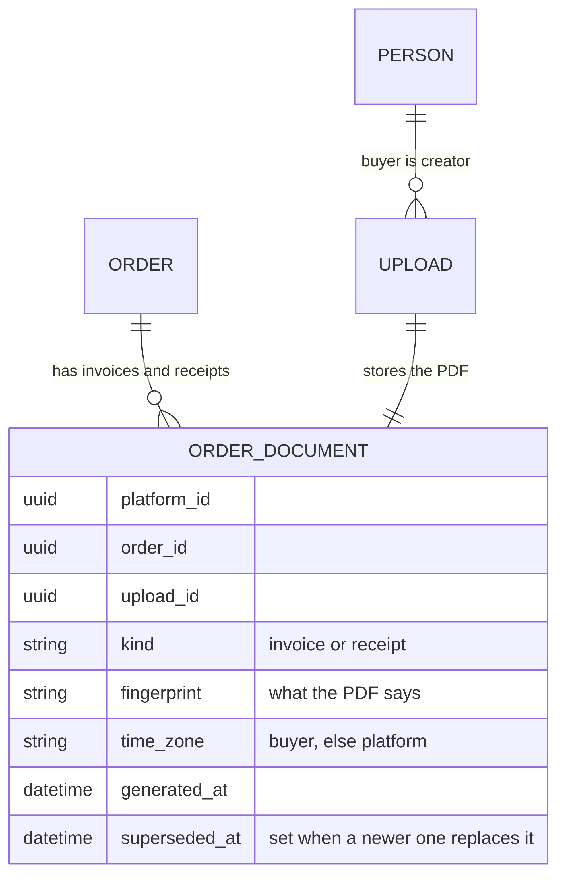

# PDF invoices and receipts

An order can be a PDF, in the same shape as the order pages and the emails: the same lines, the same row for each
tax, the same total and the same registration numbers. `Billing::Orders::Document` builds it from
`Orders::Summary`, so the figures cannot differ from one surface to another.

```ruby
BetterTogether::Billing::Orders::Document.new(order).to_pdf           # invoice while unpaid, receipt once paid
BetterTogether::Billing::Orders::Document.new(order, kind: :invoice)  # the invoice of a paid order
```

- **Layout.** Details (order, status, placed; paid and method on a receipt), then the buyer, then the lines
  (Item, Tax, Quantity, Amount; the Tax column only when the order has tax), then a right-aligned totals table so every
  amount lines up: subtotal, one row per tax with its rate and what it applies to, total. A receipt of an order with
  refunds adds the amount refunded and what is left paid. The registration numbers close the page.
- **Library.** The `receipts` gem (3.x), pure Ruby, with a bundled Inter font for Latin, Greek and Cyrillic, so all four
  locales (en, es, fr, uk) render. Pay's own `Pay::Receipts` mixin is for `Pay::Charge` and is not used: a billing
  order is not a charge, and Pay's mailers stay off (`Pay.send_emails = false`).
- **What is attached.** Only the buyer's emails: the invoice with "order placed", the receipt and the invoice with
  "order paid", the receipt with a refund. Sellers and operators get none.
- **What is never in it.** No payment instructions, payee details or processor text, like the email it travels in, so a
  forwarded copy cannot be used to redirect a payment. The file name carries only the order number
  (`invoice-<number>.pdf`, `receipt-<number>.pdf`).
- **Business details.** The company block reads `Pay.business_name`, `Pay.business_address` and `Pay.support_email`
  (from `PAY_BUSINESS_NAME`, `PAY_BUSINESS_ADDRESS`, `PAY_SUPPORT_EMAIL`), falling back to the platform name. `PAY_SUPPORT_EMAIL` falls back to `DEFAULT_FROM_EMAIL`, the app's from address.

## Pay 12

CE needs Pay 12.4 or later and receipts 3. Host apps that use Stripe through Pay also need `stripe ~> 20`, and
`payment_method_types` becomes `allowed_payment_method_types`; that is a Pay 12 change, not CE code. Pay 12 removed
`Pay::Subscription::STATUSES`; `Entitlements::State::STATUSES` is CE's own list. A status outside it (a processor can
report one Pay does not list, such as Braintree `expired`) is treated as lapsed and reported through
`BetterTogether.report_error`.

## Stored documents

A document is made once for each state the order is in and then kept. `Orders::GenerateDocument` renders the PDF,
saves it as a private `Upload` created by the buyer, and joins it to the order with a `Billing::OrderDocument`
(`kind`, `fingerprint`, `time_zone`, `generated_at`, `superseded_at`). Asking again while the figures are the same
returns the stored one; a payment or a refund changes the fingerprint, so a new one is made and the old one is marked
superseded but kept. Only the current invoice and receipt are shown on the order.



Source: [`billing_order_documents_model.mmd`](../diagrams/source/billing_order_documents_model.mmd).

- **Where they are made:** when a notice that carries one is sent (order placed, paid, refund), so the email attaches
  the stored file and nothing is regenerated.
- **Who can fetch them:** through the Upload's own download (`/f/:id/download`). The buyer is the creator; the stewards
  of a sale the platform makes are allowed by `UploadPolicy#stewards_order_document?`. Nobody else gets the file.
- **Download buttons:** the order and sale pages show a button for each document that exists
  (`#order_<id>_documents`, `.billing-order-invoice-download`, `.billing-order-receipt-download`).
- **Generated date and time:** both documents say when they were generated, with the time zone: the buyer's own
  setting, else the platform's, else UTC.

## Structured data

Each PDF carries the order as data, added as an incremental update (`Orders::PdfAttachments`) so the printed pages
are untouched:

- `factur-x.xml`: a Factur-X / ZUGFeRD Cross Industry Invoice in the BASIC WL profile (`urn:factur-x.eu:1p0:basicwl`),
  with one tax breakdown per tax, the registration numbers, and the totals including what is paid and what is due.
- `order.jsonld`: schema.org `Invoice` with its `Order`, each line (and whether it is taxed) and each tax.
- XMP metadata naming the Factur-X profile, and the Info dictionary (title, author, dates).

List them with `pdfdetach -list invoice.pdf`. Not verified: the file is not certified PDF/A-3, the XML has not been
validated against the Factur-X schema or an e-invoicing network, and Canadian orders carry their taxes as ordinary
tax breakdowns, so they are not EU invoices.

## Language

An order's line items, tax lines and agreement acceptances keep their text in every supported language, copied when the order is placed. A document is written in the first of these that is a supported language: the language chosen for the order's documents, the buyer's language, the language the order was placed in, the platform's language. A steward (or the buyer) who needs another language chooses it on the order page; the language form appears only when the page is read in a language other than the one the documents are in, and asking for the language they are already in is refused; making them again is limited to 10 requests a minute per IP (`billing/order_documents/ip`); the documents are made again in it, the earlier ones are kept as superseded, and later documents (after a payment or a refund) stay in the chosen language.
