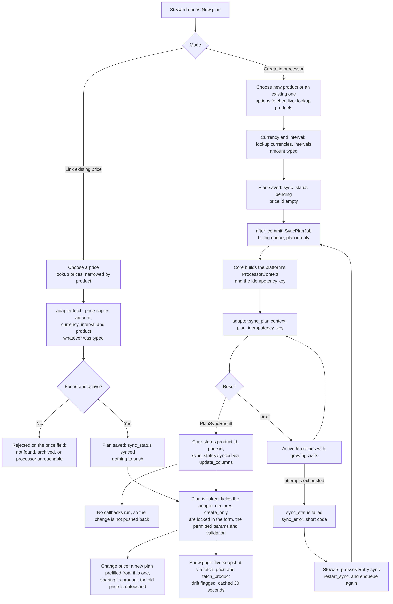
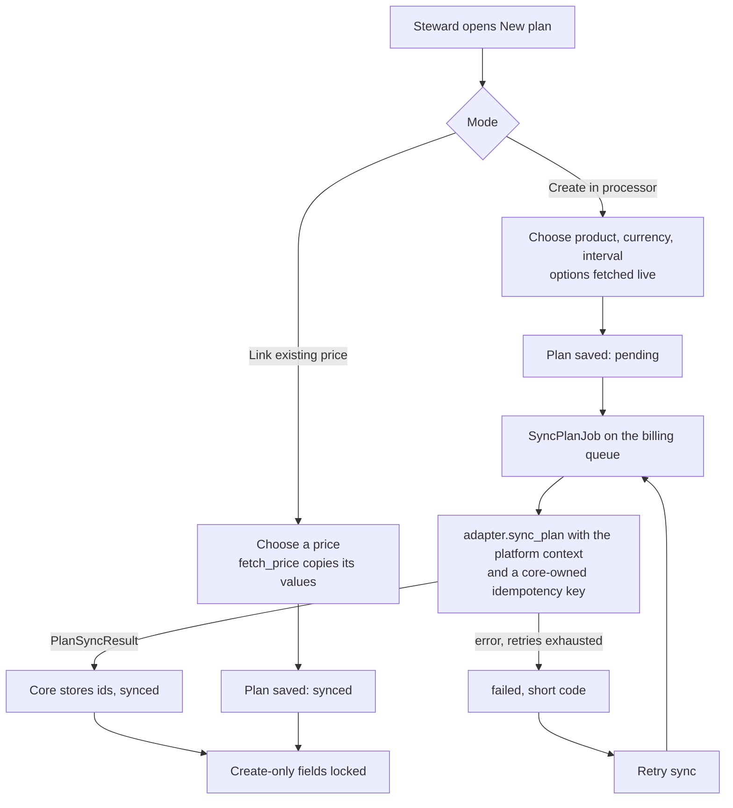
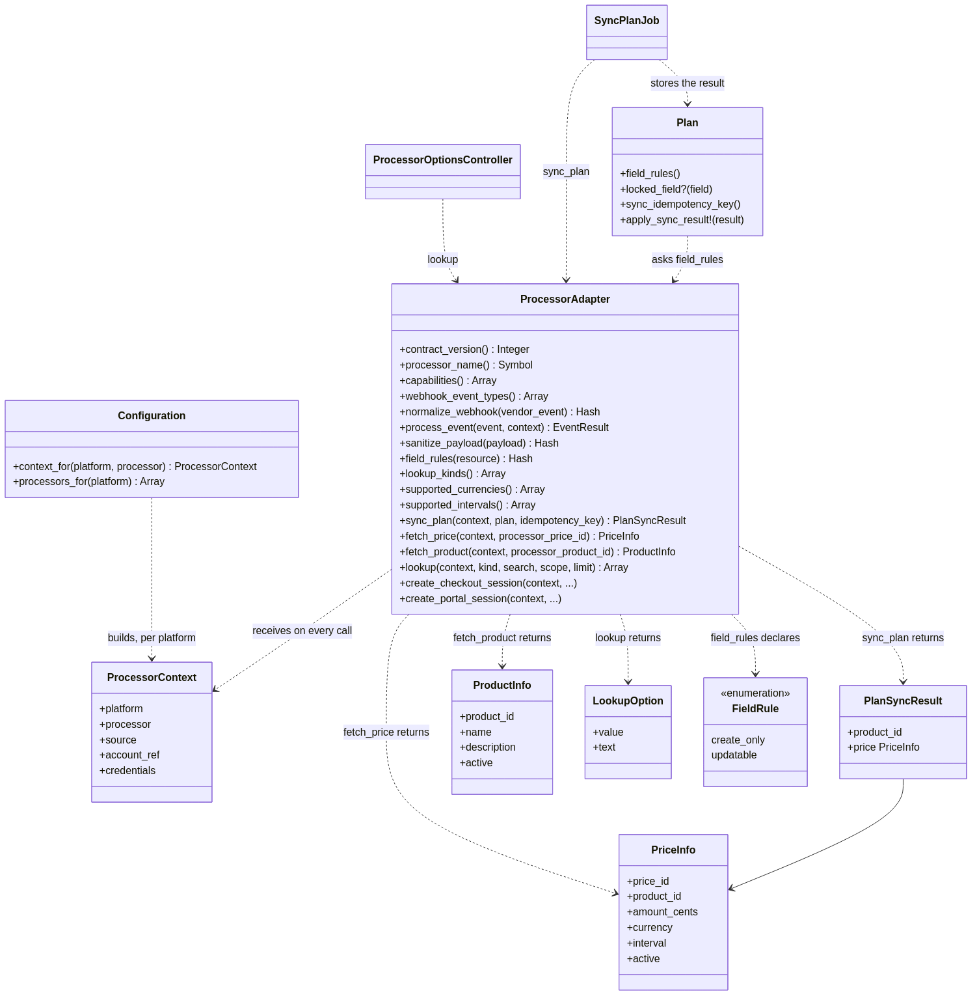
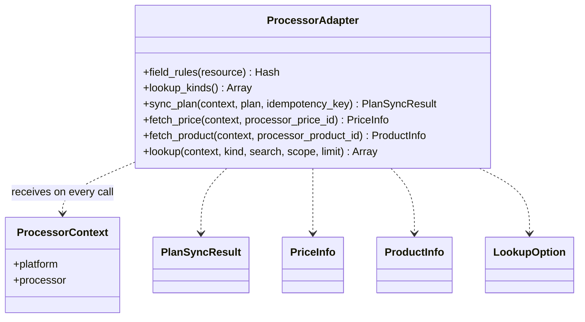
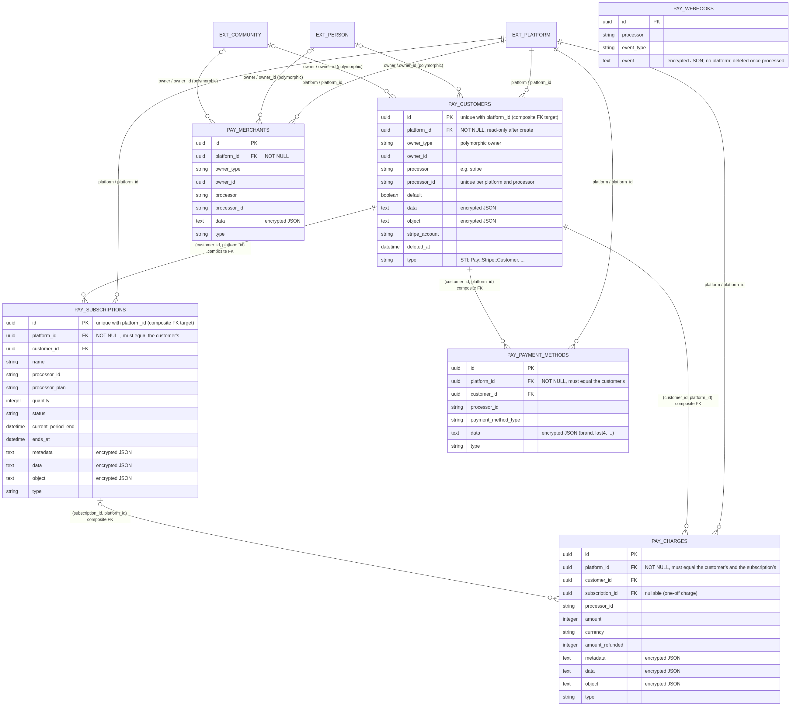
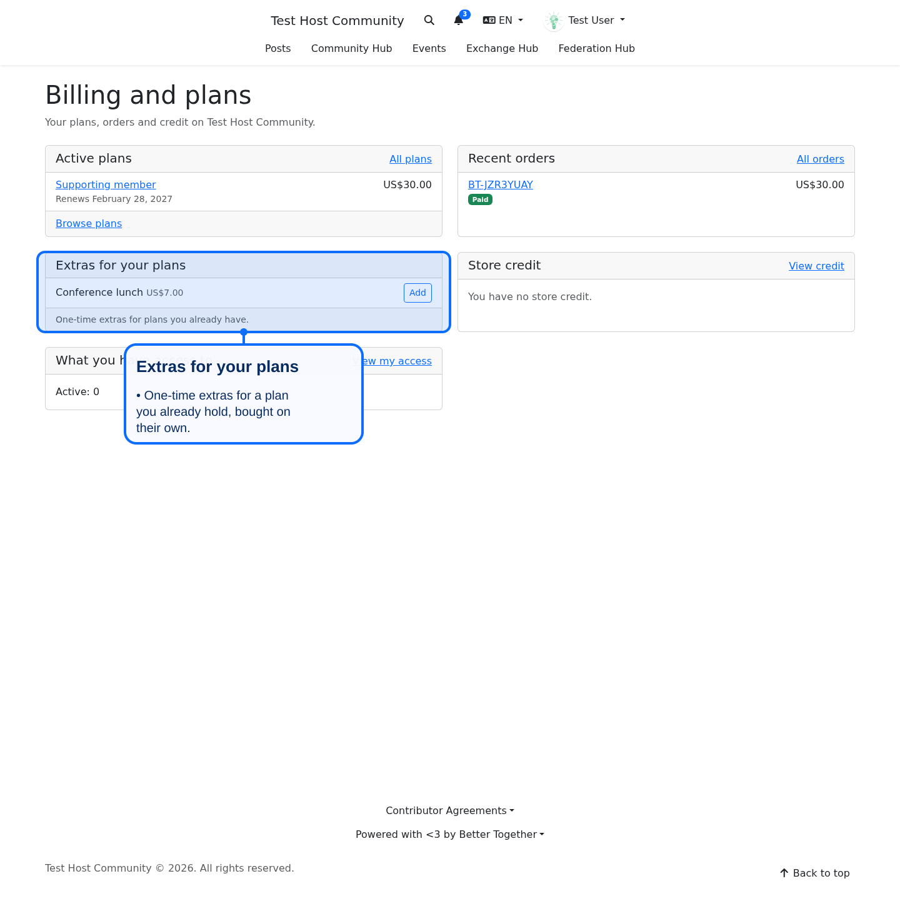
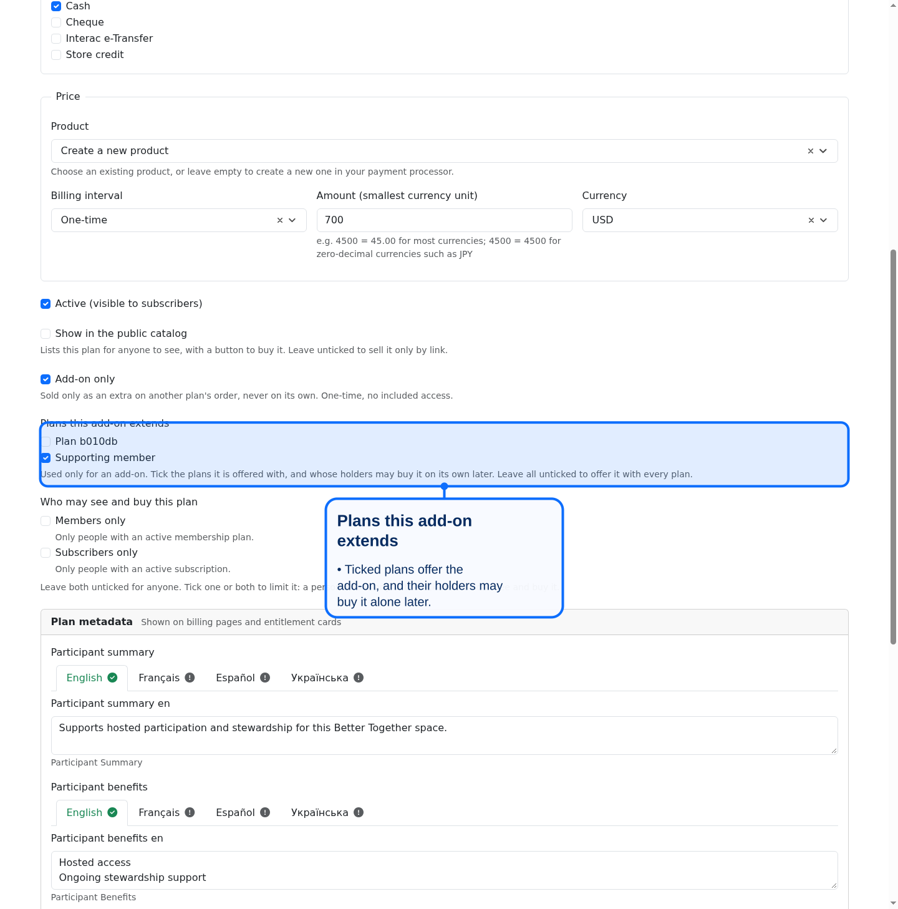
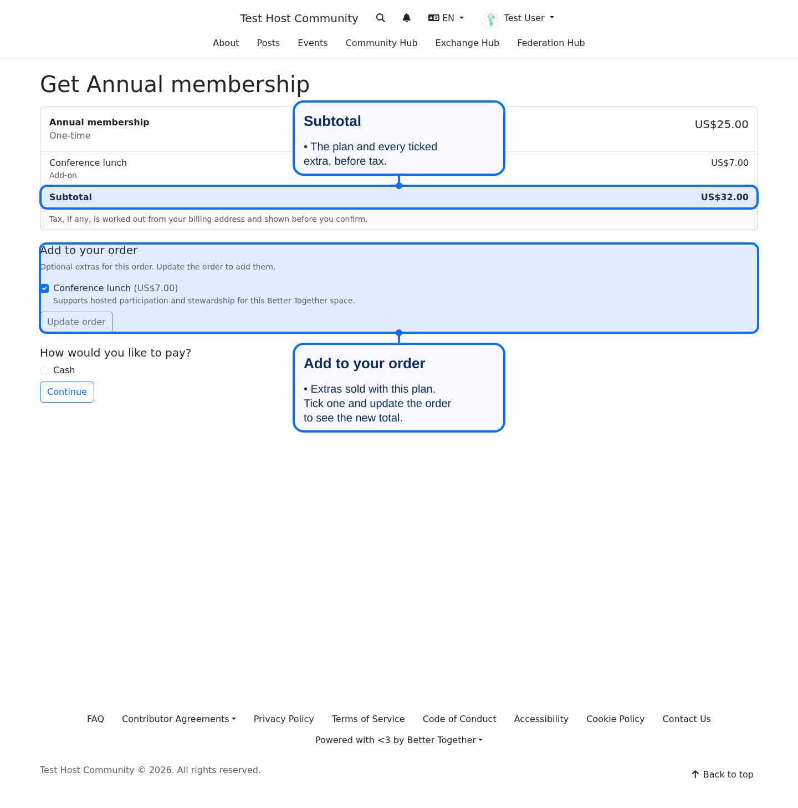
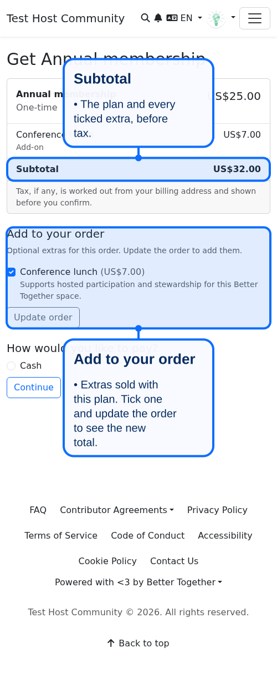

# Billing plan catalog

A **plan** is one price on one platform, sold by the platform itself or by one of its communities or people, and paid through an online payment processor, through methods outside any vendor, or both. Stewards create and
edit plans in Community Engine; they should not need the processor's dashboard once the
host has configured the processor's API keys. This page describes the plan model, how plans
reach the processor, which fields become fixed, and what a processor extension must
implement. See [processor-adapters.md](processor-adapters.md) for the wider adapter contract
and [platform_isolation.md](platform_isolation.md) for the tenancy rules.

## Who can reach it

- `/:locale/billing/plans` (not under the host dashboard). It answers **404 while billing is
  off** for the platform, before sign-in is asked for, and the navigation item is hidden
  there too.
- Everything goes through one policy question, `PlanPolicy#manage_billing?(owner)`: billing
  is on for the owner **and** the person has `manage_platform` for it. The owner is the
  current platform today; communities can be added later without changing callers (see
  [hosted_billing_roadmap.md](hosted_billing_roadmap.md)).
- Plans are reached only through the owner: `billing_owner.billing_plans.sold_by_platform.find(id)`. Another
  platform's plan is a 404 for show, edit, update, sync and snapshot, whatever id is sent.
- The platform's screens manage only what **the platform itself sells**. A plan sold by a community or
  person (its `seller`) belongs to that seller: it is left out of the list, is a 404 here, and is
  refused by `PlanPolicy#manage_billing?`, which accepts only a platform as owner until community
  billing (with its own `manage_community_billing` permission) is built.

## Fields

| Field | Notes |
|---|---|
| `seller` | Empty when the platform sells the plan; otherwise a community or person on the platform (type allow-list, read-only after create). |
| `identifier` | Unique **per seller** (one partial index for the platform's own plans, one for each other seller's). |
| `name`, `description`, `active` | Descriptive. |
| `grace_days`, `renewal_lead_days` | How a subscription Community Engine renews itself is run: days it keeps working after a period ends unpaid (default 7, 0 = none), and days before a period ends that its invoice is made (default 14). Not held by any processor, so editable at any time. See [subscriptions_and_renewals.md](subscriptions_and_renewals.md). |
| `amount_cents`, `currency`, `billing_interval`, `interval_count` | The price. No currency default: the host or steward chooses. `interval_count` is how many intervals make a period (3 months), 1 by default and always 1 for a one-time price; it is a price field, so it is locked once the processor holds the price. |
| `processor` | The **online** processor that holds the price: a registered processor with a context for the platform. Empty for a plan paid only by the methods below. |
| `accepted_payment_methods` | Installed methods that do not go through a vendor (cash, cheque, e-transfer, store credit). Each must still be enabled for the seller before buyers can use it. Editable at any time, since no processor holds them. A plan needs a processor or at least one accepted method. |
| `processor_price_id` | Empty until the processor has created the price. Unique per processor. |
| `processor_product_id` | **Not** unique: a product commonly has a monthly and a yearly price. A product may not be used by another platform's plan. |
| `manages_processor_product` | False when an existing product was chosen; Community Engine then never renames it. |
| `sync_status`, `sync_error`, `sync_attempted_at` | `pending`, `synced` or `failed`; the error is a short code (translated for display), never vendor text. |
| `metadata` | Participant text and the owner-type allow-list. |

## Two ways to create a plan

1. **Create in the processor.** The steward picks a new or existing product, a currency and
   interval (option lists fetched live from the processor), and types an amount. The plan is
   saved as `pending` and `SyncPlanJob` creates the processor-side product and price.
2. **Link an existing price.** The steward picks a price (options fetched live, narrowed by
   product). Core calls `fetch_price` and **copies** the amount, currency, interval and
   product from the processor, whatever was typed, so the two cannot disagree. A price the
   processor does not know, an archived price, or a processor that cannot be reached is
   rejected on the price field. Any price id on a new plan is looked up this way, whether or
   not the form said "link", so a crafted request cannot attach an unchecked price.

A plan with **no online processor** has nothing to push or link: it starts `synced`, needs no price id, and is paid by its accepted methods.

A processor that cannot push plans (no `plan_sync` capability) still works: the price id is
then required, because nothing will create it, and the plan starts `synced`.

**Diagram Files:**
- [Mermaid source](../diagrams/source/billing_plan_processor_sync_flow.mmd) - editable source (the complete flow)
- [PNG export](../diagrams/exports/png/billing_plan_processor_sync_flow.png) - high-resolution image
- [SVG export](../diagrams/exports/svg/billing_plan_processor_sync_flow.svg) - vector graphics

## Fields the processor fixes at creation

An adapter says what the processor will accept a change to, through `field_rules(:plan)`:
`{ field => :create_only | :updatable }`. Once a plan is **linked** (it has a price id):

- Linking an existing price **fails closed** for a price core cannot represent: a weekly or daily one, a usage-based (metered) one, or one with no interval, amount or currency is refused with "is a kind of price that cannot be used here", never shown as a monthly price of nothing. The interval count is copied from the price.
- A price field (`amount_cents`, `currency`, `billing_interval`, `interval_count`) or `processor` is locked
  unless the adapter declares it `:updatable`. A processor that says nothing is assumed to
  fix them at creation.
- A descriptive field (`name`, `description`, `active`) stays editable unless the adapter
  declares it `:create_only`.
- The same rule drives the form (a locked field is shown as text with a note), the permitted
  parameters (a crafted request cannot change it) and the model validation
  (`immutable_after_processor_link`).

Locked values are not a dead end: **Change price** starts a new plan from the old one,
sharing its product; the old price is left as it was.

## Processor-backed fields

Fields that depend on the processor are not typed free-hand. They use the SlimSelect Stimulus
controller (`better-together--slim-select`) against one endpoint,
`GET /:locale/billing/processor_options?processor=&kind=&search=&scope[product]=&limit=`:

- The processor must be one this platform has configured, and the kind one the adapter serves
  (`products`, `prices`, `currencies`, `intervals`) or a core fallback; nothing a request names
  is resolved from a string.
- Only `{value, text}` rows are returned, as plain text. Results are cached for a minute per
  platform and parameters, search is capped at 100 characters, `limit` is clamped to 50, and
  the endpoint is throttled per IP (60 a minute).
- If the processor cannot be reached the endpoint answers `[]` and an `X-Billing-Lookup-Error`
  header, and the picker shows a translated message. The cause is logged and reported, never
  sent to the browser.
- Currencies and intervals are limited to what core validates, so the picker never offers a
  value the form would reject.

## The show page

A lazy frame loads a **processor snapshot** (`fetch_price`, `fetch_product`), cached for 30
seconds, and flags drift between the processor and the local copy. A failed push shows its
short reason and a **Retry sync** action.

## What a processor extension implements

| Capability | Methods (all take `context:`) |
|---|---|
| `plan_sync` | `sync_plan(plan:, idempotency_key:)` returns a `PlanSyncResult`; `fetch_price(processor_price_id:)` returns a `PriceInfo` or `nil`; `fetch_product(processor_product_id:)` returns a `ProductInfo` or `nil` |
| `lookups` | `lookup(kind:, search:, scope:, limit:)` returns `LookupOption`s; `lookup_kinds` lists the kinds |
| (always) | `field_rules(:plan)`; optionally `supported_currencies` / `supported_intervals` as fallbacks |

Rules: `sync_plan` **never writes the plan**; core stores the result, which is also what stops
a processor-side change being pushed straight back. Pass `idempotency_key` to every processor
write. Use short SDK timeouts and no retries in `lookup` (a person is waiting). Raise
`ProcessorAdapter::LookupError` with a message safe to show when the processor cannot be
asked.

**Diagram Files:**
- [Mermaid source](../diagrams/source/billing_processor_adapter_contract_model.mmd) - editable source (full contract)
- [PNG export](../diagrams/exports/png/billing_processor_adapter_contract_model.png) - high-resolution image
- [SVG export](../diagrams/exports/svg/billing_processor_adapter_contract_model.svg) - vector graphics

### Stripe mapping (guide for the extension gem)

| Plan field | Stripe object | After creation | Lookup kind |
|---|---|---|---|
| product | Product | link is create-only; name, description and active are updatable on products this app created | `products` |
| `processor_price_id` | Price | create-only | `prices` (by product) |
| `amount_cents`, `currency`, `billing_interval` | Price `unit_amount`, `currency`, `recurring.interval` | create-only | `currencies` (the account's), `intervals` |
| `active` | Price / Product `active` | updatable | none |
| `name`, `description` | Product `name`, `description` | updatable only if the plan manages the product | none |

Every Stripe write carries the core-generated idempotency key. Credentials stay in the
extension's environment or Rails credentials; nothing is stored in the database by core.

## Data

See the plans table in [billing_schema_erd.mmd](../diagrams/source/billing_schema_erd.mmd).
The ownership and tenancy picture, including what is deferred, is in
[billing_tenancy_and_ownership_model.mmd](../diagrams/source/billing_tenancy_and_ownership_model.mmd).

Guarantees held by the database: `platform_id NOT NULL` with a foreign key; `(platform_id,
identifier)` unique; `(processor, processor_price_id)` unique; the product index is
deliberately not unique.

## Operating notes

- `SyncPlanJob` runs on the `billing` queue with the plan id only. Retries use growing waits
  (up to 10 attempts); when they run out the plan is marked `failed` with a short code
  (`processor_unavailable`, `not_configured`, `processor_error`).
- The job takes its context from the plan's platform, never from `Current.platform`.
- Troubleshooting: a plan stuck `pending` means the job has not run (check the `billing`
  queue); `failed` with `not_configured` means the platform lost its processor context.
- Not verified in the cloud session that built this: the SlimSelect behaviour in a browser
  (the feature spec and screenshots need a local Chrome) and real Stripe behaviour.

## Translated catalog text

The strings people read are Mobility translations, one value per supported language (en, es, fr, uk): the plan `name`, `beneficiary_label` and `solidarity_description` (string), and `description`, `participant_summary` and `participant_benefits` (text, one benefit per line). Tax categories, tax zones, tax rates (`label`) and promotions (`name`) work the same way. The plan form shows each as a field with a tab per language, and strong parameters accept `name_fr`, `description_uk` and so on. A change to any language pushes the plan to its processor again, which is told the platform's own language. Changing a price keeps every language of the copy.

New translated attributes default to the string type (`config/initializers/mobility.rb`); say `type: :text` for long copy.

**Diagram Files:**
- 📊 [Mermaid source](../diagrams/source/ce_localized_attributes.mmd) - every localized attribute by model and type, generated by `bin/export_localized_attributes`
- 🖼️ [PNG export](../diagrams/exports/png/ce_localized_attributes.png)
- 🎯 [SVG export](../diagrams/exports/svg/ce_localized_attributes.svg)

Adding, removing or retyping a translated attribute means running `bin/export_localized_attributes` and committing the result.

## Plan blocks on pages

Two content blocks put plans on any page, so an editor does not have to link to the catalog.

| Block | What it shows | Settings |
|---|---|---|
| `PlanCatalogBlock` | The platform's public plans as cards, cheapest first. | Heading (translated), number of plans (1 to 24). |
| `PlanButtonBlock` | One chosen plan, as a card or only its button. | The plan, and "card" or "button". |

Both draw the same card as the catalog page: `billing/catalog/_plan_card` (one plan), `_plans` (the grid), `_price` and `_buy_button`. They take a `prefix` local so ids stay unique when a plan appears twice on a page.

What a visitor sees is decided by the policy, the same as the catalog page. The catalog block lists `PlanPolicy::CatalogScope` (listed, active, platform-sold, and for the visitor's audience). The button block shows its plan only when `PlanPolicy#offer?` is true: billing is on, the plan is active and on this platform, and the visitor qualifies for its audience. An unlisted plan can be offered by a button; a members-only plan is never shown to a visitor who is not a member. Neither block uses a fragment cache, because the result depends on who is looking.

Screenshots: `docs/screenshots/{desktop,mobile}/billing_plan_catalog_block.*` and `billing_plan_button_block.*`.

## Add-ons on a checkout

A plan marked **Add-on only** (steward form checkbox `billing_plan_add_on`) is a plain extra sold on another plan's order. It never appears in the catalog, on plan blocks, or as a plan to buy on its own (`PlanPolicy#catalog_show?` and `#offer?` refuse it, `CatalogScope` leaves it out, and checkout answers 404 for it as the plan).

Rules, enforced by `Plan` and `PlanGrant` validations:

- one-time only (`add_on_cannot_renew`);
- nothing included: a plan with grants cannot become an add-on (`add_on_has_grants`) and a grant cannot be added to one (`add_on_cannot_have_grants`).

Checkout shows the add-ons this buyer may buy, in the plan's currency, as a form of checkboxes (`billing-checkout-add-ons`). Ticking one and choosing **Update order** adds a line to the summary and to the subtotal, and the tax preview prices every line. The ticked ids ride along as `add_on_ids[]` through the payment method form and the final POST, and `Orders::Place` creates one line item per purchasable.

How the extras behave:

- The one primary plan drives the order's purpose, the subscription term (`Subscriptions::Start.plan_line`) and the entitlement, so add-ons never change what the buyer is entitled to.
- Add-ons are paid by local methods only (cash, cheque, e-Transfer): a processor prices from its own price ids, so an order with an extra offers only the methods the platform settles itself.
- An order whose plan and add-ons are all free needs no payment method or billing address.

### Which plans an add-on extends, and buying it later

A steward ticks the plans an add-on extends on its form (`billing-plan-add-on-targets`); each tick is a `PlanAddOn` link. An add-on with no links extends every primary plan.

- **At a plan's checkout** only the add-ons that extend that plan (or all plans) are offered (`Plan.add_ons_for`).
- **On its own, later** (`PlanPolicy#buy_alone?`): checkout accepts an add-on as the plan when the buyer qualifies for its audience and *holds* a plan it extends. With no links, holding any primary plan of the platform is enough. A buyer who holds nothing gets 404.
- **What "holds" means** (`Plans::Holdings`): a live entitlement, a live subscription the person pays for, or a one-time order that is paid or part refunded. Refunded or cancelled orders and lapsed subscriptions hold nothing. Add-ons themselves are never held.
- **What the order does:** an add-on-only order is one-time, paid by a local method, and gives no entitlement and starts no subscription (`Subscriptions::Start.single_plan` is nil for it).
- **Where buyers find it:** the billing hub lists "Extras for your plans" with an Add button into checkout.

Not tied together: the add-on order does not record which plan order it extends, and refunding or lapsing the plan later does not touch the add-on order. Deferred: add-ons that carry their own entitlements or quotas (needs per-line entitlements), buying for a community (`on_behalf_of`), and guest checkout.

