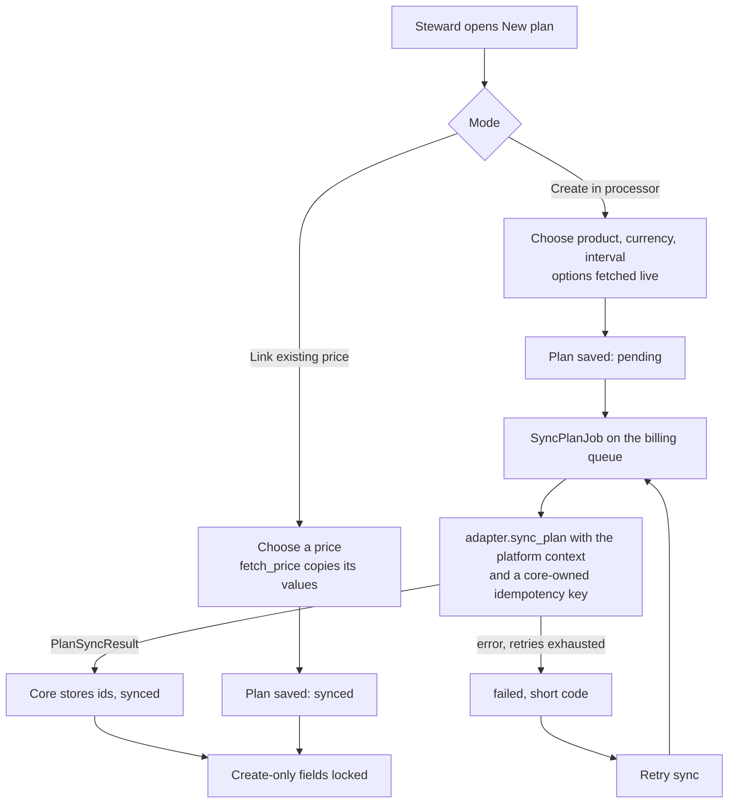
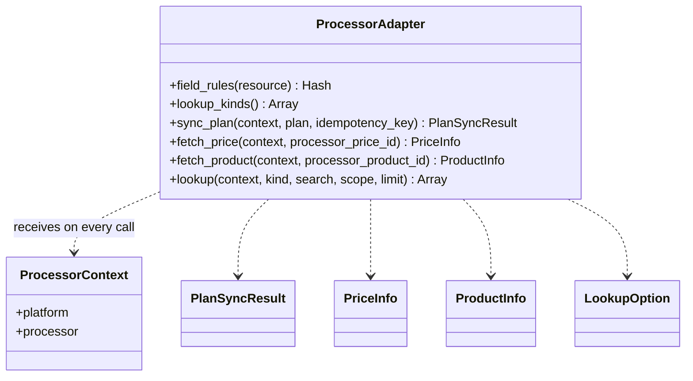

# Billing plan catalog

A **plan** is one price at one payment processor, owned by one platform. Stewards create and
edit plans in Community Engine; they should not need the processor's dashboard once the
host has configured the processor's API keys. This page describes the plan model, how plans
reach the processor, which fields become fixed, and what a processor extension must
implement. See [processor-adapters.md](processor-adapters.md) for the wider adapter contract
and [platform_isolation.md](platform_isolation.md) for the tenancy rules.

## Who can reach it

- `/:locale/billing/plans` (not under the host dashboard). It answers **404 while billing is
  off** for the platform, before sign-in is asked for, and the navigation item is hidden
  there too.
- Everything goes through one policy question, `PlanPolicy#manage_billing?(owner)`: billing
  is on for the owner **and** the person has `manage_platform` for it. The owner is the
  current platform today; communities can be added later without changing callers (see
  [hosted_billing_roadmap.md](hosted_billing_roadmap.md)).
- Plans are reached only through the owner: `billing_owner.billing_plans.find(id)`. Another
  platform's plan is a 404 for show, edit, update, sync and snapshot, whatever id is sent.

## Fields

| Field | Notes |
|---|---|
| `identifier` | Unique **per platform**. |
| `name`, `description`, `active` | Descriptive. |
| `amount_cents`, `currency`, `billing_interval` | The price. No currency default: the host or steward chooses. |
| `processor` | Must be a registered processor with a context for the platform. |
| `processor_price_id` | Empty until the processor has created the price. Unique per processor. |
| `processor_product_id` | **Not** unique: a product commonly has a monthly and a yearly price. A product may not be used by another platform's plan. |
| `manages_processor_product` | False when an existing product was chosen; Community Engine then never renames it. |
| `sync_status`, `sync_error`, `sync_attempted_at` | `pending`, `synced` or `failed`; the error is a short code (translated for display), never vendor text. |
| `metadata` | Participant text and the owner-type allow-list. |

## Two ways to create a plan

1. **Create in the processor.** The steward picks a new or existing product, a currency and
   interval (option lists fetched live from the processor), and types an amount. The plan is
   saved as `pending` and `SyncPlanJob` creates the processor-side product and price.
2. **Link an existing price.** The steward picks a price (options fetched live, narrowed by
   product). Core calls `fetch_price` and **copies** the amount, currency, interval and
   product from the processor, whatever was typed, so the two cannot disagree. A price the
   processor does not know, an archived price, or a processor that cannot be reached is
   rejected on the price field. Any price id on a new plan is looked up this way, whether or
   not the form said "link", so a crafted request cannot attach an unchecked price.

A processor that cannot push plans (no `plan_sync` capability) still works: the price id is
then required, because nothing will create it, and the plan starts `synced`.

**Diagram Files:**
- [Mermaid source](../diagrams/source/billing_plan_processor_sync_flow.mmd) - editable source (the complete flow)
- [PNG export](../diagrams/exports/png/billing_plan_processor_sync_flow.png) - high-resolution image
- [SVG export](../diagrams/exports/svg/billing_plan_processor_sync_flow.svg) - vector graphics

## Fields the processor fixes at creation

An adapter says what the processor will accept a change to, through `field_rules(:plan)`:
`{ field => :create_only | :updatable }`. Once a plan is **linked** (it has a price id):

- A price field (`amount_cents`, `currency`, `billing_interval`) or `processor` is locked
  unless the adapter declares it `:updatable`. A processor that says nothing is assumed to
  fix them at creation.
- A descriptive field (`name`, `description`, `active`) stays editable unless the adapter
  declares it `:create_only`.
- The same rule drives the form (a locked field is shown as text with a note), the permitted
  parameters (a crafted request cannot change it) and the model validation
  (`immutable_after_processor_link`).

Locked values are not a dead end: **Change price** starts a new plan from the old one,
sharing its product; the old price is left as it was.

## Processor-backed fields

Fields that depend on the processor are not typed free-hand. They use the SlimSelect Stimulus
controller (`better-together--slim-select`) against one endpoint,
`GET /:locale/billing/processor_options?processor=&kind=&search=&scope[product]=&limit=`:

- The processor must be one this platform has configured, and the kind one the adapter serves
  (`products`, `prices`, `currencies`, `intervals`) or a core fallback; nothing a request names
  is resolved from a string.
- Only `{value, text}` rows are returned, as plain text. Results are cached for a minute per
  platform and parameters, search is capped at 100 characters, `limit` is clamped to 50, and
  the endpoint is throttled per IP (60 a minute).
- If the processor cannot be reached the endpoint answers `[]` and an `X-Billing-Lookup-Error`
  header, and the picker shows a translated message. The cause is logged and reported, never
  sent to the browser.
- Currencies and intervals are limited to what core validates, so the picker never offers a
  value the form would reject.

## The show page

A lazy frame loads a **processor snapshot** (`fetch_price`, `fetch_product`), cached for 30
seconds, and flags drift between the processor and the local copy. A failed push shows its
short reason and a **Retry sync** action.

## What a processor extension implements

| Capability | Methods (all take `context:`) |
|---|---|
| `plan_sync` | `sync_plan(plan:, idempotency_key:)` returns a `PlanSyncResult`; `fetch_price(processor_price_id:)` returns a `PriceInfo` or `nil`; `fetch_product(processor_product_id:)` returns a `ProductInfo` or `nil` |
| `lookups` | `lookup(kind:, search:, scope:, limit:)` returns `LookupOption`s; `lookup_kinds` lists the kinds |
| (always) | `field_rules(:plan)`; optionally `supported_currencies` / `supported_intervals` as fallbacks |

Rules: `sync_plan` **never writes the plan**; core stores the result, which is also what stops
a processor-side change being pushed straight back. Pass `idempotency_key` to every processor
write. Use short SDK timeouts and no retries in `lookup` (a person is waiting). Raise
`ProcessorAdapter::LookupError` with a message safe to show when the processor cannot be
asked.

**Diagram Files:**
- [Mermaid source](../diagrams/source/billing_processor_adapter_contract_model.mmd) - editable source (full contract)
- [PNG export](../diagrams/exports/png/billing_processor_adapter_contract_model.png) - high-resolution image
- [SVG export](../diagrams/exports/svg/billing_processor_adapter_contract_model.svg) - vector graphics

### Stripe mapping (guide for the extension gem)

| Plan field | Stripe object | After creation | Lookup kind |
|---|---|---|---|
| product | Product | link is create-only; name, description and active are updatable on products this app created | `products` |
| `processor_price_id` | Price | create-only | `prices` (by product) |
| `amount_cents`, `currency`, `billing_interval` | Price `unit_amount`, `currency`, `recurring.interval` | create-only | `currencies` (the account's), `intervals` |
| `active` | Price / Product `active` | updatable | none |
| `name`, `description` | Product `name`, `description` | updatable only if the plan manages the product | none |

Every Stripe write carries the core-generated idempotency key. Credentials stay in the
extension's environment or Rails credentials; nothing is stored in the database by core.

## Data

See the plans table in [billing_schema_erd.mmd](../diagrams/source/billing_schema_erd.mmd).
The ownership and tenancy picture, including what is deferred, is in
[billing_tenancy_and_ownership_model.mmd](../diagrams/source/billing_tenancy_and_ownership_model.mmd).

Guarantees held by the database: `platform_id NOT NULL` with a foreign key; `(platform_id,
identifier)` unique; `(processor, processor_price_id)` unique; the product index is
deliberately not unique.

## Operating notes

- `SyncPlanJob` runs on the `billing` queue with the plan id only. Retries use growing waits
  (up to 10 attempts); when they run out the plan is marked `failed` with a short code
  (`processor_unavailable`, `not_configured`, `processor_error`).
- The job takes its context from the plan's platform, never from `Current.platform`.
- Troubleshooting: a plan stuck `pending` means the job has not run (check the `billing`
  queue); `failed` with `not_configured` means the platform lost its processor context.
- Not verified in the cloud session that built this: the SlimSelect behaviour in a browser
  (the feature spec and screenshots need a local Chrome) and real Stripe behaviour.
