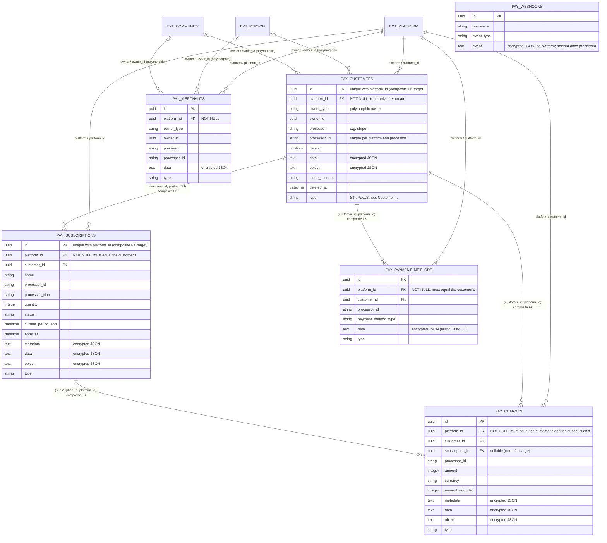

# Billing platform isolation

Community Engine can host many platforms. Billing records are payment data, so they are
bound to exactly one platform and nothing in the billing code guesses which. This page
explains the rules and where each is enforced. For the adapter side see
[processor-adapters.md](processor-adapters.md); for the data stored at rest see
[encryption.md](encryption.md).

## Why the usual platform scoping is not used

`BetterTogether::PlatformScoped` fills a missing `platform_id` from `Current.platform`,
then from the host platform, then from `Platform.first`. That is convenient for content,
and wrong for billing: a background job, a webhook or a console session has no request
platform, so a payment record would silently be filed under the host platform.

Billing records use `BetterTogether::Billing::PlatformBound` instead:

- `belongs_to :platform` is required.
- The platform is taken from `Current.platform` only (set per web request, or by a caller
  that has a tenant in hand). In a job or webhook the caller passes `platform:`; a missing
  platform is a validation error.
- `platform_id` is read-only once the record exists, and changing it is a validation error.
- `for_platform(platform)` is the scope to use. There is no default scope.

Billing models inherit `BetterTogether::Billing::ApplicationRecord` (and Pay's models
inherit `BetterTogether::Billing::PayRecord`, which builds on it). That base does **not**
include `Seedable`, so a billing record, with its decrypted payment data, cannot be written
into a seed with `export_as_seed`.

## Where the platform is enforced

| Layer | Rule |
|---|---|
| Database | `platform_id uuid NOT NULL` with a foreign key to platforms on every table that holds tenant data: `pay_customers`, `pay_merchants`, `pay_payment_methods`, `pay_subscriptions`, `pay_charges`. |
| Database | Composite foreign keys `(customer_id, platform_id)` and `(subscription_id, platform_id)` mean a child row cannot point at another platform's customer or subscription, even if validations are skipped. |
| Database | Uniqueness is per platform: a person can be a customer of two platforms' processor accounts. |
| Models | `PayExtensions::PlatformScoping` is included into each Pay model. Children copy their customer's platform and must match it; an owner that belongs to a platform (a community) must be billed on that platform. |
| Models | The platform cannot be re-pointed. Pay's own `set_payment_processor` looks up an owner's existing customer without regard to platform and then updates it; without a read-only platform a second platform could take over the first platform's customer. |
| Processor | Every adapter call carries a `ProcessorContext`. Only the host platform has one today (the deployment's own credentials). Any other platform has none, so billing is off for it and it cannot use the host's processor account. |

`pay_webhooks` has no platform column: Pay deletes a row once its event is processed, so
rows are transient. A failed delivery stays, encrypted, until the billing maintenance job
prunes it.

## Rules for application code

- Reach billing records through their platform (`platform.billing_plans`), never with a
  bare class-level read such as `Plan.find`, `Plan.all` or `Event.where`.
- Policies' scopes return only the acting platform's rows.
- A job loads its record and derives the platform from it. It never reads
  `Current.platform`, which is empty (or the host) in a worker. Job arguments are ids only.
- A webhook is attributed to a platform from the event itself or from the processor
  account it came from. If neither resolves, no tenant log row is created and the
  delivery is reported; nothing falls back to the host platform.
- Maintenance sweeps (dead-letter, redaction, prune) are the only cross-tenant
  operations. Each acts on one record at a time and reads nothing across tenants.
- Never use Pay's unscoped `owner.payment_processor` or `set_payment_processor` for an
  owner that can be billed by more than one platform. Look the customer up for a platform.
- Every new billing table is platform-bound and ties children to their parent with a
  composite foreign key.

## Tests

`spec/support/shared_examples/platform_bound_billing_record.rb` is shared by every
platform-bound billing model. `spec/models/better_together/billing/pay_extensions/`
covers the Pay models and the database-level checks.

## Schema diagram

**Diagram Files:**
- [Mermaid source](../diagrams/source/billing_schema_erd.mmd) - editable source
- [PNG export](../diagrams/exports/png/billing_schema_erd.png) - high-resolution image
- [SVG export](../diagrams/exports/svg/billing_schema_erd.svg) - vector graphics
