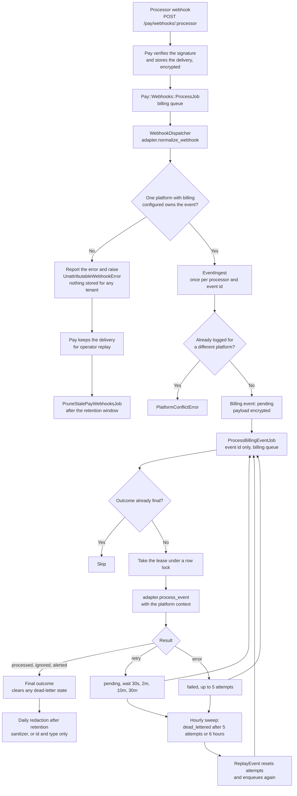

# Billing foundation and payment processor adapters

Community Engine core ships a vendor-neutral billing foundation: the `pay` gem, the Pay tables, host billing configuration, and a processor adapter contract. Core never calls a payment vendor SDK. A processor extension gem (for example `better_together-billing-stripe`) registers an adapter and does the vendor work. With no adapter registered, billing stays off and nothing else changes.

## Host requirements

- Active Record Encryption keys (`bin/rails db:encryption:init`, stored in credentials or environment variables). Billing encrypts payment data at rest; see [encryption.md](encryption.md).
- A `billing` Sidekiq queue with a high weight and ideally a dedicated capsule; see [../production/billing_queue_rollout.md](../production/billing_queue_rollout.md).
- Run the engine migrations (`20261015120000_create_better_together_pay_tables`). The Pay tables are owned by Community Engine: uuid keys, a required `platform_id` on every table that holds tenant data, and encrypted columns stored as `text`. No billing data exists to migrate, so the migration does not reconcile older Pay installs.

Pay's models inherit from `BetterTogether::Billing::PayRecord`, an abstract class the engine provides (`Pay.model_parent_class`), so a host does **not** need a top-level `ApplicationRecord` for billing.

## Configuration

Billing identity has no built-in defaults. Until the three required variables are set, `BetterTogether::Billing::Configuration.ready?` is false. A host that has switched billing on (`BT_BILLING_ENABLED`) but is missing variables gets a one-line warning at boot; a host that never asked for billing sees nothing.

| Variable | Required | Purpose |
|---|---|---|
| `PAY_BUSINESS_NAME` | yes | Legal or trading name shown by the processor |
| `PAY_BUSINESS_ADDRESS` | yes | Business address |
| `PAY_SUPPORT_EMAIL` | yes | Support contact |
| `BT_BILLING_ENABLED` | yes | Master switch (`true` to enable) |
| `BT_BILLING_DEFAULT_CURRENCY` | no | Preselects the currency when creating a plan |
| `BT_BILLING_DEFAULT_COUNTRY` | by feature | Used when an owner has no country (merchant onboarding) |
| `PAY_APPLICATION_NAME` | no | Defaults to `Community Engine` |

`BetterTogether::Billing.enabled?(platform)` is true only when the flag is on, the identity is configured, and a registered processor has a **context** for that platform. Today only the host platform has one, so billing is off for every other platform. See [platform_isolation.md](platform_isolation.md).

## Writing an adapter

Subclass `BetterTogether::Billing::ProcessorAdapter` and register it from your engine:

```ruby
initializer 'my_processor.register' do
  BetterTogether::Billing.register_processor(:my_processor, -> { MyProcessor::Adapter.new })
end
```

Implement `processor_name` (it must equal the name you register under; a mismatch raises `ContractError`), `sanitize_payload`, `capabilities`, `webhook_event_types`, and the methods for each capability you advertise. Every capability method receives `context:`, a `BetterTogether::Billing::ProcessorContext` naming the platform and processor account the call is for; use it instead of reading global environment variables, so one platform never acts through another's account. `ProcessorAdapter::CAPABILITY_METHODS` lists the methods and keywords per capability. The contract version is checked when the adapter is built; a mismatch raises `ContractError`. Run the shared examples in `spec/support/shared_examples/billing_processor_adapter.rb` against your adapter.

Core owns idempotency keys and money state. Money-moving calls always receive an `idempotency_key` that the adapter must pass through to the processor.

## Settlement kinds: remote, manual and internal

Not every way of paying goes through a payment vendor. An adapter says how money reaches the seller with `settlement_kind`, and the contract treats the three kinds differently.

| Kind | Examples | Who knows the payment happened |
|---|---|---|
| `remote` (default) | Stripe, Braintree | The processor, by webhook |
| `manual` | cash, cheque, e-transfer | The seller, who confirms receipt. Core owns the state machine; the adapter only describes the method |
| `internal` | store credit | A ledger inside Community Engine |

A manual adapter advertises the `offline_settlement` capability (and only a manual adapter may). `verify!` rejects the mismatch. Manual adapters also declare:

- `recurring_mode`: `automatic` (the processor renews), `manual` (each period is a new pending payment the seller confirms) or `none`. Manual methods are `manual`.
- `supported_countries`: ISO 3166 alpha-2 codes, or `nil` for anywhere (e-transfer is `['CA']`). Core hides the method or refuses to enable it outside them.
- `fee_collectible?`: false for every manual method, because the platform can neither track nor take a fee on a payment made outside it. Reports show such sales as uncollected rather than zero.
- `instruction_fields`: the `Billing::InstructionField`s a seller fills in so buyers know how to pay (a payee name, an e-transfer address). Values are stored encrypted and shown only on the buyer's own order.
- `instructions_for(context:, setting:, order:)`: what the buyer is shown. It must never be logged or put in an email.

The contract also gains two capabilities used by every payment kind: `refunds` (`refund`) and `transfers` (`transfer`, for paying a seller out). Both carry `context:` and an `idempotency_key`.

## Event pipeline

Processors deliver webhooks through Pay. Core logs, attributes, retries and replays them; the adapter only understands the vendor payload.

1. After boot, core subscribes each registered adapter's `webhook_event_types` to Pay's delegator. A processor whose adapter cannot be built is logged and reported and skipped; it never stops the application booting.
2. `adapter.normalize_webhook(vendor_event)` returns `{ event_id:, event_type:, payload: }`, and may add `occurred_at:` (when the processor says it happened), `platform_id:` and `account_ref:`.
3. Core attributes the event to **one platform** (below) and records it once per `(processor, event_id)` in `better_together_billing_events`. The payload and error text are encrypted at rest ([encryption.md](encryption.md)).
4. `ProcessBillingEventJob` is enqueued with the **event id only**, so payloads never appear in Redis or job logs. It runs on the `billing` queue ([queue rollout](../production/billing_queue_rollout.md)).
5. `adapter.process_event(event:, context:)` reads `event.payload` and returns a `Billing::EventResult`: `processed`, `ignored`, `alerted` (handled, but an operator should look), or `retry` (a prerequisite such as a not-yet-synced subscription is missing). `context` is the platform and processor account the event belongs to.

Status values: `pending`, `processed`, `ignored`, `alerted`, `failed`, `dead_lettered`, `replayed`. Only `failed` and `dead_lettered` count as problems, so unrelated or informational events do not raise alerts.

### Which platform an event belongs to

Nothing is guessed. An event is attributed, in order, by the `platform_id:` the adapter reports, by the `account_ref:` matched to a platform whose context names that account, or, with neither, to the only platform that has billing configured for the processor. If that does not single out one platform (none, or several), no tenant row is created: the dispatcher reports the error and raises `Billing::UnattributableWebhookError`. Pay deletes a webhook row only after successful processing, so the delivery stays, encrypted, and an operator can replay it after fixing the mapping. Pay's job discards the error (retrying cannot change the answer).

A duplicate delivery that matches an event already logged for a **different** platform is refused (`EventIngest::PlatformConflictError`), because vendor event ids are globally unique.

### What an outcome says happened

`Billing::EventResult` carries two optional, processor-neutral fields so the rest of the system never reads a vendor's event names:

- `outcome_kind`, one of `EventResult::OUTCOME_KINDS`. Processor adapters report `payment_succeeded`, `payment_failed`, `payment_action_required`, `refund_issued`, `dispute_opened`, `dispute_resolved`, `subscription_renewing`, `subscription_canceled`, `trial_ending` and `trial_ended` (the same messages Pay's own mailers would have sent). Core's own services report `payment_claimed`, `payment_confirmed`, `payment_rejected`, `payment_expired` and `refund_recorded` for manual methods such as cash, cheque and e-transfer, which log events named `<method>.payment_claimed`, `<method>.payment_confirmed` and so on. An unknown kind raises, so a vendor name cannot leak in.
- `subject`: the record the event is about (an order, a Joatu agreement, a hosted platform). Only models that include `Billing::Subjectable` are accepted, the same opt-in idea as `Billable` for owners, and a platform-bound subject must be on the event's platform.

The processor stores both on the event (`outcome_kind`, `subject`), so notifications, reports and the operator queue read them from there.

### Writing `process_event`

It **must be idempotent**. A job that fails after the adapter acted is retried, a duplicate delivery of a still-pending event is enqueued again, and a replay runs the event again. Use the event id (and, for a processor write, a key derived from it) so repeating it is harmless. Core helps but does not remove the need:

- an event whose outcome is already final (`processed`, `ignored`, `alerted`) is skipped;
- a job takes a short lease (`claimed_at`, ten minutes) under a row lock before calling the adapter, so two jobs never run the processor at once; a lease left by a crashed worker expires;
- the outcome is written under a row lock, so a sweep or replay that touched the row meanwhile cannot make the write fail, and a late success clears any dead-letter state;
- a failure to record the outcome (for example an owner type that is not billable) is itself recorded as a failure, not left silently pending.

### Retries, dead letters and replay

- A failed result is retried by ActiveJob up to `Billing::Event::MAX_ATTEMPTS` (5) times with growing waits. A `retry` result waits 30 seconds, 2 minutes, 10 minutes, then 30 minutes (about forty minutes in all), because the prerequisite it waits for (Pay's own sync, say) can lag. `processed_at` is set only on a final outcome.
- Hourly, `DeadLetterStaleBillingEventsJob` moves events that exhausted their retries (`retries_exhausted`) or made no progress for 6 hours (`stale_unresolved_drift`) to `dead_lettered`. It handles one event at a time under a row lock that re-checks the event is still stuck, so an event a job finished meanwhile is left alone, and one bad row does not stop the sweep.
- A duplicate delivery of an event that is still `pending` is enqueued again, in case the first enqueue was lost.
- `Billing::ReplayEvent` resets the attempt count and re-enqueues a dead-lettered event. It refuses events whose payload was redacted, whose processor is no longer installed, or whose platform no longer has billing configured for the processor.
- `occurred_at` is stored as `processor_event_created_at`. Receive time is not event time, so an adapter that must ignore a stale event compares this value.

### Payload retention

Raw payloads are kept for `BT_BILLING_EVENT_PAYLOAD_RETENTION_DAYS` (default 30) after processing. A daily job then replaces each with `adapter.sanitize_payload(payload)`. Redaction fails closed: if the adapter is gone, cannot be built, raises, or returns something that is not a Hash, the payload is replaced with just `id` and `type`, so a broken adapter never leaves a raw payload behind. Sanitizers must remove personal data and secrets.

Pay keeps the raw delivery in `pay_webhooks` until it is processed. A daily job (`PruneStalePayWebhooksJob`) deletes deliveries that are still there after the same retention window.

## Diagram



**Diagram Files:**
- [Mermaid source](../diagrams/source/billing_event_pipeline_flow.mmd) - editable source
- [PNG export](../diagrams/exports/png/billing_event_pipeline_flow.png) - high-resolution image
- [SVG export](../diagrams/exports/svg/billing_event_pipeline_flow.svg) - vector graphics

## Plan catalog

Plans, and the processor-backed fields of the plan form (async option lists, fields the
processor only accepts at creation, creating and editing products and prices from
Community Engine) are described in [plan_catalog.md](plan_catalog.md).
