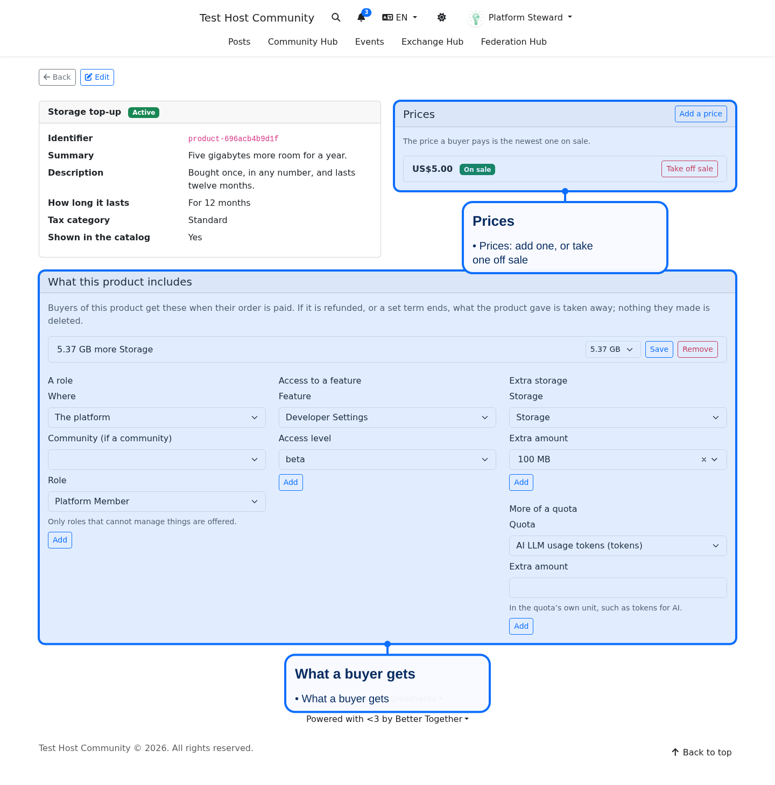
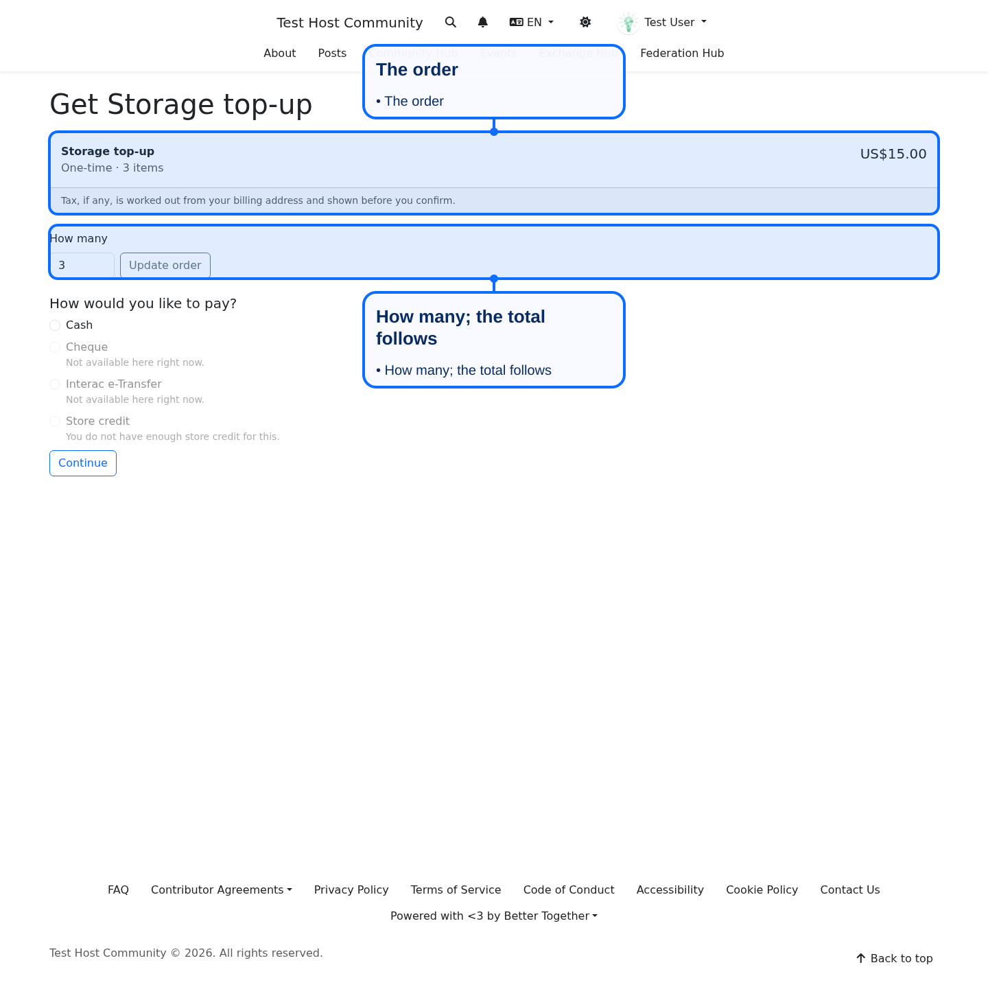

# Products and prices

A **product** is a one-off item a platform sells: a storage top-up, a one-time add-on, later tickets and other goods. A **price** is what the product costs, and is what an order line points at. Plans stay the recurring subscription offer. See [the split plan](purchasable_split_plan.md).

## Product

| Field | Meaning |
|---|---|
| `identifier`, `name`, `description`, `summary` | Catalog identity. `name` is a short string, `description` and `summary` are long text, all translated. |
| seller | The platform, or one of its communities or people (as for a plan). |
| `active`, `listed`, `restricted_to_*` | Whether it is on sale, shown in the catalog, and limited to members or subscribers. |
| `tax_category` | How it is taxed; none means standard. |
| `lifetime` | `until_used` (no end date) or `fixed_term` (ends `term_length` `term_unit`s after payment). |
| `type` | A subclass from an allow-list (`Product::SUBTYPES`). The base class is the standard product; tickets will be a subclass. Never set from a parameter. |

A product includes **grants** (a role, feature access or a quota allowance), the same grants a plan has. A price never belongs to anything but its product.

## Price

An amount in one currency, with an optional translated `label` ("Early bird"). A price never changes: a different amount is a new price, and the old one is archived (`archive!`), as a payment processor requires. An order keeps its own copy of what it was sold for, so history never moves.

The price is the purchasable. It takes its description and tax category from the product, is fulfilled through its own order, never renews, and is not an extra or a plan line.

## Giving it

When an order with a price line is paid, `Entitlements::Sync.order` gives one entitlement per plan or product on the order, for the quantity bought:

- A quota allowance is multiplied by the quantity: three of a 10 GB top-up give 30 GB.
- `until_used` has no end date. `fixed_term` ends at `paid_at + term`; the hourly `LapseEntitlementsJob` brings an order past its end back in line, which lapses the entitlement and takes its grants back.
- A refund or cancellation revokes it either way.

Storage (a cumulative, reversible quota) behaves as a top-up should: the limit rises while the purchase stands. A consumable quota such as monthly AI tokens is not drawn down from a grant; see the plan's "what the quota code does today".

## Data

`better_together_billing_products` and `better_together_billing_prices`. Grants gain a `product_id` (a grant is for a plan or a product, exactly one); entitlements gain `product_id` and `quantity` (for a plan or a product, exactly one), and the one-entitlement-per-order rule is now one per order and item. See [the schema ERD](../diagrams/exports/png/ce_full_schema_erd.png).

## Screens

Stewards manage products at `/billing/products`: a list, a form (name, summary, description, how long it lasts, tax category, where it is listed and who may buy it), and a product page that holds its prices and what it includes. A price is added, never edited; adding a new one takes the old one off sale if the steward chooses, and the newest price on sale is what buyers pay. What a product includes is edited with the same grants form as a plan, and a change brings current buyers up to date.

Buyers find listed products on the public catalog and on a product page. Checkout is the same one a plan uses, started with `price_id` instead of `plan_id`, with a quantity from 1 to 99 that scales the first line and its tax. Payment is by the offline methods (cash, cheque, e-transfer, store credit) for now.

Seeds: the billing demo packet plants a "[Demo] Storage top-up" product with a price and a storage grant (types `billing_product`, `billing_price`, `billing_product_grant`).

## Not yet built

The processor mirror (`sync_plan` for products, PS-7).

## Extras and the move from plans (PS-6)

A product may need a plan: tick "needs any plan" or the plans it goes with on the product form (`billing-product-requirements`), which stores [purchase requirements](purchase_requirements.md). Plans no longer have one-time or add-on forms. A migration ran `Products::ConvertPlans`, which made each old one-time or add-on plan a product with one price, moved its grants, entitlements, agreement requirements, plan-button blocks and past order lines to it, turned add-on links into rules, and removed the plan. A plan still pointed at by a subscription term is skipped and reported, and the cleanup migration refuses to run while any is left. Counts are checked in the same transaction.

One behaviour changed: buying a one-time plan no longer counts as holding "any plan" for a rule.
