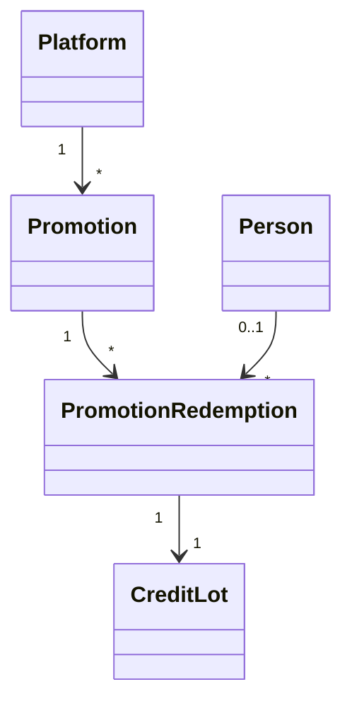

# Billing Promotions

A promotion is a code that gives **store credit** when a person redeems it (see [store_credit.md](store_credit.md)). A steward makes the code and sees it once; a person types it on their credit page; the credit arrives as a promotional lot with its own expiry.

## Model

**Diagram files:**
- 📊 [Mermaid model](../diagrams/source/billing_promotion_model.mmd) and [redemption flow](../diagrams/source/billing_promotion_redemption_flow.mmd)
- 🖼️ PNG and SVG exports are rendered by the maintainers (`bin/render_diagrams`)

| Table | Holds | Rules |
|---|---|---|
| `billing_promotions` | Name (for stewards only), amount and currency, `credit_expires_after_days`, the `purposes` the credit may pay for, `starts_at`/`ends_at`, `max_redemptions`, `redemptions_count`, `new_members_only`, `active`, and `code_digest` | `amount_cents > 0`; days and cap positive; `redemptions_count <= max_redemptions` (CHECKs). The digest, amount and currency cannot change. Unique digest per platform |
| `billing_promotion_redemptions` | Who redeemed which promotion, and the credit lot it made | **One per person and promotion** (unique). Composite foreign keys with the platform. Never changed once written |

## The code is a secret

- It is **never stored**: only `code_digest`, an **HMAC-SHA256 keyed with a key derived from the application's secret** (`Rails.application.key_generator`). A copy of the database does not reveal codes, and without the key a digest cannot be used to check guesses offline.
- It is **shown once**, in the response to the form that made it (`Cache-Control: no-store`), never in a redirect, flash, notice or event. It cannot be read back, so a lost code means making a new one.
- 16 characters from a 31-letter-and-digit alphabet with nothing easy to confuse (no `0/O`, `1/I/L`), about 79 bits, shown as `XXXX-XXXX-XXXX-XXXX`. People can type it in any case, with or without dashes.
- The `promotion_code` parameter is filtered from logs.

## Redeeming (`Promotions::Redeem`)

**One answer for every failure.** An unknown code, one that has ended, is not open yet, is switched off, has run out, is for new members only, or was already used by this person all give "That code is not valid", so a failed attempt tells nobody which codes exist.

Guessing is limited three ways:
1. **Per address**: `POST .../billing/promotion_redemptions` is throttled to 10 a minute (Rack::Attack).
2. **Per person**: after 10 failures in an hour (counted in `Rails.cache`, per person and platform) a person is refused outright, with the same answer and without looking anything up. This needs a real cache store in production; with a null store only the per-address throttle applies.
3. **By shape**: a code that cannot be the right length is refused without a lookup.

The promotion is **locked** while a redemption is made, so a cap of N is N however many people redeem at once, and the database allows one redemption per person. The credit is made with `Credit::Grant` (origin `promotion`, `promotional: true`, expiry from the promotion's days, the promotion's purposes) and the redemption row ties the person to that lot. "New members only" means the person has never paid for an order on this platform.

## Screens

| Who | Where | What |
|---|---|---|
| A person | their credit page, `/:locale/billing/credit` | A code box and Redeem button |
| A steward | `/:locale/billing/promotions` | List with use (`3 of 100`), window, status; switch on/off. Linked from the credit accounts page |
| A steward | `/:locale/billing/promotions/new` | Name, credit amount and currency, days the credit lasts, most people, opens/closes, what it may pay for, new members only. The response shows the code once |

A promotion cannot be deleted or edited once made (amount, currency and code are fixed); switch it off and make another.
