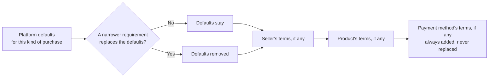

# Purchase agreements

Nothing is bought until the buyer has accepted the agreements that apply. This page describes which agreements those are, how they are chosen for a purchase, how acceptance is recorded as evidence on the order, and where in the payment flow and screens an agreement is required.

The agreement text itself is not decided here. The platform ships **draft placeholders** that a steward reviews and sets to active, and per-platform, per-seller, per-plan (and later per-ticket-type) terms can be added.

## The agreements that ship

`AgreementBuilder.build_purchase_agreements` (through `Billing::PurchaseAgreementSeeds`) seeds three agreements for each platform. They are normal `BetterTogether::Agreement` records of kind `transactional_agreement`, protected, with `requires_reacceptance` on, so changing a platform's terms asks buyers to accept the new version.

| Agreement | Covers | Added when |
|---|---|---|
| `subscription_agreement` | subscriptions and memberships | the purchase is for a plan that renews |
| `one_time_purchase_agreement` | one-time purchases, event tickets, exchanges | any other purchase |
| `offline_payment_terms` | what cash, a cheque or an e-transfer cannot do | the buyer pays by cash, cheque or e-transfer |

**They are seeded as drafts with placeholder text**, and seeding again never touches an agreement a steward has edited or activated. Until each is reviewed and set to `active`, nothing can be sold: checkout shows that the purchase "cannot be completed yet" and offers no way to accept a draft. This is deliberate, so placeholder legal text never goes live by accident. A platform with no purchase agreement at all fails closed in the same way.

## Which agreements apply to a purchase

A `Billing::AgreementRequirement` ties an agreement to a target and, optionally, to one kind of purchase and one payment method:

- **Target.** None means the platform's default for every purchase. A seller (a community or a person) or a plan narrows it to theirs. Later, an event or a ticket type will be targets too, which is how a ticket type gets an agreement of its own.
- **Mode.** `additional` adds to the defaults; `replaces_default` takes the defaults out for that seller or product.
- **Payment method.** Terms that come with a method are always added for that method, and are never replaced: they describe the method, not the product.

`Billing::AgreementResolver` combines them for one purchase and lists the agreements most general first, so a buyer reads the platform's terms, then the seller's, then the product's, then the method's:

Only the current platform's requirements are ever read. Another platform's agreements, plans and requirements cannot apply, and a steward cannot attach them.

## Where an agreement is required in the payment flow and UI

| Step | Screen | What happens | Enforced |
|---|---|---|---|
| Before choosing | A plan, a ticket type, an offer | Shows the terms that apply, as links. Informational only | no |
| Choose how to pay | Checkout, step 1 | Lists the ways to pay this plan accepts; one that is unavailable says why. The method chosen decides which method terms are added | yes: only an available method can be chosen |
| **Review and accept** | Checkout, step 2 | Shows every agreement that applies, with its text, a tick box for each one not yet accepted in its current form, and the "Place order" button. If the purchase terms are missing or still drafts, it says so and offers no way to continue | **yes** |
| Place the order | `Orders::Place` | Re-checks everything on the server: each agreement exists, is in force, and has been accepted by the signer as it reads now. It refuses otherwise, whatever the screen sent, and copies the acceptances onto the order | **yes** |
| Instructions and payment | The order page, the pay screen | Payment instructions for cash, cheque or e-transfer are shown only after the order exists, so only after the acceptance | yes, by order |
| Any purchase, even free | Same | A zero-total purchase still needs the agreements | yes |
| Walk-up sale | A seller placing an order for a buyer | The agreements are recorded with the method `seller_assisted`, with the seller and the time, and the buyer is told | yes, recorded |
| Renewals | Renewal orders | A renewal carries the acceptance already given. If an agreement that requires re-acceptance changes, the person is asked again before changes and the next renewal | planned with subscriptions |
| Receipt | The order page | Lists each agreement accepted, by whom and when | evidence |
| Steward set-up | Purchase terms; payment methods | A checklist says what is still to do: billing configured, a method on, and in-force agreements for each kind of purchase | readiness only |

## Evidence

Each order keeps its own `Billing::OrderAgreementAcceptance` rows: the agreement, its identifier and title and **content digest as it read then**, who accepted (the signer, who may be a person acting for a community or another person), how (`checkout`, `seller_assisted`), and when. Rows are never rewritten, and are tied to the order by a composite foreign key so the evidence is always on the order's own platform. The agreement can change and be accepted again later without altering what applied to a purchase already made.

The acceptance itself is recorded through the existing `AgreementAcceptanceRecorder`, so it also appears in the person's agreement history. Two acceptance methods were added to `AgreementParticipant`: `checkout` and `seller_assisted`.

## Screens

| Screen | Who | Route |
|---|---|---|
| Checkout | Any signed-in person | `/:locale/billing/checkout/new?plan_id=` and `POST /:locale/billing/checkout` |
| Purchase terms | Stewards | `/:locale/billing/agreement_requirements` |

Both answer 404 while billing is off (the terms page works as soon as billing is configurable, before any method is on). A plan that is inactive, another platform's, or sold by someone else is a 404 at checkout.

## What is not in this page

Where the order goes after it is placed (paying by cash, cheque or e-transfer, and the seller's confirmation) is in [offline_payment_methods.md](offline_payment_methods.md). The legal wording of the agreements, and the per-ticket-type agreements, come with ticketing.
