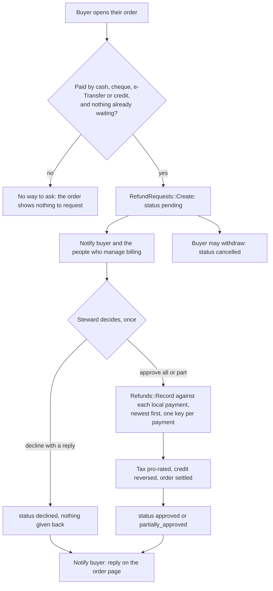

# Billing Refund Requests

A buyer can ask for money back on an order, and the people who manage the platform's billing answer once: approve it, approve part of it, or decline it with a reply. Nothing changes for a buyer who does not ask, and a request never moves money by itself.

## Who can do what

| Person | Can | Where |
|---|---|---|
| The buyer of an order | Ask for a refund while something can still be given back and no other request is waiting. Withdraw it while it waits. | The order page, "Ask for a refund" |
| A steward (`manage_platform`) | See the queue, open a request, approve, approve part, decline. | `/billing/refund_requests` (linked from Sales) |
| Anyone else | Nothing. Another person's order and the queue are not reachable. | |

## What can be asked for

Only money Community Engine settles itself: cash, cheque, e-Transfer and store credit. A refund made through a payment vendor is made at the vendor and reported by it, so it is not offered here. The form shows how much can still be given back. Leaving the amount empty asks for all of it.

## The refund policy

The platform can write a `refund_policy` agreement (seeded as a draft with placeholder text, like the purchase agreements). Once a steward activates it, the buyer's request form shows it through the shared agreement modal and the box must be ticked, once per version of the wording. The server refuses a request without it (`RefundRequests::PolicyGate`, checked in the controller and again in `RefundRequests::Create`). While the policy is a draft nothing is asked, so placeholder text is never put in front of a buyer.

## What approving does

Approving records ordinary refunds (`Refunds::Record`) against the order's local payments, newest first, so tax is pro-rated, store credit goes back to the buyer's balance, and the order becomes partially refunded or refunded exactly as for a refund the steward records directly. Each refund carries a key made from the request and the payment, so a repeated click records nothing twice. A steward can give back less than was asked (the request becomes "partly approved") but never more than can be given back.

Declining needs a reply, so the buyer is never left without a reason.

## Privacy

What the buyer wrote and what the steward answered are free text from people, so both are encrypted at rest. Notifications say that a request was made or answered and link to the order; they never carry either text.

## Notifications

| Kind | Who hears |
|---|---|
| `refund_requested` | The buyer (receipt of the request) and the people who manage billing |
| `refund_request_decided` | The buyer |

## Data

Table `better_together_billing_refund_requests`: platform, order, requester, reason, optional amount asked, status, encrypted details and reply, amount approved, who decided and when. A partial unique index allows one waiting request per order.

Screenshots are in `docs/screenshots/{desktop,mobile}/billing_refund_request_*` and `billing_refund_requests_queue`.
