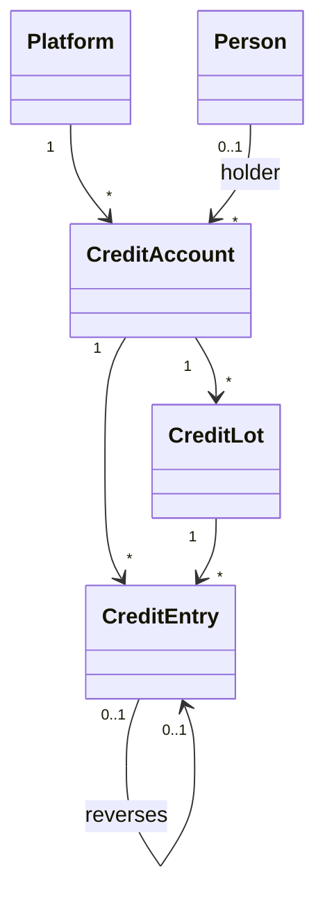

# Billing Store Credit

Store credit is a balance a person holds with a platform. It pays **whole orders for what the platform itself sells**. It is the platform's own money, kept as a ledger in Community Engine, and sits beside Pay rather than inside a processor: a spend writes a `Pay::Local::Charge` like any other settled payment (see [local_pay_processor.md](local_pay_processor.md)).

This page covers the ledger, how credit is spent and given back, the screens and the notice, and the rules. How credit is created by a promotion arrives in a later change.

## The model

**Diagram files:**
- 📊 [Mermaid model](../diagrams/source/billing_store_credit_model.mmd) and [flow](../diagrams/source/billing_store_credit_flow.mmd)
- 🖼️ PNG and SVG exports are rendered by the maintainers (`bin/render_diagrams`)

| Table | Holds | Rules |
|---|---|---|
| `billing_credit_accounts` | One per platform, holder and currency, with a cached `balance_cents` | `balance_cents >= 0` (CHECK). The holder is **nullified** when the person is deleted; the ledger stays |
| `billing_credit_lots` | Each amount that came in: `origin` (`steward_grant`, `promotion`, `refund`, `adjustment`), `amount_cents`, `remaining_cents`, `expires_at`, the `purposes` it may pay for (empty means any), whether it is `promotional` | `0 <= remaining_cents <= amount_cents` (CHECK) |
| `billing_credit_entries` | The history: one entry per lot touched, signed, with `balance_after_cents`, a `transaction_key`, the actor and what it was about (a `Payment` or `Refund`) | **Append-only** (read-only once saved, never removed). Unique per platform, transaction and lot |

All three tables carry `platform_id NOT NULL`, and their links (account, lot, reversed entry) are composite foreign keys that include the platform, so a row can never point at another platform's. Money is `bigint`.

## Services (`Billing::Credit`)

Every change goes through a service, under the **account's lock**, and leaves entries behind. The balance is never written by hand.

| Service | What it does |
|---|---|
| `Grant` | A steward gives credit (a new lot and an entry). **Nobody can give themselves credit.** A promotion or a refund is granted by the system, with no actor |
| `Spend` | Pays for a payment. Takes the **soonest-expiring** unexpired lot that allows the purpose first, then the oldest; one entry per lot. All of it or none |
| `Reverse` | Gives credit back after a refund, to the lot it came from while that lot is still valid; otherwise as a **new refund lot that lasts 30 days**, so a refund never extends a promotion. Never more than was spent and not yet given back |
| `ExpireLots` | Empties lots past their date, with an `expire` entry for what was lost. Run daily by `ExpireCreditLotsJob` (04:50 UTC) |
| `Recalculate` | Checks the balance against the lots and the entries; `repair: true` resets the balance to what the lots say |
| `PayOrder` | Used by `Orders::Place`: makes the payment, spends, succeeds it |

Each is **idempotent**: repeating a request with the same key returns what it already made.

## Paying an order

Credit is a payment method like cash, with its own `ProcessorSetting` a steward turns on (no instructions, no hold time, and a different acknowledgement: it is not cash, it can expire, refunds go back onto it). `Orders::Place` with `payment_method: 'store_credit'`:

1. refuses unless credit is on for this kind of purchase, the sale is the platform's own (credit never pays a seller) and the currency matches;
2. in the placement transaction makes the payment for the **whole balance**, spends it, and succeeds it, so the order is `paid` when `Place` returns;
3. refuses, leaving **no order, no hold and no spend**, if the usable credit does not cover it.

**No split tender.** Credit pays an order in full or not at all. A part-payment would leave an order half paid that has to be unwound if it is cancelled or lapses; refusing keeps every order either unpaid or paid. A buyer who is short is told so at checkout (`Checkout::Methods` lists credit as unavailable with the reason `insufficient_credit` when they have not enough usable credit) and can pay the whole price another way.

A sale in person (a seller-assisted walk-up) never uses credit: it is the buyer's to spend, not a seller's to record.

## Refunds

A payment made with credit is refunded **to credit**, never to a bank. `Refunds::Record` for such a payment is `succeeded` at once and calls `Credit::Reverse` in the same transaction; the Pay charge's `amount_refunded` follows, so `payment.refunded_cents == pay_charge.amount_refunded` holds as for every payment. A steward does this from the sale page (a "Return to store credit" card per credit payment).

## Method kinds

Credit forced the question "is this a method outside a vendor?" to be split, because credit is not a method a seller confirms:

| Question | Methods | Used for |
|---|---|---|
| `Billing.local_method?` | cash, cheque, e-transfer, store credit | A plan accepting it, a purchase agreement for it, settings, checkout |
| `Billing.manual_method?` | cash, cheque, e-transfer | Offline payments, instructions, the seller's confirmation |
| `Billing.internal_method?` | store credit | Spending and returning credit |

`ProcessorAdapter` has safe defaults (`grant_on_options`, `default_grant_on`, `settings_errors`) so a setting never calls a manual-only method on an internal adapter.

## Screens and notice

| Who | Where | What |
|---|---|---|
| The holder | `/:locale/billing/credit` | Per currency: what can be spent now, each amount left with when it expires and what it may pay for, and the newest 50 entries. Only their own accounts on this platform are ever loaded. Linked from the orders list |
| A steward | `/:locale/billing/credit_accounts` | Pick a person from a **search** over this platform's members (name or the start of a handle, at least two characters, 20 results at most, never a full list; searches are throttled per address), see accounts that hold a balance, and **give credit** (amount, currency, optional days to expiry, optional note). Linked from the payment methods list |
| A steward | `/:locale/billing/credit_accounts/:id` | Every lot and entry, with who gave it and why |

Giving credit is `Credit::Grant` with the steward as actor. The form carries a token that becomes the idempotency key, so a double click gives it once, and the service refuses a steward giving themselves credit. The search is limited to members of the platform and needs steward permission, and an id that is not a member looks the same as one that does not exist.

The holder is told with the `credit_granted` notice (audience `holder`, not critical): how much, until when if it expires, and a link to their credit page. It is sent for credit a steward gives; credit the system gives (a refund, a promotion) is silent here. See [notifications.md](notifications.md).

## Rules

- Credit is **platform money**: spendable only on what the platform sells, in the currency it is held in.
- Usable credit is unexpired, with something left, and allowed for the purpose.
- Nobody grants themselves credit.
- Entries are never changed or removed; a mistake is corrected by a later entry.
- Credit that expires first is spent first.
