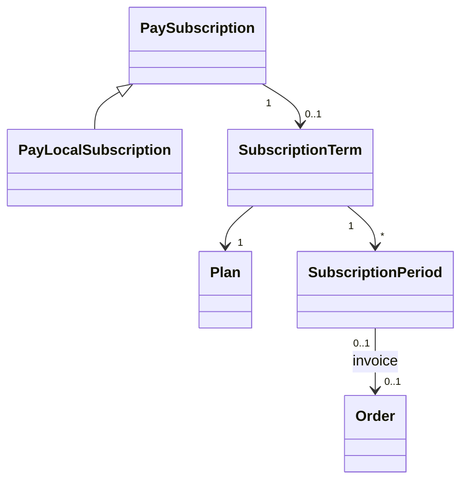

# Billing Subscriptions and Renewals

**`Pay::Subscription` is the subscription.** Community Engine adds no subscription model of its own. For a subscription paid by a method Community Engine settles itself (cash, a cheque, an e-transfer, store credit), the subscription is a `Pay::Local::Subscription` (see [local_pay_processor.md](local_pay_processor.md)); for one a processor renews, Pay syncs it. Everything lifecycle-related stays in Pay's columns, so anything built on Pay's records sees every subscription the same way.

What Pay has no place for lives in two small tables.

## Model

**Diagram files:**
- 📊 [Mermaid model](../diagrams/source/billing_subscription_model.mmd) and [lifecycle](../diagrams/source/billing_subscription_lifecycle_flow.mmd)
- 🖼️ PNG and SVG exports are rendered by the maintainers (`bin/render_diagrams`)

| Table | Holds | Rules |
|---|---|---|
| `billing_subscription_terms` | One per Pay subscription: the `plan`, who it is for (`beneficiary`, else the payer), the `payment_method` each renewal is paid by, `unit_amount_cents` (the price it was **sold** at), `anchor_at`/`anchor_sequence` (what periods are counted from), `grace_ends_at` | Unique per Pay subscription. Composite keys with the platform to the Pay subscription and the plan. Plan and method cannot change |
| `billing_subscription_periods` | One per billing period of a subscription Community Engine renews (Pay keeps only the current period): `sequence`, `starts_at`/`ends_at`, `status`, the invoicing `order` | **Unique per subscription and sequence**, which is what makes making a renewal twice harmless. `ends_at > starts_at` (CHECK) |

A renewal invoice is an ordinary `Billing::Order` (its number is the invoice number) whose `subject` is the terms. A plan's price change applies to **new** subscribers; a steward can move one subscriber to the current price.

## Plan settings

`interval_count` (every N months or years), **`grace_days`** (default 7, 0 = none) and **`renewal_lead_days`** (default 14). The last two are editable at any time and apply from the next renewal.

## Periods never drift

Every period is counted from the **anchor**, never from the period before (`Billing::Periods`). A subscription that began January 31 renews February 28 (29 in a leap year), then March 31, not the 28th from then on. The sums are done in the platform's time zone, so a 9 a.m. renewal stays 9 a.m. across a daylight saving change; times are stored in UTC.

## The flow (only for methods Community Engine settles itself)

1. **Start.** The first order of a recurring plan is paid (the seller confirms the cash, credit is spent). `Orders::Settle` enqueues `SubscriptionOrderPaidJob` after the payment commits, so a failure there is retried and can never undo a recorded payment. `Subscriptions::Start` makes the Pay customer and subscription, the terms, and period 0 (paid by that order). The anchor is when the money **really** arrived (a cheque's `received_on` counts).
2. **Invoice.** `GenerateRenewalsJob` (daily 05:10 UTC) makes the next period and its invoice once within `renewal_lead_days` of the period ending: the period row first (unique), then the order, held until the period end **plus the grace**. A deactivated plan still renews its existing subscribers.
   - Agreements changed since the payer accepted them: the period waits as `needs_agreement`, the payer is told and accepts on their subscription page, the invoice follows.
   - Any other refusal (the method was switched off): `blocked`, with a reason, tried again each run.
   - Store credit: paid at once if the credit covers the whole invoice; otherwise the invoice waits and the payer is told once a day (`AdvanceSubscriptionsJob` tries again, so topping up is enough).
3. **Paid.** The invoice's payment is confirmed (or credit spent) and `Subscriptions::Renew` moves the Pay subscription on, using the same columns Pay reads (`current_period_*`, `status`, `ends_at`).
   - Paid early or in time: it moves on at once.
   - Paid inside the grace: it runs on **from the old end**, not from the day paid.
   - Paid after it lapsed: **nothing is back-dated**; it starts again from the day paid and periods are counted from there.
4. **Late.** `AdvanceSubscriptionsJob` (hourly :25) moves `active` to **`past_due`** when a period ends unpaid (the *dunning window*: everything works, the payer and stewards are told) and to **`unpaid`** when the grace ends (`ends_at` = that moment, the period `lapsed`). Content is never deleted. A cancellation becomes `canceled` once its date passes.
5. **Reminders.** `RemindRenewalsJob` (daily 14:30 UTC) reminds the payer of an unpaid invoice a week and a day before the period ends, and warns a day before the grace ends. Each stage is sent once.

Pay's own "grace period" means a cancelled subscription still paid through its period; the unpaid window above is called the *grace* or *dunning window* here and uses `past_due`.

## Actions

| Who | Action | What it does |
|---|---|---|
| Payer | Cancel | `ends_at` = the end of the paid period (Pay's `cancel`); the unpaid invoice is cancelled with it |
| Payer | Resume | Clears `ends_at` while the paid period still runs (Pay's `resume`) |
| Payer | Accept changed terms | Records acceptance, then the invoice is made at once |
| Steward | Cover a period | The next period is `waived`, its invoice cancelled, the subscription moves on |
| Steward | Give more time | Extends `grace_ends_at`; a lapsed subscription whose new date is ahead is `past_due` again |
| Steward | Cancel (at the end, or now) | As above, or ends it now; nothing already paid is refunded |
| Steward | Move to the current price | From the next invoice |

## Processor-backed subscriptions

A processor renews its own, so nothing is scheduled here. `Subscriptions::Adopt(pay_subscription:, order:)` links a subscription Pay synced to the order that bought it by making its terms (no periods). A processor extension calls it when it sees the order id in the subscription's metadata.

## Screens

Payer: `/:locale/billing/subscriptions` (list, show with periods and invoices). Steward: `/:locale/billing/subscribers` (filter by past due, lapsed, active, ended; show with the actions above). Plan form: a "Renewals" section for recurring plans.

## Limits

Plan changes mid-subscription are not supported (cancel and subscribe again). Seller-sold plans are not renewed here, only the platform's own. A processor-backed subscription has no payer screen in core yet (the processor's portal is the extension's).
