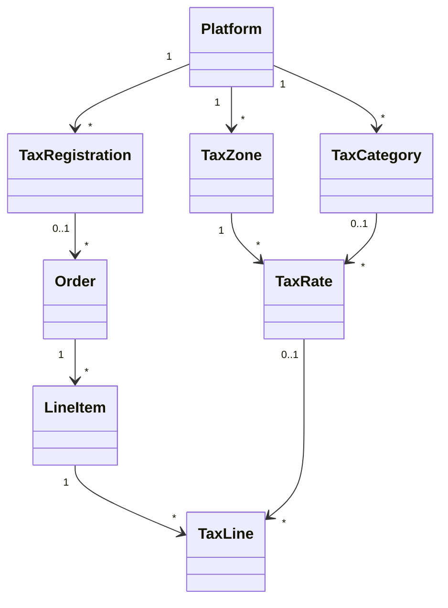

# Billing Tax

Community Engine works out tax itself for every order, whatever the way of paying (a processor, cash, a cheque, an e-transfer, store credit), so the amount an order asks for is the same on every route. This page covers what is built so far: the data and the calculator. Screens for registering, tax lines on receipts and reports come in later changes.

An order with no tax registration behind it has no tax lines and the totals it always had.

## Model

**Diagram files:**
- 📊 [Mermaid model](../diagrams/source/billing_tax_model.mmd)
- 🖼️ PNG and SVG exports are rendered by the maintainers (`bin/render_diagrams`)

| Table | Holds | Rules |
|---|---|---|
| `billing_tax_registrations` | Who collects: the platform (no seller) or a seller; country and region; `status`; `prices_include_tax` (empty means the country's usual way); the registration number (encrypted); when it is in force | Only `registered` collects. `small_supplier_exempt`, `exempt` and `not_collecting` charge no tax |
| `billing_tax_categories` | What kind of thing is sold; `taxable` | A category that is not taxable (fresh produce) is never taxed. A plan or line with no category is taxed as standard |
| `billing_tax_zones` | A country, or one region of it | A zone covers a place when it has the country and either no region or that region |
| `billing_tax_rates` | One tax in one zone: label, rate as a fraction, when it applies, optionally one category | Discarded, never deleted, so past tax lines keep pointing at it |
| `billing_tax_lines` | One tax on one line of one order, with the label and rate copied when the order was placed | `included` means the amount is inside the price. Composite foreign keys with the platform |

`orders` and `line_items` also keep `tax_cents` and `included_tax_cents`; `orders` keep the place the tax was worked out for and the registration used. Plans and line items carry a `tax_category`.

## How tax is worked out (`Tax::Calculator`)

It reads plain values, writes nothing and can be run again with the same answer.

1. **Whose tax.** The seller's own registration if the seller has one in force, otherwise the platform's. If that registration does not collect, or there is none, there is no tax.
2. **Where.** The buyer's place when `Orders::Place` is given a `tax_address`, otherwise the registrant's own place.
3. **How much.** For each item: skip it if its category is not taxable; take every rate in force for the place that fits the category; apply each to the item's amount. Store credit and other payments never change the amount tax is worked out on.
4. **Inclusive or added.** When prices include tax the tax is taken out of the price (`amount * rate / (1 + sum of rates)`) and the total does not change; otherwise it is added. Each amount is rounded half up to the minor unit.

The default for `prices_include_tax` comes from the country (`Tax::Defaults`): inclusive in most of the EU, the UK, Australia, New Zealand and similar; added in Canada and the United States. A registration can override it.

## Placing an order

`Orders::Place` works out the tax once, from the same amounts it builds the order from, and `Orders::ApplyTax` copies it onto the unsaved order, its lines and a tax line per tax. `Order#total_up` then sets `total_cents = subtotal_cents + tax_cents - included_tax_cents`. `PaymentParts` checks the parts against that same total. After placing, the tax is not worked out again, so a rate change never changes an order that exists.

## Not built yet

Registration and settings screens, the seller's agreement to collect tax, the buyer's address at checkout, processor adapter input and output, subscription renewal tax, refunds that split net and tax, tax lines in receipts, and monthly, quarterly and yearly reports. See the plan for the stages.
