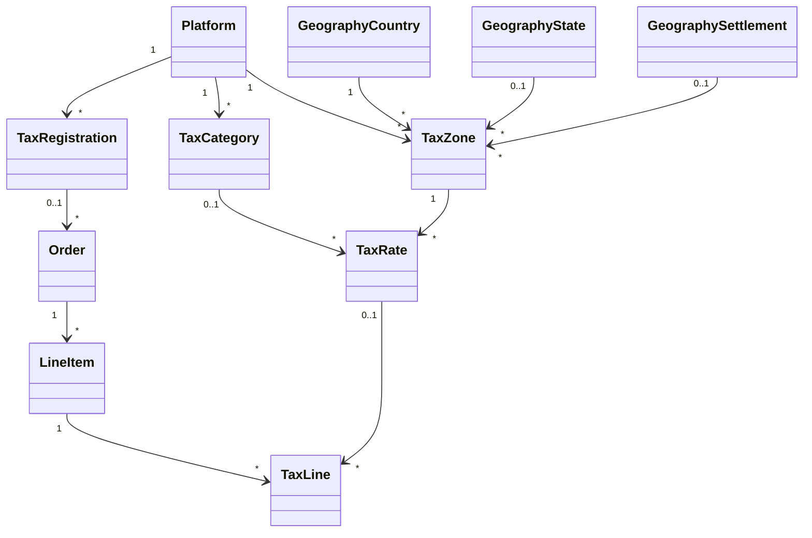

# Billing Tax

Community Engine works out tax itself for every order, whatever the way of paying (a processor, cash, a cheque, an e-transfer, store credit), so the amount an order asks for is the same on every route. This page covers what is built so far: the data and the calculator. Screens for registering come in a later change, and so do reports.

An order with no tax registration behind it has no tax lines and the totals it always had.

## Model

**Diagram files:**
- 📊 [Mermaid model](../diagrams/source/billing_tax_model.mmd)
- 🖼️ PNG and SVG exports are rendered by the maintainers (`bin/render_diagrams`)

| Table | Holds | Rules |
|---|---|---|
| `billing_tax_registrations` | Who collects: the platform (no seller) or a seller; country and region; `status`; `prices_include_tax` (empty means the country's usual way); the registration number (encrypted); when it is in force | Only `registered` collects. `small_supplier_exempt`, `exempt` and `not_collecting` charge no tax |
| `billing_tax_categories` | What kind of thing is sold; `taxable` | A category that is not taxable (fresh produce) is never taxed. A plan or line with no category is taxed as standard |
| `billing_tax_zones` | A place, as geography rows: a country, a state or province of it, or a settlement (a city or town) in it | A zone covers a place when its country matches and its state and its settlement are each either empty or the place's. Tax at every level that covers the place is added together |
| `billing_tax_rates` | One tax in one zone: label, rate as a fraction, when it applies, optionally one category | Discarded, never deleted, so past tax lines keep pointing at it |
| `billing_tax_lines` | One tax on one line of one order, with the label and rate copied when the order was placed | `included` means the amount is inside the price. Composite foreign keys with the platform |

`orders` and `line_items` also keep `tax_cents` and `included_tax_cents`; `orders` keep the place the tax was worked out for (country, region and, when the buyer's place was a city or town, the settlement) and the registration used. Plans and line items carry a `tax_category`.

## How tax is worked out (`Tax::Calculator`)

It reads plain values, writes nothing and can be run again with the same answer.

1. **Whose tax.** The seller's own registration if the seller has one in force, otherwise the platform's. If that registration does not collect, or there is none, there is no tax.
2. **Where.** The buyer's place when `Orders::Place` is given a `tax_address` (`country_iso:` and `region_code:`, or a `settlement:`), otherwise the registrant's own place. `Tax::Place` turns it into geography rows: a settlement brings its state and country, and an ISO country and region code find the `Geography::Country` and `Geography::State` (`CA` and `NL` find `CA-NL`). A place the geography does not hold has no zones, so it has no tax.
3. **How much.** For each item: skip it if its category is not taxable; take every rate in force for the place that fits the category; apply each to the item's amount. Store credit and other payments never change the amount tax is worked out on.
4. **Inclusive or added.** When prices include tax the tax is taken out of the price (`amount * rate / (1 + sum of rates)`) and the total does not change; otherwise it is added. Each amount is rounded half up to the minor unit.

The default for `prices_include_tax` comes from the country (`Tax::Defaults`): inclusive in most of the EU, the UK, Australia, New Zealand and similar; added in Canada and the United States. A registration can override it.

## Placing an order

`Orders::Place` works out the tax once, from the same amounts it builds the order from, and `Orders::ApplyTax` copies it onto the unsaved order, its lines and a tax line per tax. `Order#total_up` then sets `total_cents = subtotal_cents + tax_cents - included_tax_cents`. `PaymentParts` checks the parts against that same total. After placing, the tax is not worked out again, so a rate change never changes an order that exists.

## Which registration applies

A platform (or seller) may hold registrations for several places. A registration is for a country, and optionally one state or province of it, chosen with the same geography selects the address form uses; the codes tax is looked up by (`country_iso`, `region_code`) follow the chosen records, and the records are the same ones the tax zones use. For a sale the calculator picks the seller's registration, else the platform's, that covers the buyer's place: the buyer's country, a registration for the buyer's own region before a country-wide one, and the latest if several remain. A buyer somewhere no registration covers is not taxed. Without a buyer's place the latest registration is used, as before. "In force until" is a whole day: a registration stays in force to the end of the date chosen.

## The buyer's billing address

Checkout asks for a billing address before anything is placed (`Checkout::BillingAddressChoice`). The buyer picks one of their own addresses (those with a country and a state chosen from the geography lists, so tax can be matched by ISO code), or types a new one, which is saved to their contact details as a private postal address. "Use this as my default billing address" records a `Billing::DefaultAddress` (one per person, platform and kind, `billing` or `shipping`, with the address deleted along with it). Another person's address is refused.

The order keeps a snapshot of the address in `billing_address` (street, city, state, postal code, country, `country_iso`, `region_code`), so editing or deleting the address later does not change the record; `billing_address_id` points at the source and is emptied if the address is deleted. Tax is worked out for the address's place: its settlement when it has one (which brings municipal tax), otherwise its country and region codes. An explicit `tax_address` passed to `Orders::Place` still wins. Walk-up sales and renewals pass no address and are taxed for the registrant's own place as before.

The diagram `billing_tax_model` shows the new columns and the default address table. Sellers who are non-collecting or small suppliers charge no tax, as above; the platform-operator goods rule stays documented and deferred until shippable goods exist.

## Municipal tax

Some US cities and counties tax sales on top of the state's. The design holds this without any special case: a zone may name a settlement (`Geography::Settlement`), and a settlement knows its state and country, so a municipal zone needs only the settlement. Rates in a municipal zone stack with the state's and the country's, in the same calculation, the same inclusive or added rules and the same rounding. Orders keep the settlement they were taxed for (`tax_settlement_id`). No municipal data is seeded; a platform adds the zones and rates it needs, or a seed packet may name a `settlement_identifier` for a zone.

## Tax seed packets (`Tax::Seeds::Planter`)

Tax reference data ships as seed packets, the same Seed envelope the rest of Community Engine uses (`BetterTogether::Seed`, YAML under `config/seeds/better_together/billing/`). `Tax::Seeds::Planter.call(platform:, identifier: 'billing_tax_canada')` records the packet as a Seed row (versioned, exportable), then adds its categories, one zone per place it names and the rates in force there. Zones are tied to the seeded geography: the packet names `CA-NL`, and the zone keeps the `Geography::State` row, so the geography countries and provinces have to be planted first (the planter raises `Missing`, and plants nothing, if they are not). It only adds what is missing and never changes a rate that exists. The seed catalog page (`/host/seeds/catalog`) lists the packet under "Sales Tax Reference Data", with the countries and the provinces as its prerequisites, and plants it on the host platform.

### Canadian packet (`billing_tax_canada`)

A zone per province and territory, the rates in force there, and two categories (`standard`, and `basic_groceries` which is not taxable). It is not planted automatically.

| Place | Tax |
|---|---|
| AB, NT, NU, YT | GST 5% |
| BC | GST 5% and PST 7% |
| MB | GST 5% and RST 7% |
| SK | GST 5% and PST 6% |
| QC | GST 5% and QST 9.975% |
| ON | HST 13% |
| NS | HST 14% (15% before April 1, 2025) |
| NB, NL, PE | HST 15% |

Every figure carries its official source link and the date the page shows in the comments of `config/seeds/better_together/billing/billing_tax_canada.yml`. That file also holds the small supplier limits (GST/HST $30,000, or $50,000 for a public service body; B.C. PST small seller $10,000; Saskatchewan small trader $10,000; Manitoba $30,000; Quebec $30,000) for the monitor planned in T5.

Revenu Quebec refuses plain automated reads (HTTP 403). Its pages, and the Saskatchewan grocery bulletin PST-2, were read with the repo's Camoufox browser session, one page at a time with pauses, and the packet records each page's date. Quebec: QST 9.975% on the price before GST, basic groceries zero-rated, small supplier limit $30,000. Saskatchewan: basic groceries exempt from PST.

### Who collects when a seller sells through the platform

British Columbia (Bulletin PST 142), Saskatchewan (Bulletin PST-5) and Manitoba (The Retail Sales Tax Act, s. 21.2(2)) each say a seller who sells only through a marketplace need not collect the provincial tax when the marketplace operator collects the buyer's payment and the tax. Community Engine follows that: a seller may be `not_collecting` while the platform is the registrant only when the seller's payments do not go through the platform's own payment processors. That check is built with the seller settings in T2.

### Platform operators and sellers who are not registered

The CRA (Excise Tax Act, sections 211.21 and 211.25, in effect July 1, 2021) makes a registered distribution platform operator collect GST/HST on goods delivered in Canada that are sold through its platform by vendors who are not registered for the GST/HST, a Canadian small supplier included. An operator is a platform that controls the essential elements of the sale or collects and passes on the payment; a payment processor alone, or a listing alone, is not an operator. For digital products and services the rule reaches only non-resident suppliers. Revenu Quebec has a matching QST rule for goods delivered in Quebec, and for services and digital property supplied by sellers outside Quebec. Today's plans and line items are services and digital items by sellers on the platform, so these goods rules are not triggered. They will matter when shippable goods are added: a seller with `small_supplier_exempt` status selling goods through the platform will need the platform's registration applied instead of no tax. Sources and page dates are in the packet comments.

## Processors and renewals

A processor checkout session is given the order's tax (`tax_cents`, `included_tax_cents`, `prices_include_tax`) and may report the `tax_cents` it will charge; a reported tax that differs from the order's raises the same notice when the session is created. An adapter whose `create_checkout_session` does not name those keywords (or accept `**`) is not handed them, so older adapters keep working and charge their own amount, which `Payments::Succeed` then flags. `Payments::Succeed` records the amount actually charged and, if it differs from the amount core asked for, tells the operators once (`payment_amount_mismatch`). A subscription renewal is an ordinary order placed through the same calculator, taxed for the place the subscriber was last taxed for (the latest invoice's, else the order that started the subscription) with the rates and registration in force at the time of the invoice.

## Refunds

A refund keeps `tax_cents`: its share of the order's tax, pro-rated at the time it is recorded (`Refunds::ProRatedTax`), never worked out again from today's rates. The share is the refund's part of the order total, rounded half up; the refund that completes what the order took in takes the tax that is left, so refunded tax equals the order's tax to the cent. `Refund#net_cents` is the amount without the tax. The refund forms on a sale tell the seller how much tax the order carries.

## Where tax shows

One value object, `Orders::Summary` (built `for_order` or, at checkout, `for_preview`), feeds every surface, so the figures, the rows and their order cannot differ. The web partial `billing/_order_summary` and the email partials draw it.

| Place | What the reader sees |
|-------|----------------------|
| Order and sale details | The line table, with a Taxed or Not taxed marker on each line when the order carries tax (an untaxed order keeps three columns). Under it, right-aligned: subtotal, one row per tax (name, rate, the amount it applies to, the tax, "included" when inside the price), the total, then the registration numbers by tax. |
| Checkout | The compact summary (rows and registration numbers) for the chosen billing address, from the same calculator as placing the order (`Checkout::TaxPreview`). Without an address, a note that tax is worked out once one is chosen. |
| Offline payment instructions | The compact summary for a taxed order, above how to pay. |
| Notice emails (HTML and text) | The full summary, registration numbers included, and never payment instructions or payee details. |
| In-app notification | The short line: the total with the tax in it ("$51.75 (including $6.75 tax)"). |
| Sales list | A Tax column per sale, the same total; a dash when there is none. |

HST is one row, never split. Rows are grouped by label, rate and whether the tax is inside the price, so a tax charged on several lines reads as one row; its base is the sum of the taxed lines (with any tax inside the price taken out). Tax rates apply to each line separately, never compounded.

### Registration numbers

Each `billing_tax_lines` row keeps the number of the registration that collected it (`registration_number`, encrypted, nullable, a snapshot: no backfill, later changes to a registration do not touch placed orders). The calculator takes, for each rate, the registrant's registration for the rate's own place, a region-specific one before a country-wide one, so a Quebec order shows the federal number under GST and Quebec's under QST. A rate with no number to show leaves that tax out of the list. Only presence is validated; the number's format is not checked. The notes follow the CRA and Revenu Quebec invoice rules (supplier number and each tax shown for supplies of $100 or more) and Manitoba Bulletin 004 (price and tax stated separately).

Screenshots: `docs/screenshots/{desktop,mobile}/billing_tax_{quebec,bc}_{order,checkout,offline,email}.png`.

## Not built yet

The seller's agreement to collect tax, and monthly, quarterly and yearly reports. Processor receipts are the processor's own pages, so tax shows there only if the processor puts it there; our notices carry the tax amount. See the plan for the stages.

## Sellers: a later phase

Registrations, categories and the calculator already support a seller (a community or a person) having a registration of their own: the columns, the `SellerScoped` rules and the calculator's seller-then-platform choice are in place, and tests cover them. What is not built yet is anything a seller uses themselves: a seller's tax settings screen, the seller's tax collection agreement, and the community or person authorization it needs. That work is deliberately left until the platform-level billing system has been merged, deployed and tested; nothing in the design blocks it, and it will add a community branch to `OwnerPolicy` rather than change the platform screens.
