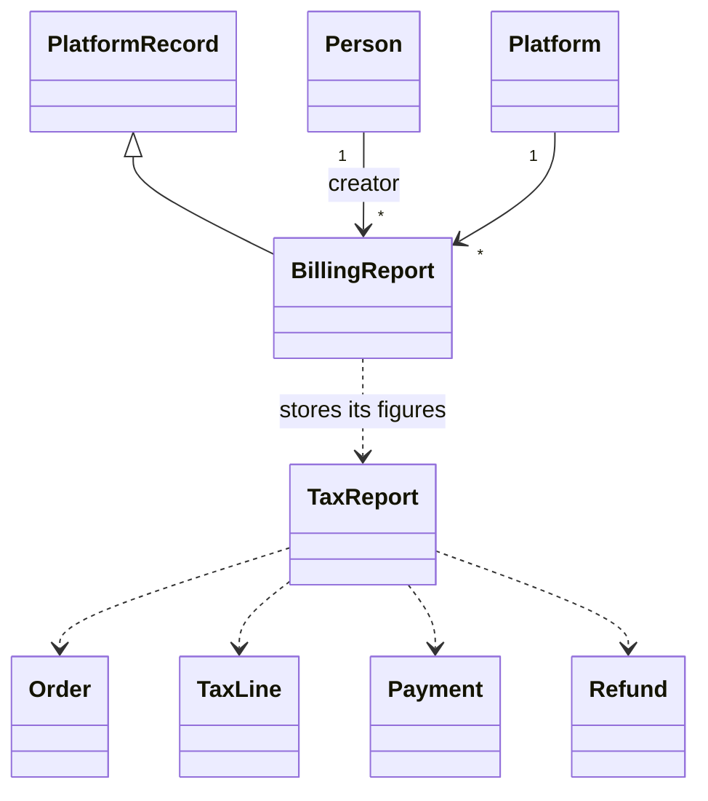

# Billing Tax Reports

The Billing tab of the metrics dashboard (Reports, under the host dashboard) shows sales, revenue, tax collected, refunds and the ways people paid, by month, quarter or year, with charts and a CSV file you can save and download. It covers the platform level only. A seller's own reports are a later phase; the design already allows them (see below).

## Who can see it

Someone who can see the metrics dashboard and who also manages the platform (`manage_platform`). Billing must be switched on for the platform. Everyone else gets no tab, no charts and no saved reports; the policy is `Metrics::BillingReportPolicy`, and every lookup stays inside the current platform.

## What the figures mean

- **Sales** are orders that are `paid`, `partially_refunded` or `refunded` (`Billing::TaxReport::SALE_STATUSES`), counted on the day they were paid in the platform time zone.
- **Revenue** is the price without any tax inside it, in four parts: taxable (the line has tax lines), zero-rated (categories `zero_rated` and `basic_groceries`), non-taxable (any other category that is not taxable) and exempt (nothing was charged on it).
- **Tax collected** is by tax label and rate, whether it was inside the price, the administrator it is owed to (GST/HST, PST, QST, RST, VAT) and who collected it: the seller, the platform, or the platform for the seller (a facilitator sale, not on the seller's own return). A per-administrator total, a per-region summary and the registrations the orders were taxed under are shown too; registration numbers are masked to the last four characters because saved reports are stored.
- **Basis**: a saved report counts a sale on the day it was paid (default) or the day it was placed (invoice date, as CRA expects for most filers). Paid statuses are still required.
- **Refunds** count when they are `succeeded` or `recorded`. Each carries its share of tax, split from its net amount (the same split the refund screen shows), and is netted off in the period the refund was made.
- **Payment methods** are the payments that succeeded, by processor.
- **Each currency is shown on its own.** Amounts are never added across currencies.
- **Owner** is all, the platform only, or one seller.

## Where it lives

| Piece | What it does |
|---|---|
| `Billing::TaxReport` | The query layer: one span, owner and interval in, per-currency summaries out |
| `Metrics::BillingReport` | A saved report: filters, the figures, a CSV file (table `better_together_metrics_billing_reports`) |
| `Metrics::GenerateBillingReportJob` | Builds and attaches the CSV, then tells the maker the file is ready |
| `Billing::TaxReport::Csv` | The CSV: one block per currency, with decimal amounts and no formula injection |
| `Billing::TaxReport::ChartData` | Chart data in the shapes the metrics charts already use |
| `Metrics::BillingReportsController` | Saved reports: list, make, download, delete |

The charts are fed by two JSON endpoints on the metrics reports controller, `billing_revenue_data` and `billing_tax_by_rate_data`, and drawn by the metrics charts Stimulus controller, so the date range and filters work as they do on every other metrics tab. The report row uses the same Action Cable channel as the user account reports to turn into a download link when the file is ready.

## Diagram

**Diagram files:**
- 📊 [Mermaid model](../diagrams/source/billing_tax_report_model.mmd)
- 🖼️ PNG and SVG exports are rendered by the maintainers (`bin/render_diagrams`)

## Sellers: a later phase

`TaxReport::Owner` already accepts a seller (`Type:id`, only for types in `SellerScoped.assignable_types`), and a saved report keeps the owner in its filters. No seller screen, route or permission exists yet.

## Screenshots

`docs/screenshots/{desktop,mobile}/billing_tax_reports_*.png`, made by `spec/docs_screenshots/better_together/billing_tax_reports_spec.rb`.

## Tests

`spec/models/better_together/billing/tax_report_spec.rb`, `tax_report/csv_spec.rb`, `tax_report/chart_data_spec.rb`, `spec/models/better_together/metrics/billing_report_spec.rb`, `spec/policies/better_together/metrics/billing_report_policy_spec.rb`, `spec/requests/better_together/metrics/billing_reports_spec.rb`, `spec/jobs/better_together/metrics/generate_billing_report_job_spec.rb` and the DOM contract `spec/dom_contracts/billing_tax_reports_spec.rb`.
