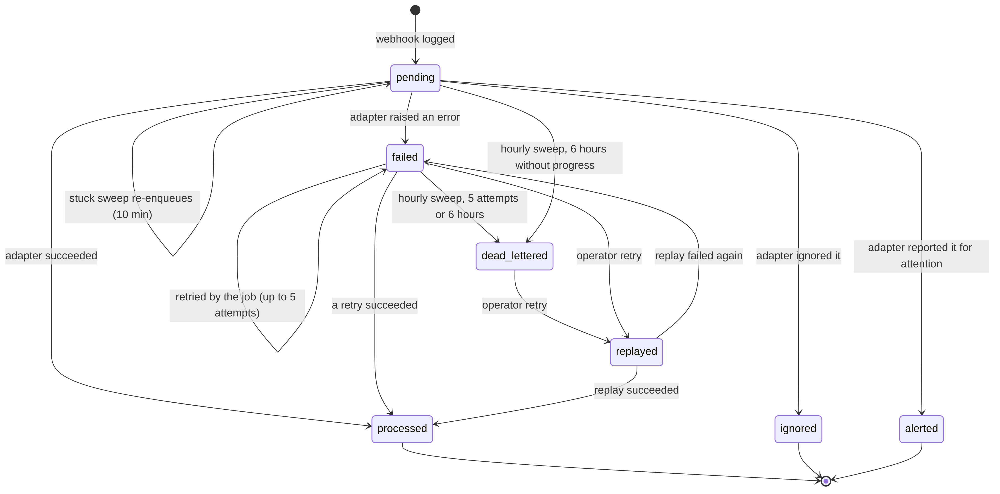
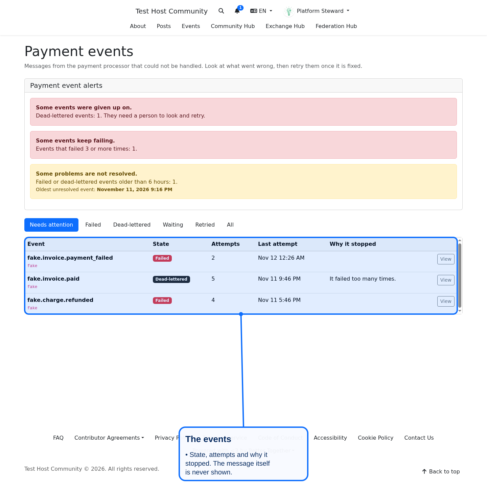
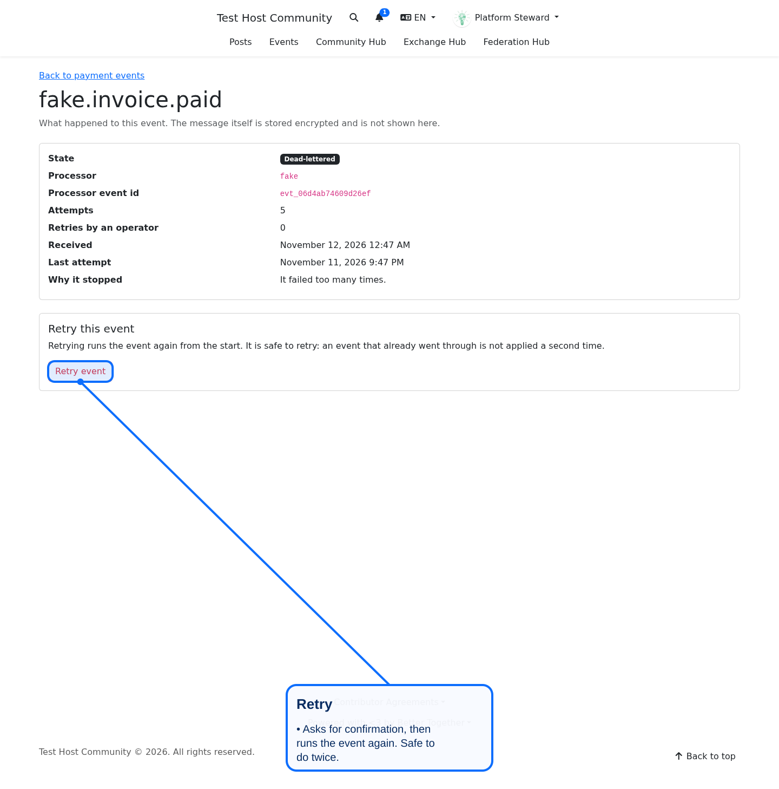

# Webhook event operations

What to do when a payment processor event does not go through. This is the operator runbook for `Billing::Event`, the processor-neutral log of webhook events. It applies to every processor adapter, not to one vendor.

Who can do it: **host platform operators only**, that is a person who can manage the host platform. Another platform's stewards cannot see or retry events. The pages and tasks never show the event payload or the error text, which are stored encrypted.

## How an event moves



- [Mermaid source](../diagrams/source/billing_event_lifecycle_state.mmd)
- [PNG export](../diagrams/exports/png/billing_event_lifecycle_state.png)
- [SVG export](../diagrams/exports/svg/billing_event_lifecycle_state.svg)

The wider path, from the processor's webhook to the event log, is in [processor adapters](processor-adapters.md#retries-dead-letters-and-replay).

| State | Meaning | Needs an operator |
|-------|---------|-------------------|
| `pending` | Logged, waiting for a job or for a retry wait to end | Only if it stays pending |
| `processed`, `ignored`, `alerted` | Final outcome reached | No |
| `failed` | The adapter raised an error; the job retries up to 5 attempts | After the retries stop |
| `dead_lettered` | Given up on: 5 attempts used, or 6 hours without progress | Yes |
| `replayed` | An operator asked for another run | No, unless it fails again |

## Automatic help

Two sweeps run on the billing queue, so most events never need a person:

- `EnqueueStuckBillingEventsJob`, every 10 minutes. A `pending` event that never got a job (a lost enqueue, a flushed queue) or whose last retry wait ended more than 35 minutes ago gets a processing job. It skips an event a job currently holds, and one the next sweep is about to dead-letter. Repeating it is harmless: processing takes a lease and skips final outcomes.
- `DeadLetterStaleBillingEventsJob`, hourly at :15. Moves exhausted or stale events to `dead_lettered` and tells the operators.

Both are registered in `config/sidekiq_scheduler.yml`.

## Look at the events

Page: **Payment events** (`/billing/events`), reachable from the host dashboard navigation and from the payment methods page. It shows an alerts card (dead-lettered, repeated failures, older than one reconciliation window) and a list you can filter by state: needs attention, failed, dead-lettered, waiting, retried, all. Open an event to see its state, attempts, reason and history.

Rake, read only:

```bash
bin/rails "better_together:billing:list_events"                 # failed and dead-lettered
bin/rails "better_together:billing:list_events[dead_lettered]"  # or failed
bin/rails "better_together:billing:show_event[EVENT_ID]"
```



## Retry

Check first why it stopped. A retry runs the event again from the start with a fresh attempt count. If the cause is not fixed (processor still down, platform setting missing), it just fails again.

On the page: open the event, press **Retry event**, confirm. The button is absent when a retry is not possible.

With rake, which only reports until `APPLY=1`:

```bash
# 1. See what would happen. Nothing changes.
bin/rails "better_together:billing:replay_event[EVENT_ID]"
ALL=1 bin/rails "better_together:billing:replay_event"

# 2. Do it. OPERATOR is the id of a person who manages the host platform.
APPLY=1 OPERATOR=PERSON_ID bin/rails "better_together:billing:replay_event[EVENT_ID]"
APPLY=1 OPERATOR=PERSON_ID ALL=1 bin/rails "better_together:billing:replay_event"
```

Output is one line per event: `would replay`, `replayed`, or `refused (reason)`. The operator is recorded on the event.

A retry is refused when the event is not failed or dead-lettered (`not_replayable`), its payload was already redacted (`payload_unavailable`), its processor is no longer installed (`unsupported_processor`), or the platform no longer has the processor configured (`platform_not_configured`).



## Is it safe to retry twice?

Yes.

- A replay moves the event to `replayed`. A second request for it finds it is no longer a problem and is refused, so it queues one job.
- If two jobs for one event still arrive, processing takes a lease under a row lock and skips an event whose outcome is already final, so the adapter runs once.
- Notifications use a dedupe key per event, so people are told once.
- Adapters must be idempotent anyway: a job that fails after the adapter acted is retried. See [processor adapters](processor-adapters.md#retries-dead-letters-and-replay).

Specs: `spec/services/better_together/billing/event_replay_idempotency_spec.rb` and the rake and controller specs.

## When the payload is gone

Payloads are redacted after the retention window (`BT_BILLING_EVENT_PAYLOAD_RETENTION_DAYS`, default 30 days). A redacted event cannot be retried. The processor can send it again, or the state can be repaired from the processor's side.

## Events that never reached the log

A webhook that could not be attributed to one platform is not stored as an event. Pay keeps the delivery. List and reprocess them with `better_together:billing:pay_webhooks` and `better_together:billing:reprocess_pay_webhook[ID]`; see [processor adapters](processor-adapters.md).

## Pausing billing

The kill switch is still `BT_BILLING_ENABLED` and needs a restart. See [billing queue rollout](../production/billing_queue_rollout.md).
