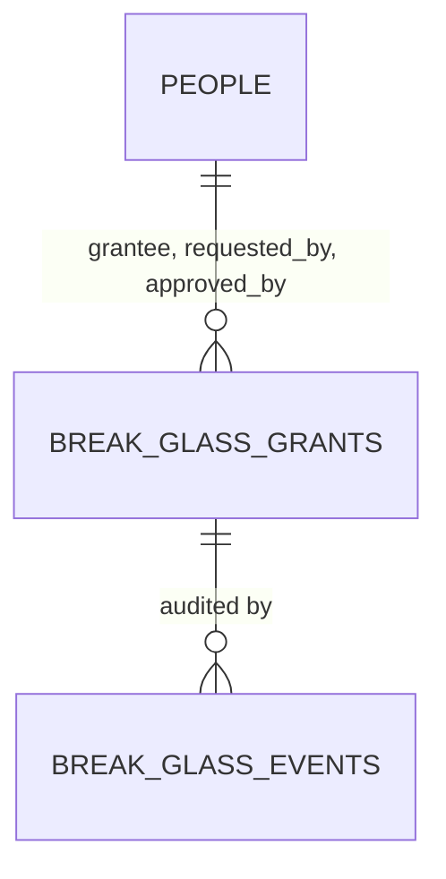

# Break-glass disclosure

Break-glass is the only way a person reads a private record they could not otherwise read. It exists because the access contract says no standing role discloses private content or personal data: operating a platform, reviewing safety reports and disclosing private content are three separate kinds of authority, and the third has no standing holder.

This page covers stack 1 (model, audit trail, request and revoke). Nothing consults a grant yet, so this change widens no one's access. Later stacks add the policy hook (communities first), member notice and objection with a "who accessed my data" view, then the other subsystems.

## The grant

A `BreakGlassGrant` lets one person (the grantee) read one record (the subject). It is read only.

| Field | Meaning |
| --- | --- |
| `subject` | The record. Only types in `BreakGlassGrant::SUBJECT_TYPES` are allowed (communities first); never constantized from input. |
| `reason` | Required, at least 20 characters. |
| `emergency`, `reason_code` | An emergency grant is usable at once, needs a reason code and is flagged in the audit trail. |
| `available_at` | Request time plus 24 hours, so the affected member can be told before anything is read. Emergencies start immediately. |
| `expires_at` | Defaults to 24 hours after `available_at`; never more than 7 days. |
| `status`, `revoked_at` | `requested` or `revoked`. Pending, active and expired are derived from the timestamps, so no job has to flip a flag. |

`BreakGlassGrant#active_now?` is the only question a policy asks.

## Who may request

Only a holder of the sealed `manage_break_glass_disclosure` permission on the record's platform. It belongs to the `platform_disclosure_officer` role, which is assigned to no one by default and which no other role (steward, manager, technical roles) holds. `BreakGlass::Request` checks it again, so no caller can skip it. The requester may be the grantee; when no deputy or witness is configured the grant self-approves by waiting out the delay, with every step audited. A configured deputy may approve emergencies later.

## Audit trail

`BreakGlassEvent` rows are append-only: they cannot be updated or destroyed, and neither can a grant. Events are `requested`, `revoked` and `accessed` (one row per read made under a grant, written by `BreakGlass::RecordAccess`).

**Diagram files:**
- [Mermaid source](../../diagrams/source/break_glass_disclosure_erd.mmd)
- [PNG export](../../diagrams/exports/png/break_glass_disclosure_erd.png)
- [SVG export](../../diagrams/exports/svg/break_glass_disclosure_erd.svg)

## Revoking

The requester, the grantee and any holder of the sealed permission may revoke at any time (`BreakGlass::Revoke`). Revoking is idempotent and audited.

## Upgrading a host app

The `SeedBreakGlassDisclosureRole` migration adds the permission and the sealed role to every platform that has roles. It grants the role to no one.

## Not built yet

Policy hook, member notice, objection window, the "who accessed my data" view, a request UI, deputy approval, and any subject type beyond communities.
