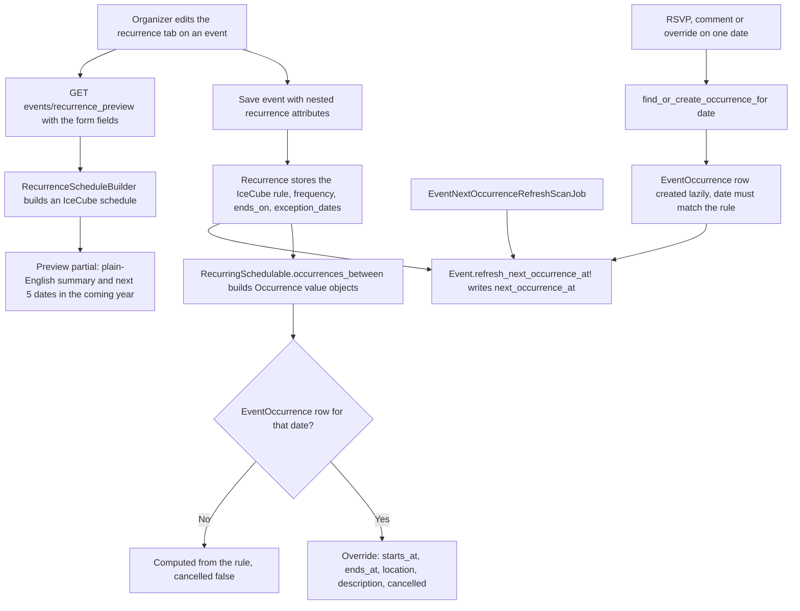

# Event Recurrence and Occurrences

Events can repeat. A repeating event is one `Event` row plus a `Recurrence` that stores the rule. Individual sessions are **not** stored: they are computed from the rule, and a database row (`EventOccurrence`) is created only when someone attaches something to a specific date (an RSVP, a comment, or an organizer override such as a cancellation). This page describes how the pieces fit; for events generally see [Events System](events_system.md) and [Event Invitations and Attendance](event_invitations_and_attendance.md).

## Components

| Piece | File | Role |
|---|---|---|
| `BetterTogether::Recurrence` | `app/models/better_together/recurrence.rb` | Polymorphic `schedulable`; stores the IceCube `rule` (YAML), `frequency`, `ends_on`, `exception_dates`; answers `occurrences_between`, `next_occurrence`, `interval`, `weekdays`, `end_type`, `count`, `month_option` |
| `RecurringSchedulable` | `app/models/concerns/better_together/recurring_schedulable.rb` | Adds `has_one :recurrence` (with nested attributes), `recurring?`, `schedule`, `occurrences_between`, `next_occurrence`, `create_recurrence!` |
| `RecurrenceScheduleBuilder` | `app/services/better_together/recurrence_schedule_builder.rb` | Builds an `IceCube::Schedule` from form attributes (frequency, interval, weekdays, month option, end type) and reports errors |
| `BetterTogether::Occurrence` | `app/models/better_together/occurrence.rb` | Plain value object for one session: start and end time, location and description, `cancelled?`, with override values when a row exists and delegation to the event otherwise |
| `BetterTogether::EventOccurrence` | `app/models/better_together/event_occurrence.rb` | The lazily created override row (`better_together_event_occurrences`) |
| `EventNextOccurrenceRefreshScanJob` | `app/jobs/better_together/event_next_occurrence_refresh_scan_job.rb` | Keeps `events.next_occurrence_at` fresh as time passes |
| `EventOccurrencesController` | `app/controllers/better_together/event_occurrences_controller.rb` | Per-session update, RSVP and comment actions |
| `RecurrenceHelper#recurrence_attrs_summary` | `app/helpers/better_together/recurrence_helper.rb` | Plain-English rule summary used by the preview |

## Flow

**Diagram files:** [Mermaid source](../../diagrams/source/event_recurrence_occurrences_flow.mmd), [PNG](../../diagrams/exports/png/event_recurrence_occurrences_flow.png), [SVG](../../diagrams/exports/svg/event_recurrence_occurrences_flow.svg).

## The rule

`Recurrence` validates that `rule` is a loadable IceCube schedule, that an end condition is present, and that exception dates parse; `frequency` is extracted from the rule and must be `daily`, `weekly`, `monthly` or `yearly`.

`RecurrenceScheduleBuilder` maps the form to a rule:

| Attribute | Effect |
|---|---|
| `frequency` | `daily`, `weekly`, `monthly` or `yearly`; anything else is `frequency_invalid` |
| `interval` | Every N units; values below 1 become 1 |
| `weekdays` | Weekly only: indices 0 to 6 (Sunday first) become `day` constraints |
| `month_option` | `day_of_month` (default) or `day_of_week`, which pins the weekday and position of the start date ("the 3rd Tuesday"; the last week is used when the month has no fifth occurrence) |
| `end_type` | `never`, `until` (with `ends_on`) or `count` (with `count`); `count` requires a number |

`Recurrence#occurrences_between` removes dates listed in `exception_dates`. `next_occurrence` skips exceptions, stops after `ends_on`, and gives up after 1000 iterations.

## Occurrences

`RecurringSchedulable#occurrences_between(start, end)` returns one `Occurrence` object per computed date (for a non-recurring event it returns the event itself). Each object looks for an `EventOccurrence` row on that date; if one exists its overrides win.

`EventOccurrence` (unique on `event_id` and `occurrence_date`) holds `starts_at`, `ends_at`, `cancelled`, a rich-text `description_override`, a location (through `Geography::Locatable::One`; it skips the map callbacks so a session reuses its parent's map), comments, and attendances (`event_attendances.event_occurrence_id`). Its `effective_*` readers fall back to the event, and a validation rejects a date the rule does not actually produce, or an event that is not recurring.

**Write path.** `Event#find_or_create_occurrence_for(date)` is the only intended way to create a row. Call it when something attaches to a date; never from a read or display path. Routes: `resources :occurrences, only: [:update], param: :occurrence_date` with `rsvp_interested`, `rsvp_going`, `rsvp_cancel` and `comments`; the parameter is an ISO 8601 date, not a record id. `EventOccurrencePolicy` allows the creator, a platform steward or an event host to update; `show?` follows the event's own policy.

## `next_occurrence_at`

`events.next_occurrence_at` is a denormalised "when does this event next happen" value used for ordering and the upcoming lists. `Event#refresh_next_occurrence_at!` computes it (the next non-cancelled occurrence for a recurring event, `starts_at` otherwise) and writes it with `update_column`. It runs after save when the temporal fields changed, after a `Recurrence` or `EventOccurrence` commit, and from `EventNextOccurrenceRefreshScanJob` (queue `maintenance`), which refreshes every recurring event whose stored value is already in the past.

## Preview endpoint

`GET /events/recurrence_preview` (`EventsController#recurrence_preview`, authorised with `recurrence_preview?`) accepts `frequency`, `interval`, `end_type`, `ends_on`, `count`, `month_option` and `weekdays[]`, builds a schedule starting now, and renders `events/_recurrence_preview` with the plain-English summary and up to five dates in the next year, or a single error line. A blank `frequency` returns an empty preview.

## Tests

`spec/models/better_together/recurrence_spec.rb`, `event_occurrence_spec.rb`, `occurrence_spec.rb`, `spec/services/better_together/recurrence_schedule_builder_spec.rb`, `spec/jobs/better_together/event_next_occurrence_refresh_scan_job_spec.rb`, and the screenshot spec `spec/docs_screenshots/better_together/recurrence_calendar_ux_spec.rb`.

## Related

- [Events System](events_system.md)
- [Event Invitations and Attendance](event_invitations_and_attendance.md)
- [Mapping System](mapping_system.md)
