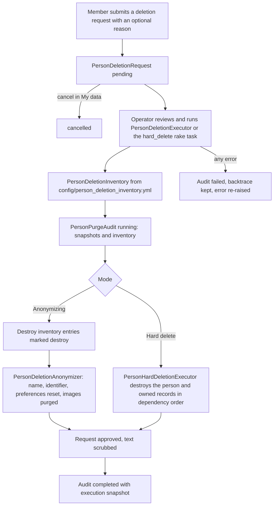

# Person Deletion Requests and Purge Audits

Members can ask for their account to be deleted. This page covers the data model and the two executors (anonymizing and hard deletion) added in 0.11.0, and how every run is recorded. The member-facing screens are in [Account Deletion Requests](../../end_users/account_deletion_requests.md) and [My Data and Exports](../../end_users/my_data_and_exports.md); exports are in [Personal Data Exports and Seeds](personal_data_exports_and_seeds.md).

## Models

| Model | Table | Role |
|---|---|---|
| `PersonDeletionRequest` | `better_together_person_deletion_requests` | The member's request: `person`, `platform`, `requested_reason`, `requested_at`, `status` (`pending`, `cancelled`, `approved`, `rejected`), `reviewed_by`, `reviewer_notes`, `resolved_at` |
| `PersonPurgeAudit` | `better_together_person_purge_audits` | One row per deletion run: `status` (`running`, `completed`, `failed`), snapshots of the person and the request text, `inventory_snapshot` and `execution_snapshot` JSON, error message, and timestamps |

A person can have only one pending request (`single_active_request` on create). `cancel!`, `approve!(reviewed_by:, reviewer_notes:)` and `reject!` set the status and `resolved_at`. The audit keeps its own snapshots (email, identifier, name, reason, reviewer notes) because the person and user rows may be gone afterwards; its `person`, request and reviewer links are optional, and deleting a request nullifies the link.

## Member actions

`PersonDeletionRequestsController` (`resources :person_deletion_requests, only: [:create, :destroy]`) lets a signed-in member create a request, with an optional reason, and cancel their own pending request from the settings "My data" area. There is no screen for reviewing or approving requests: a platform operator runs the executors below, which approve the request as part of the run.

## The inventory

`config/person_deletion_inventory.yml` lists every place that holds a person's data. `PersonDeletionManifest` loads it and `PersonDeletionInventory.call(person:)` resolves it for one person into entries (`key`, `action`, `kind`, `model`, `count`, `ids`, `concern`, `reverse_association`). Entry kinds: `self` (the user and person rows), `owner_association`, `model_reference` (a model that references the person, for example `PersonLink#source_person`, `PersonMessagingGrant#grantor` or `MessageRequest` sender and recipient) and `creatable_creator_reference` (records created by the person, grouped by class). Actions: `destroy`, `anonymize` or `retain`.

Adding a model that references people means adding it to this file; `PersonHardDeletionInventory` is the stricter variant used for hard deletion.

## Executors



**Diagram files:** [Mermaid source](../../diagrams/source/person_deletion_pipeline_flow.mmd), [PNG](../../diagrams/exports/png/person_deletion_pipeline_flow.png), [SVG](../../diagrams/exports/svg/person_deletion_pipeline_flow.svg).

**`PersonDeletionExecutor.call(person_deletion_request:, reviewed_by:, reviewer_notes:)`** keeps the person row as an anonymised stub. In one transaction it approves the request, destroys the inventory entries marked `destroy`, runs `PersonDeletionAnonymizer`, and scrubs the request text. The anonymizer purges the profile and cover images, destroys the contact detail, and rewrites the person: name "Deleted person", a generated identifier, no description, `privacy: private`, preferences and notification preferences reset to defaults (for example `receive_messages_from_members: false`, `notify_on_comments: false`), `deleted_at` and `anonymized_at` set.

**`PersonHardDeletionExecutor.call(person:, person_deletion_request:, reviewed_by:, reason:)`** removes the person and the records they own. It builds the hard-deletion inventory, creates the audit, breaks the circular references of an owned community and calendars, destroys entries in dependency order (user and person first, deferred entries afterwards, with `ConversationParticipant` rows deleted directly), and records a verification snapshot of what remains. It runs with person touching disabled.

Both write a `PersonPurgeAudit`; on any exception the audit becomes `failed` with the message and the first 20 backtrace lines, and the error is re-raised.

## Running a hard deletion

```bash
# Dry run (default): prints the inventory for each person, changes nothing
bin/rails better_together:people:hard_delete PERSON_IDS=<uuid>[,<uuid>] 
# or by request
bin/rails better_together:people:hard_delete DELETION_REQUEST_IDS=<uuid>

# Execute: needs WRITE_ENABLE=true; REVIEWED_BY_ID and REASON are recorded on the audit
bin/rails better_together:people:hard_delete DELETION_REQUEST_IDS=<uuid> WRITE_ENABLE=true REVIEWED_BY_ID=<uuid> REASON="Member request, reviewed"

# Refuse to touch named people even if listed
... PRESERVE_PERSON_IDS=<uuid>
```

Without `WRITE_ENABLE` the task is a dry run. It raises when neither `PERSON_IDS` nor `DELETION_REQUEST_IDS` matches a person, and refuses people listed in `PRESERVE_PERSON_IDS`. The output is JSON with a mode, the audit id and status or the inventory.

## Tests

`spec/models/better_together/person_deletion_request_spec.rb`, `person_purge_audit_spec.rb`, `spec/services/better_together/person_deletion_executor_spec.rb`, `person_hard_deletion_executor_spec.rb`, `person_deletion_anonymizer_spec.rb`, `person_deletion_inventory_spec.rb`, `person_hard_deletion_inventory_spec.rb`, and the screenshot spec `spec/docs_screenshots/better_together/person_deletion_review_spec.rb`.

## Related

- [Person Links, Access Grants and Messaging Permissions](person_links_grants_and_messaging_system.md)
- [Security Protection System](security_protection_system.md)
