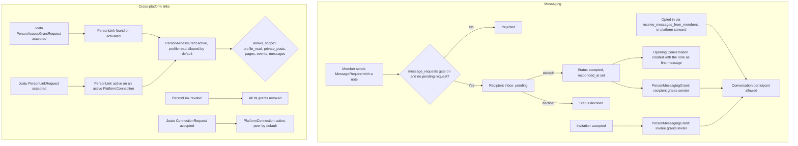

# Person Links, Access Grants and Messaging Permissions

Three small permission systems added in 0.11.0 let one person deliberately open a door to another: **messaging grants and message requests** (who may start a conversation with whom), and **person links with access grants** (a verified relationship between people on connected platforms, and what the grantee may see). Joatu requests are the user-facing way to create the cross-platform records. This page is for developers; end users see [Message Requests and Linked Access](../../end_users/message_requests_and_linked_access.md).

## Models

| Model | Table | What it records |
|---|---|---|
| `MessageRequest` | `better_together_message_requests` | A note from `sender` to `recipient`, `status` `pending`, `accepted` or `declined`, `responded_at` |
| `PersonMessagingGrant` | `better_together_person_messaging_grants` | `grantor` allows `grantee` to message them on a platform |
| `PersonLink` | `better_together_person_links` | A relationship between `source_person` and `target_person` (or a remote identifier) over a `PlatformConnection`; `status` `pending`, `active`, `revoked` |
| `PersonAccessGrant` | `better_together_person_access_grants` | What a `grantee_person` may read of a `grantor_person` over one `PersonLink`; `status` `pending`, `active`, `revoked`, `expired` |
| `Joatu::PersonLinkRequest` | `better_together_joatu_requests` (STI) | Request whose acceptance creates a `PersonLink` |
| `Joatu::PersonAccessGrantRequest` | same | Request whose acceptance activates the link and creates an access grant |
| `Joatu::ConnectionRequest` | same | Request whose acceptance activates a `PlatformConnection` between two platforms |

The three Joatu classes are single-table subclasses of `Joatu::Request`. Each implements `after_agreement_acceptance!(offer:)`, which `Joatu::Agreement` calls when the agreement is accepted.

## Diagram

**Diagram files:** [Mermaid source](../../diagrams/source/person_links_grants_and_messaging_flow.mmd), [PNG](../../diagrams/exports/png/person_links_grants_and_messaging_flow.png), [SVG](../../diagrams/exports/svg/person_links_grants_and_messaging_flow.svg).

## Messaging

Who can be added to a conversation is decided by `ConversationPolicy#permitted_participants`, the union of:

1. platform stewards (a membership role with `manage_platform_members`, `manage_platform_settings` or `manage_platform`) who are active on the current platform;
2. people whose `preferences` have `receive_messages_from_members: true` (the "Receive messages from members" toggle in profile preferences);
3. people who gave the current agent a `PersonMessagingGrant` (the grant lists the grantor; `explicitly_granted_participants` looks up grants where the agent is the grantee).

Grants are created in two places:

- **Message requests.** `MessageRequest#accept!` runs in one transaction: it marks the request accepted, creates `PersonMessagingGrant(grantor: recipient, grantee: sender, platform:)` with `find_or_create_by!`, and builds the opening `Conversation` (creator `sender`, both as participants) whose first message is the request note. `decline!` only sets the status.
- **Accepted invitations.** `InvitationSessionManagement#grant_inviter_messaging_permission` creates a grant from the invitee to the inviter, so accepting an invitation consents to messages from that person without opting in to everyone.

Rules enforced by the model: the note is required and at most 1000 characters; a sender cannot request themselves; only one pending request per sender, recipient and platform; a grant is unique per grantor, grantee and platform and cannot be to oneself.

`MessageRequestPolicy` requires the `message_requests` feature gate (alpha in `config/feature_gates.yml`) for every action. Only the recipient may accept or decline; sender and recipient may view. Routes: `resources :message_requests, only: [:index, :show, :create]` with `PUT accept` and `PUT decline`. The index lists the current person's pending incoming requests.

## Person links and access grants

A `PersonLink` ties `source_person` on the connection's source platform to `target_person` on its target platform (or to an encrypted `remote_target_identifier` and name when the target is not local). Validations require an active membership of each person on the matching platform and uniqueness per connection. `settings` holds `reciprocal` and `link_origin` (default `joatu`).

`revoke!` revokes the link and, in the same transaction, every access grant that is not already revoked.

A `PersonAccessGrant` hangs off one link. The grantor must be the link's source person and, when local, the grantee its target person. `settings` flags control the scopes it allows:

| Flag | Default | Scope checked by `allows_scope?` |
|---|---|---|
| `allow_profile_read` | true | `profile_read` |
| `allow_private_posts` | false | `private_posts` |
| `allow_private_pages` | false | `private_pages` |
| `allow_private_events` | false | `private_events` |
| `allow_private_messages` | false | `private_messages` |

Any other scope name returns false. `current_active` is the scope that treats a grant as live (active, not revoked, not past `expires_at`); `active_now?` is the instance check. `remote_grantee_identifier` and `remote_grantee_name` are encrypted attributes.

Policies: `PersonAccessGrantPolicy` needs the `person_access_grants` feature gate (stable); the grantor may update or revoke, grantor and grantee may view. `PersonLinkPolicy` lets either side view and only the source person revoke. Routes: `access-grants` (index, show, update, `POST revoke`) and `person-links` (index, show, `POST revoke`); person links also appear on the "My data" page.

## Joatu requests that create these records

| Request class | Target must be | On acceptance |
|---|---|---|
| `PersonLinkRequest` | a `Person` | Finds an active `PlatformConnection` between platforms where both people are active members, then creates or updates the `PersonLink` as `active` with `verified_at` set. Raises `RecordInvalid` when no connection is found. |
| `PersonAccessGrantRequest` | a `Person` | Resolves or activates the link the same way, then creates or updates the grant as `active` (profile read allowed on creation). |
| `ConnectionRequest` | a `Platform` | Finds or creates the `PlatformConnection` between the offer's platform and the target and sets it `active` (`connection_kind` `peer` unless already set). |

## Privacy and deletion

Links, grants, messaging grants and message requests are listed in `config/person_deletion_inventory.yml`, so person deletion handles them (see [Personal Data Exports and Seeds](personal_data_exports_and_seeds.md)). The anonymizer resets `receive_messages_from_members` to false.

## Tests

`spec/models/better_together/message_request_spec.rb`, `person_messaging_grant_spec.rb`, `person_link_spec.rb`, `person_access_grant_spec.rb`, `spec/models/better_together/joatu/*_request_spec.rb`, `spec/policies/better_together/message_request_policy_spec.rb`, `conversation_policy_spec.rb`.

## Related

- [Conversations and Messaging](conversations_messaging_system.md)
- [Federation System](federation_system.md)
- [Feature Access Grants and Developer Settings](feature_access_grants_and_developer_settings.md) (feature gates)
