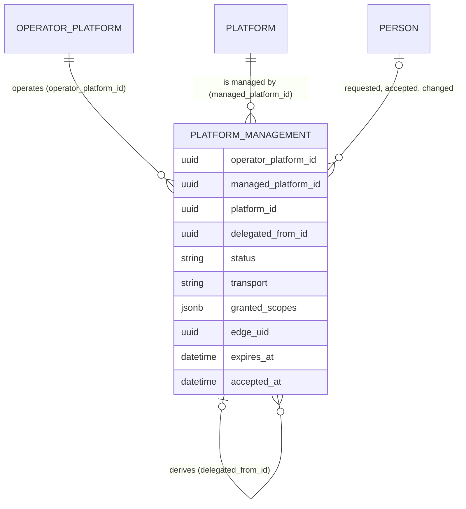

# Platform Management System

`BetterTogether::PlatformManagement` is the explicit, directed join between two platforms. It is the single place that answers "who operates whom". Nothing is implied by platform type, host flag or location: every relationship is a row that can be consented to, scoped, suspended, expired, revoked and audited.

Source: [platform_management_erd.mmd](../../diagrams/source/platform_management_erd.mmd)

## Rules

- Direction is operator to managed. The operator must be an `OperatorPlatform`; the managed platform must be a `HostedPlatform` or an `OperatorPlatform`. No self edge. One edge per (operator, managed).
- Status is a string enum: `requested`, `active`, `suspended`, `revoked`. Revoked is terminal. The managed side drives accept, narrow, suspend, resume and revoke.
- `granted_scopes` come from `PlatformManagement::SCOPES`. Accepting or narrowing can only remove scopes.
- `transport` is `direct` when both platforms are local to the instance and `http` when either is remote.
- `platform_id` (the `PlatformRecord` tenancy column) always mirrors `managed_platform_id`.
- `edge_uid` is the shared id the two sides of a remote relationship will use to mirror the record (transport is a later change).
- Graph: no cycles, and no chain longer than `MAX_DEPTH` edges.

## Delegation

A client host holding an edge over a hosted platform may pass a remote operator (for example BTS, which operates the client host) a narrower edge over that hosted platform. The derived edge sets `delegated_from_id` to the client host's edge and requires the operator to hold an edge over the client host. Its scopes must be a subset of the parent's.

Effectiveness is computed, never stored: a derived edge is effective only while it, its parent and the operator's upstream edge are all active and unexpired, and its effective scopes are the intersection with the parent's effective scopes. Suspending, revoking, expiring or narrowing an upstream edge therefore takes effect on every derived edge immediately. Authority is never transitive on its own: being the operator of an operator grants nothing without an explicit derived edge.

## Queries

- `PlatformManagement.operators_of(platform)` and `.managed_by(platform)` return platforms reached through effective edges.
- `PlatformManagement.effective_scopes_for(operator, managed)`.
- `PlatformManagement.authorizes?(user_or_person, platform, scope: nil)` is query only. It is not wired into Warden, JWT or policies.

## Authorization and audit

`PlatformManagementPolicy` checks `manage_platform` against the specific platform record: managed-platform stewards accept, narrow, suspend, resume and revoke; operator stewards may view and request. Lifecycle events go through `TenancyAudit.record` (`platform_management.requested|accepted|narrowed|suspended|resumed|revoked`); persistence of the audit is a later change.
