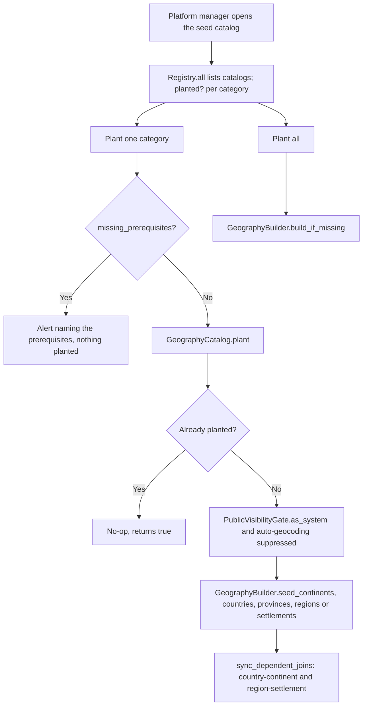

# Seed Catalog and Seed Plantings

Two related pieces handle seed data in 0.11.0: the **seed catalog**, which plants curated reference data (geography today) on demand from the host dashboard, and **seed plantings**, the audit records that track each time a seed is planted, imported or ingested from a federated peer. For personal seeds and exports see [Personal Data Exports and Seeds](personal_data_exports_and_seeds.md).

## Seed catalog

### Components

| Piece | File |
|---|---|
| `SeedCatalog::Registry` | `app/services/better_together/seed_catalog/registry.rb`: a frozen map of catalog key to catalog class (`geography`) |
| `SeedCatalog::GeographyCatalog` | `app/services/better_together/seed_catalog/geography_catalog.rb`: categories, planting state, prerequisites, planting |
| `SeedCatalogController` | `app/controllers/better_together/seed_catalog_controller.rb`: `index`, `plant`, `plant_all` |
| `SeedCatalogPolicy` | `app/policies/better_together/seed_catalog_policy.rb`: `show?` for people with `manage_platform_settings` or `manage_platform` on the host platform |
| View | `app/views/better_together/seed_catalog/index.html.erb` |

Routes are collection routes on `resources :seeds` inside the `host` scope, so the page is `/<locale>/host/seeds/catalog` and the actions are `POST host/seeds/catalog/:catalog_key/plant/:category_key` and `POST host/seeds/catalog/:catalog_key/plant_all`. They must stay collection routes: a sibling route declared after `resources :seeds` would lose to `seeds#show` matching `catalog` as an id.

### Geography categories

| Key | Label | Model | Prerequisite |
|---|---|---|---|
| `continents` | Continents | `Geography::Continent` | none |
| `countries` | Countries | `Geography::Country` | none |
| `provinces` | Provinces & Territories | `Geography::State` | `countries` |
| `regions` | Regions | `Geography::Region` | none |
| `settlements` | Settlements | `Geography::Settlement` | `provinces` |

`planted?(key)` is `Model.exists?`, a coarse signal: any row counts as planted. `missing_prerequisites(key)` returns the unplanted prerequisites; the index disables the plant button and shows a hint when any are missing, and `plant` redirects with an alert naming them.

### Planting flow

`plant` is idempotent and re-checks prerequisites server side, so a repeated or hand-made POST cannot create duplicates or skip the order. Planting runs inside `PublicVisibilityGate.as_system`, so an administrator who has not accepted the publishing agreement can still plant, and with auto-geocoding suppressed (coordinates come from the packaged `seed_coordinates.yml`, so no live geocoder calls in the common case). After planting, `sync_dependent_joins!` creates the country-continent and region-settlement join rows once both sides exist.

The same flow is drawn in [seed_catalog_planting_flow.mmd](../../diagrams/source/seed_catalog_planting_flow.mmd) ([PNG](../../diagrams/exports/png/seed_catalog_planting_flow.png)).

### Adding a catalog

Add a class with `key`, `label`, `description`, `categories`, `planted?`, `missing_prerequisites`, `plant` and `plant_all` (copy the shape of `GeographyCatalog`) and register it in `Registry::CATALOGS`. Controllers find catalogs only through the registry, so unknown keys raise a routing error.

## Seed plantings

`BetterTogether::SeedPlanting` (`better_together_seed_plantings`) records one planting event. It includes `Creatable` (`planted_by` is an alias of `creator`) and `Privacy`, with an optional `seed` and `platform`.

| Attribute | Values / notes |
|---|---|
| `status` | `pending` (default), `in_progress`, `completed`, `failed`, `cancelled` |
| `planting_type` | `seed` (default), `bulk_data`, `configuration`, `federated_tending` |
| `metadata` | Required JSON; progress, timings and context |
| `result`, `error_message` | Result on success; `error_message` is required for `failed` |
| `started_at`, `completed_at` | `completed_at` is required for terminal states |
| `privacy` | Defaults to `private` |

Helpers: `mark_started!`, `mark_completed!(result)`, `mark_failed!(error, details)`, `update_progress(processed:, total:, details:)`, `progress_percentage`, `duration`, and the scopes `recent`, `active`, `terminal`, `successful`, `failed_plantings`.

Where plantings come from:

- **Seed import.** `Seed.create_seed_planting` (when `track_planting` is passed) creates a `seed` planting with the current platform and person when known, then `update_seed_planting_success` or `update_seed_planting_failure` finish it. A failure to write the planting is logged and never aborts the import.
- **Federation.** `Content::FederatedContentIngestService` and `Seeds::LinkedSeedIngestService` create `federated_tending` plantings with the remote platform as `source` and the connection and seed count in `metadata`; the private linked-seed lane also records `lane: private_linked` and the recipient person. See [Federation System](federation_system.md).

Plantings are shown in a table on a seed's page and on the person seed page (status, type, started, completed).

## Tests

`spec/services/better_together/seed_catalog/geography_catalog_spec.rb`, `spec/requests/better_together/seed_catalog_spec.rb`, `spec/dom_contracts/seed_catalog_spec.rb`, `spec/models/better_together/seed_planting_spec.rb`, and the screenshot spec `spec/docs_screenshots/better_together/seed_catalog_spec.rb`.

## Related

- [Geography System](geography_system.md)
- [Personal Data Exports and Seeds](personal_data_exports_and_seeds.md)
- [Public Publishing Agreement Gate](public_publishing_agreement_gate_system.md) (`PublicVisibilityGate`)
