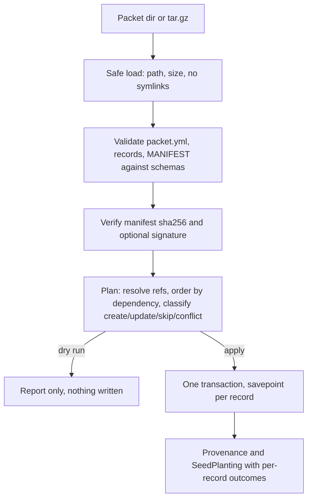

# Seed Packet Protocol 2.0

Seed packs are the installable bundles of Community Engine data (roles, pages, navigation, events, files). Protocol 2.0 is the portable format that carries them: a directory or `.tar.gz` that any host app can verify, plan and plant on a chosen platform without a new Ruby importer per packet. It is additive. Version 1.0 envelopes stay valid and keep loading through `Seed.load_seed`.

This document is the specification and the record of why it exists. The validator in this PR (`BetterTogether::Seeds::Protocol::Validator`) enforces the structure; the registry, planner, applier and blob transport follow in later PRs.

## Where this came from

There was never a single written protocol. The design was reconstructed from these sources and reconciled here.

| Source | What it contributed |
|---|---|
| Current repo: `Seed`, `Seedable`, `SeedPlanting`, `config/seeds/seed_example.yml`, [Seed Catalog and Seed Plantings](seed_catalog_and_plantings_system.md) | The envelope (`better_together:` root, `version`, `seed:`), safe YAML loading, size and path guards, plantings audit rows |
| `docs/implementation/current_plans/seedable_system_implementation_plan.md` | Three phases: security, validation and conflict handling, dependencies and rollback |
| Seed packs design (Copilot session, 2026-03-27/28) | The `seed_pack` metadata block, `PackImportService`, `PackInstaller`, `InstallerRegistry`, structured result, one transaction per pack, dependency rules by pack identifier, builder-to-pack extraction map, setup wizard `seed_pack_selection` step |
| CE Seed Protocol plan (Codex, 2026-03-11) | Seed as the CE-to-CE wire envelope, package classes (structural, platform-shared, person-linked private), dependency metadata |
| Billing planters (`feature/billing`) | Add-only idempotent reruns, explicit platform target, natural-key references that fail the whole plant before any write |
| NLO municipal loaders | Dry-run by default, source checksums, attach-once blobs with licence recorded |

### Reconciliation rule

The seed-packs names win. Protocol 2.0 keeps `seed_pack` (block), `PackImportService`, `PackInstaller` and `InstallerRegistry`, and adds the missing pieces on top: manifest, blobs, platform target, references, dry-run, provenance. `seed.type` stays `BetterTogether::Seed` because it is the STI column; pack identity lives in `seed.identifier` and `seed_pack`. "Seed pack" is the human-facing term. "Packet" names the on-disk transport of one pack.

## Packet layout

```
my-packet/
  packet.yml          envelope (this section)
  MANIFEST.json       sha256, size, media type, owner for every other file
  MANIFEST.json.sig   optional detached signature (key id in seed.origin.signing_key_id)
  records/pages.yml   one file per record type, listed in packet.records
  blobs/<sha256>      file bytes, content addressed
```

A `.tar.gz` of the directory is equivalent. Readers must reject absolute paths, `..` segments, symlinks and any entry not listed in the manifest.

### packet.yml

```yaml
better_together:
  version: "2.0"
  seed:                      # unchanged from 1.0, plus origin.signing_key_id
    type: "BetterTogether::Seed"
    identifier: "foray-nl-site"
    created_by: "..."
    created_at: "2026-11-13T00:00:00Z"
    description: "..."
    origin: { platforms: [], contributors: [], license: "", usage_notes: "", signing_key_id: "" }
  seed_pack:                 # from the seed packs design
    schema_version: "1.0"
    pack_type: "pages"
    install_tier: "optional" # core | recommended | optional | demo
    dependencies: []         # other pack identifiers; missing ones fail closed
  packet:                    # new in 2.0
    id: "foray-nl-site"
    version: "1.0.0"
    mode: "add_only"         # add_only | upsert | managed
    default_locale: "en"
    locales: ["en", "fr"]
    unsupported_locale_policy: "skip"   # fail | skip | fallback_default
    target: { platform_identifier: "foray" }   # optional hint, never the authority
    records: ["records/pages.yml"]
    manifest: "MANIFEST.json"
  deletes:                   # tombstones, only honoured for records this packet planted
    - { type: page, key: old-page }
```

The platform that receives the packet is always supplied by the caller (`PLATFORM=` in the rake task). If the packet declares `target.platform_identifier` and it differs, the plan reports a conflict. A packet can never choose its own target.

### records/*.yml

```yaml
version: "2.0"
type: page                   # a name in the type registry (C2)
records:
  - key: about/history       # natural key, unique per (platform, type)
    attributes: { slug: history }
    translations: { en: { title: "History" }, fr: { title: "Histoire" } }
    refs: { parent: "page:about" }          # or { type: page, key: about, scope: platform }
    files:
      - { attachment: hero_image, blob: "blobs/<sha256>", filename: hero.png,
          content_type: image/png, checksum: "<sha256>" }
    position: 3
```

References resolve packet-local first, then on the target platform (`scope: platform` skips the packet). An unresolved reference fails the plan before any write.

### Modes

| Mode | Behaviour |
|---|---|
| `add_only` | Create missing records; never touch an existing one, even if unedited |
| `upsert` | Update records the packet planted and nobody edited since; edited ones are reported `skipped_edited` |
| `managed` | Like `upsert`, plus `deletes:` tombstones for records the packet planted and nobody edited |

Edits are detected by comparing the stored fingerprint (sha256 of the canonical record) with the current row.

### Result report

```json
{ "created": 0, "updated": 0, "skipped_edited": 0, "unchanged": 0,
  "errors": [ { "record": "page:about", "field": "/refs/parent", "message": "..." } ] }
```

The validator already produces the same shape (`Report#to_h`): `file`, `record`, `field` (a JSON pointer) and `message`, all errors at once.

## Flow



Steps B and C ship in this PR. D, E and G are C3 and C4.

## Schemas and validator

JSON Schema documents (draft 2020-12) live in `config/seeds/schema/`: `envelope.schema.json`, `records.schema.json`, `manifest.schema.json`. `Seeds::Protocol::Validator` runs them with `Seeds::Protocol::SchemaValidator`, a small in-process validator for the keyword subset the schemas use (the `json-schema` gem is test-only here). On top of the schemas it enforces what a schema cannot: default locale is listed in `locales`, no duplicate record files or keys per type, a blob path equals `blobs/<checksum>`, a pack does not depend on itself. 1.x envelopes pass through the original required-field rules.

## The 16 numbered deficiencies

Found by assessing `github/main`, billing, multi-tenancy, NLO and NLV, then confirmed by building the foray packet. Status says where each is fixed.

| # | Deficiency | Resolution | Status |
|---|---|---|---|
| 1 | No materialization layer: `Seed.import` stores a row, nothing creates records | `PackImportService`, installer registry, applier | C2, C3 |
| 2 | Missing record types (pages with nesting, content blocks, navigation, uploads, events, social accounts, redirects) | Registry entries per type; Redirect model is Track D | C2, D1 |
| 3 | No file transport; 10 MB cap applies to the YAML | `blobs/<sha256>`, manifest, streaming reads, per-blob size policy | spec C1, code C4 |
| 4 | No cross-record references | `refs` with `type:key` or `{type, key, scope}`, resolved before any write | spec and schema C1, resolver C3 |
| 5 | Idempotency is per planter; Builder identifier has a random suffix; no provenance | Natural `key` per (platform, type); fingerprint, packet id, version, key stored on planted records | spec C1; columns held with C7 |
| 6 | `Seed` is global on (type, identifier); `clear` deletes every platform's data | Required platform target; platform-scoped `Seed` | spec C1; migration held (C7, PR #2165) |
| 7 | No dry-run or diff | The plan is the dry-run report | C3 |
| 8 | No validation schema | JSON Schemas and `Protocol::Validator` | **fixed in C1** |
| 9 | No signature verification | Detached signature over `MANIFEST.json`, key id in `origin` | spec C1; verification later |
| 10 | No partial update or deletion model | `mode` plus `deletes:` tombstones limited to provenance-owned records | spec and schema C1, applier C3 |
| 11 | No versioning or migration semantics | `version` 2.x selects the 2.0 schema, 1.x keeps old rules; `packet.version` per packet; `seed_pack.schema_version` | **fixed in C1** (selection), migrations later |
| 12 | Inconsistent locale handling | `default_locale`, `locales`, `unsupported_locale_policy`, per-record `translations` | **fixed in C1** (declaration and consistency check), policy applied in C3 |
| 13 | No ordering model | `position` per record; apply order is topological by references, then `position` | spec C1, C3 |
| 14 | Errors flatten to strings | `Report` with file, record, field pointer, message; all errors at once | **fixed in C1** |
| 15 | Concurrency only on the `Seed` row | One transaction per packet, advisory lock per (platform, packet id) | C3 |
| 16 | `ALLOWED_SEED_DIRECTORIES` blocks host-app directories and uploads | Configurable packet-source allowlist beyond `config/seeds` | C4 |

## What is deliberately not here

- No `Seed` migration and no provenance columns (C7, held until the multi-tenancy direction in PR #2165 is confirmed, so there is one `Seed` schema change).
- No conversion of billing planters or the navigation builder (C6, held until the conformance suite exists and the billing branch owner is coordinated).

## Tests

`spec/services/better_together/seeds/protocol/` with fixture packet `spec/fixtures/seed_packets/minimal/`.
