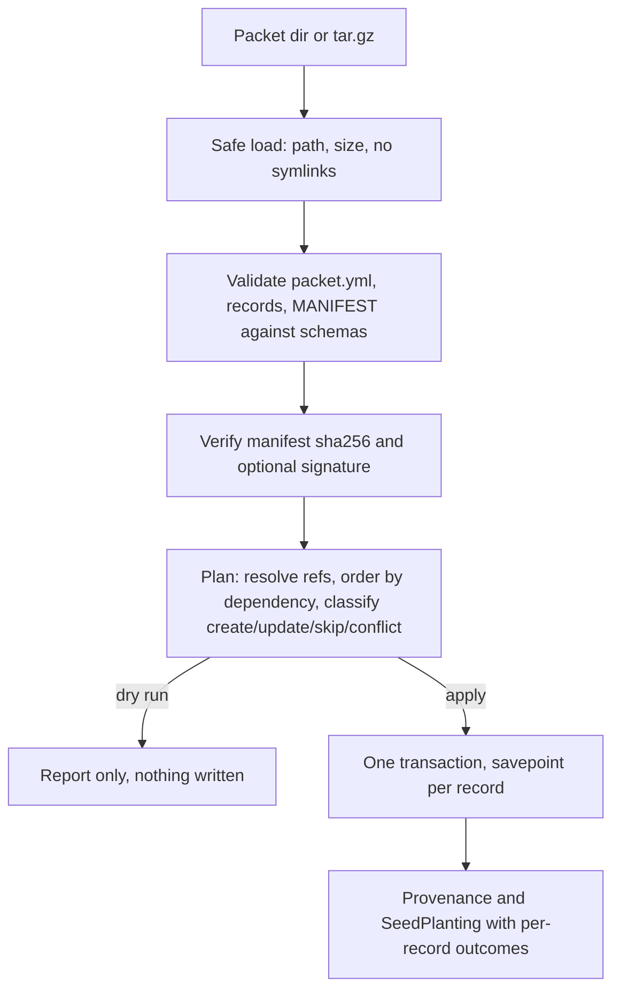

# Seed Packet Protocol 2.0

Seed packs are the installable bundles of Community Engine data (roles, pages, navigation, events, files). Protocol 2.0 is the portable format that carries them: a directory or `.tar.gz` that any host app can verify, plan and plant on a chosen platform without a new Ruby importer per packet. It is additive. Version 1.0 envelopes stay valid and keep loading through `Seed.load_seed`.

This document is the specification and the record of why it exists. The validator in this PR (`BetterTogether::Seeds::Protocol::Validator`) enforces the structure; the registry, planner, applier and blob transport follow in later PRs.

## Where this came from

There was never a single written protocol. The design was reconstructed from these sources and reconciled here.

| Source | What it contributed |
|---|---|
| Current repo: `Seed`, `Seedable`, `SeedPlanting`, `config/seeds/seed_example.yml`, [Seed Catalog and Seed Plantings](seed_catalog_and_plantings_system.md) | The envelope (`better_together:` root, `version`, `seed:`), safe YAML loading, size and path guards, plantings audit rows |
| `docs/implementation/current_plans/seedable_system_implementation_plan.md` | Three phases: security, validation and conflict handling, dependencies and rollback |
| Seed packs design (Copilot session, 2026-03-27/28) | The `seed_pack` metadata block, `PackImportService`, `PackInstaller`, `InstallerRegistry`, structured result, one transaction per pack, dependency rules by pack identifier, builder-to-pack extraction map, setup wizard `seed_pack_selection` step |
| CE Seed Protocol plan (Codex, 2026-03-11) | Seed as the CE-to-CE wire envelope, package classes (structural, platform-shared, person-linked private), dependency metadata |
| Billing planters (`feature/billing`) | Add-only idempotent reruns, explicit platform target, natural-key references that fail the whole plant before any write |
| NLO municipal loaders | Dry-run by default, source checksums, attach-once blobs with licence recorded |

### Reconciliation rule

The seed-packs names win. Protocol 2.0 keeps `seed_pack` (block), `PackImportService`, `PackInstaller` and `InstallerRegistry`, and adds the missing pieces on top: manifest, blobs, platform target, references, dry-run, provenance. `seed.type` stays `BetterTogether::Seed` because it is the STI column; pack identity lives in `seed.identifier` and `seed_pack`. "Seed pack" is the human-facing term. "Packet" names the on-disk transport of one pack.

## Packet layout

```
my-packet/
  packet.yml          envelope (this section)
  MANIFEST.json       sha256, size, media type, owner for every other file
  MANIFEST.json.sig   optional detached signature (key id in seed.origin.signing_key_id)
  records/pages.yml   one file per record type, listed in packet.records
  blobs/<sha256>      file bytes, content addressed
```

A `.tar.gz` of the directory is equivalent. Readers must reject absolute paths, `..` segments, symlinks and any entry not listed in the manifest.

### packet.yml

```yaml
better_together:
  version: "2.0"
  seed:                      # unchanged from 1.0, plus origin.signing_key_id
    type: "BetterTogether::Seed"
    identifier: "foray-nl-site"
    created_by: "..."
    created_at: "2026-11-13T00:00:00Z"
    description: "..."
    origin: { platforms: [], contributors: [], license: "", usage_notes: "", signing_key_id: "" }
  seed_pack:                 # from the seed packs design
    schema_version: "1.0"
    pack_type: "pages"
    install_tier: "optional" # core | recommended | optional | demo
    dependencies: []         # other pack identifiers; missing ones fail closed
  packet:                    # new in 2.0
    id: "foray-nl-site"
    version: "1.0.0"
    mode: "add_only"         # add_only | upsert | managed
    default_locale: "en"
    locales: ["en", "fr"]
    unsupported_locale_policy: "skip"   # fail | skip | fallback_default
    target: { platform_identifier: "foray" }   # optional hint, never the authority
    records: ["records/pages.yml"]
    manifest: "MANIFEST.json"
  deletes:                   # tombstones, only honoured for records this packet planted
    - { type: page, key: old-page }
```

The platform that receives the packet is always supplied by the caller (`PLATFORM=` in the rake task). If the packet declares `target.platform_identifier` and it differs, the plan reports a conflict. A packet can never choose its own target.

### records/*.yml

```yaml
version: "2.0"
type: page                   # a name in the type registry (C2)
records:
  - key: about/history       # natural key, unique per (platform, type)
    attributes: { slug: history }
    translations: { en: { title: "History" }, fr: { title: "Histoire" } }
    refs: { parent: "page:about" }          # or { type: page, key: about, scope: platform }
    files:
      - { attachment: hero_image, blob: "blobs/<sha256>", filename: hero.png,
          content_type: image/png, checksum: "<sha256>" }
    position: 3
```

References resolve packet-local first, then on the target platform (`scope: platform` skips the packet). An unresolved reference fails the plan before any write.

### Modes

| Mode | Behaviour |
|---|---|
| `add_only` | Create missing records; never touch an existing one, even if unedited |
| `upsert` | Update records the packet planted and nobody edited since; edited ones are reported `skipped_edited` |
| `managed` | Like `upsert`, plus `deletes:` tombstones for records the packet planted and nobody edited |

Edits are detected by comparing the stored fingerprint (sha256 of the canonical record) with the current row.

### Result report

```json
{ "created": 0, "updated": 0, "skipped_edited": 0, "unchanged": 0,
  "errors": [ { "record": "page:about", "field": "/refs/parent", "message": "..." } ] }
```

The validator already produces the same shape (`Report#to_h`): `file`, `record`, `field` (a JSON pointer) and `message`, all errors at once.

## Flow



Steps B and C ship in this PR. D, E and G are C3 and C4.

## Schemas and validator

JSON Schema documents (draft 2020-12) live in `config/seeds/schema/`: `envelope.schema.json`, `records.schema.json`, `manifest.schema.json`. `Seeds::Protocol::Validator` runs them with `Seeds::Protocol::SchemaValidator`, a small in-process validator for the keyword subset the schemas use (the `json-schema` gem is test-only here). On top of the schemas it enforces what a schema cannot: default locale is listed in `locales`, no duplicate record files or keys per type, a blob path equals `blobs/<checksum>`, a pack does not depend on itself. 1.x envelopes pass through the original required-field rules.

## The 16 numbered deficiencies

Found by assessing `github/main`, billing, multi-tenancy, NLO and NLV, then confirmed by building the foray packet. Status says where each is fixed.

| # | Deficiency | Resolution | Status |
|---|---|---|---|
| 1 | No materialization layer: `Seed.import` stores a row, nothing creates records | `PackImportService`, installer registry, applier | C2, C3 |
| 2 | Missing record types (pages with nesting, content blocks, navigation, uploads, events, social accounts, redirects) | Registry entries per type; Redirect model is Track D | C2, D1 |
| 3 | No file transport; 10 MB cap applies to the YAML | `blobs/<sha256>`, manifest, streaming reads, per-blob size policy | **fixed in C4** |
| 4 | No cross-record references | `refs` with `type:key` or `{type, key, scope}`, resolved before any write | spec and schema C1, resolver C3 |
| 5 | Idempotency is per planter; Builder identifier has a random suffix; no provenance | Natural `key` per (platform, type); fingerprint, packet id, version, key stored on planted records | spec C1; columns held with C7 |
| 6 | `Seed` is global on (type, identifier); `clear` deletes every platform's data | Required platform target; platform-scoped `Seed` | spec C1; migration held (C7, PR #2165) |
| 7 | No dry-run or diff | The plan is the dry-run report | **fixed in C3** |
| 8 | No validation schema | JSON Schemas and `Protocol::Validator` | **fixed in C1** |
| 9 | No signature verification | Detached signature over `MANIFEST.json`, key id in `origin` | spec C1; verification later |
| 10 | No partial update or deletion model | `mode` plus `deletes:` tombstones limited to provenance-owned records | spec and schema C1, applier C3 |
| 11 | No versioning or migration semantics | `version` 2.x selects the 2.0 schema, 1.x keeps old rules; `packet.version` per packet; `seed_pack.schema_version` | **fixed in C1** (selection), migrations later |
| 12 | Inconsistent locale handling | `default_locale`, `locales`, `unsupported_locale_policy`, per-record `translations` | **fixed in C1** (declaration and consistency check), policy applied in C3 |
| 13 | No ordering model | `position` per record; apply order is topological by references, then `position` | **fixed in C3** |
| 14 | Errors flatten to strings | `Report` with file, record, field pointer, message; all errors at once | **fixed in C1** |
| 15 | Concurrency only on the `Seed` row | One transaction per packet, advisory lock per (platform, packet id) | C3 |
| 16 | `ALLOWED_SEED_DIRECTORIES` blocks host-app directories and uploads | Configurable packet-source allowlist beyond `config/seeds` | **fixed in C4** |

## Blob transport (C4)

- `Seeds::Manifest` loads and verifies `MANIFEST.json`: every listed file must exist with the listed size and a streamed sha256 match, a blob's file name must equal its sha256, nothing may be present that the manifest does not list, and size policy applies.
- `Seeds::BlobPolicy`: per-blob cap (default 100 MB), packet cap (2 GB) and archive cap (2 GB), overridable with `BETTER_TOGETHER_SEED_BLOB_MAX_BYTES`, `BETTER_TOGETHER_SEED_PACKET_MAX_BYTES`, `BETTER_TOGETHER_SEED_ARCHIVE_MAX_BYTES`. The 10 MB YAML cap is unchanged. The foray packet's largest PDF (about 67 MB) fits; raise the cap deliberately for bigger files.
- `Seeds::BlobAttacher` implements the `attach_files:` contract of `Seeds::Applier`: it re-hashes each blob just before reading it (a file changed after verification is rejected), checks the declared content type against the manifest, streams it into Active Storage, and skips a file whose identical bytes (size and MD5) are already attached. Records that include `ContentSecurity::ScannableAttachment` (`Upload`) are enrolled for scanning by their own after-commit hook, so every PDF is queued exactly as a normal upload would be.
- `Seeds::PacketArchive.extract` unpacks `.tar.gz` into an empty directory, accepting only regular files that match the packet layout; links, absolute paths, traversal, unknown paths, more than 20,000 entries and archives over the size cap are rejected while streaming.
- `Seeds::PacketSources` is the allowlist for where packets may be read from: `config/seeds` (app and engine), roots registered with `PacketSources.register_root`, and `BETTER_TOGETHER_SEED_PACKET_ROOTS`. Paths are resolved through symlinks before the check (deficiency 16).

Limit: `BlobAttacher` re-checks and attaches one-file attachments; `has_many_attached` records attach every listed file without the already-attached shortcut.

## Type registry (C2)

`Seeds::Registry` replaces the per-class `plant` pointers. Each type is declared once with a small DSL and frozen:

```ruby
BetterTogether::Seeds::Registry.register(:upload) do
  model 'BetterTogether::Upload'
  attributes :privacy
  translated :name, :description
  attachment :file
end
```

| DSL | Meaning |
|---|---|
| `model` | The ActiveRecord class |
| `natural_key col` | Column that holds the packet `key`, looked up inside the target platform (default `identifier`) |
| `natural_key col, within: :ref` | Key is unique only inside a parent record (social account within its contact detail) |
| `natural_key by_refs: [:a, :b]` | A join row identified by the records it joins (`page_block`) |
| `attributes`, `translated` | The only fields a packet may write |
| `reference name, to:, optional:` | Reference slots; `to:` lists allowed target types |
| `attachment`, `position`, `sti` | Files, ordering column, and the subclass column for STI types such as content blocks |
| `before_resolve`, `transform`, `after_plant` | Hooks for host-app logic |

`Registry.ordered` returns types in dependency order and raises `DependencyCycle`. `TypeDefinition#find(platform:, key:, parent_refs:)` resolves a key on the target platform only, never globally. Host apps register their own types (NLO districts, NLV venues) from an initializer.

Registered: `page`, `content_block`, `page_block`, `navigation_area`, `navigation_item`, `upload`, `event`, `community`, `contact_detail`, `social_media_account`, `platform` (lookup target only). `SocialMediaAccount::PLATFORMS` gains Flickr.

### Findings while registering (added to the numbered list)

| # | Deficiency | Resolution |
|---|---|---|
| 17 | Natural keys are not always a column: social accounts and join rows have none | `within:` and `by_refs:` key kinds |
| 18 | `Page` has no cover or share image attachment, so the page share image needs a model change | Open model work item, not worked around |
| 19 | `Event.identifier` is globally unique (index on `identifier` alone), unlike pages and uploads | Platform-scoped uniqueness needed before two platforms plant one events packet; open model work item |

The registry spec checks each declared attribute is writable on the model, each attachment exists, and each reference points at a registered type, so a drifting model fails CI.

## Planner and applier (C3)

`Seeds::Plant.call(path:, platform:, apply: false)` loads a packet directory (`Seeds::Packet`: no symlinks, safe YAML, schema validation), plans it (`Seeds::Planner`) and, only with `apply: true` and an error-free plan, writes it (`Seeds::Applier`). It always returns the structured report; a dry run writes nothing, not even a `SeedPlanting`.

```
rake better_together:seeds:plan  PACKET=/path/to/packet PLATFORM=<platform identifier>
rake better_together:seeds:plant PACKET=/path/to/packet PLATFORM=<platform identifier> APPLY=1
```

Planning checks that every attribute and translation is declared writable in the registry, every reference slot is allowed and resolves (packet-local first, then on the target platform), locales follow `unsupported_locale_policy`, the packet's `target.platform_identifier` matches, and `seed_pack.dependencies` are already planted. Records are ordered by reference (Kahn's algorithm, ties by type order, `position`, file order); cycles are errors.

Each record is classified by comparing a flat snapshot of the fields the entry owns (`attr:`, `tr:<locale>:`, `ref:`, `position`) with the record and with the snapshot taken when this packet last planted it:

| Situation | Action |
|---|---|
| No record with that key on the platform | `create` |
| Record already holds the packet values | `unchanged` |
| `add_only`, record differs | `skipped_edited` (existing records are never touched) |
| `upsert` or `managed`, record differs, matches what the packet last planted | `update` |
| Record differs and was edited since, or the packet never planted it | `skipped_edited` |
| `managed` tombstone, record planted by the packet and unedited | `delete` |

Apply takes a per-packet advisory lock (deficiency 15), writes one transaction with a savepoint per record, and rolls the whole packet back if any record errors, reporting every failing record with its field. A `SeedPlanting` row records the outcome; its `result.provenance` holds the per-record snapshots that the next plan reads, so provenance works today without new columns. Files fail closed per record until blob transport (C4) supplies `attach_files`.

Known limits: `Seed` is not written (platform-scoped `Seed` is C7); lookups of `within:` and `by_refs:` types as references to existing platform records are not supported (packet-local only); snapshot-based edit detection is replaced by provenance columns once C7 lands.

## What is deliberately not here

- No `Seed` migration and no provenance columns (C7, held until the multi-tenancy direction in PR #2165 is confirmed, so there is one `Seed` schema change).
- No conversion of billing planters or the navigation builder (C6, held until the conformance suite exists and the billing branch owner is coordinated).

## Tests

`spec/services/better_together/seeds/protocol/` with fixture packet `spec/fixtures/seed_packets/minimal/`.
