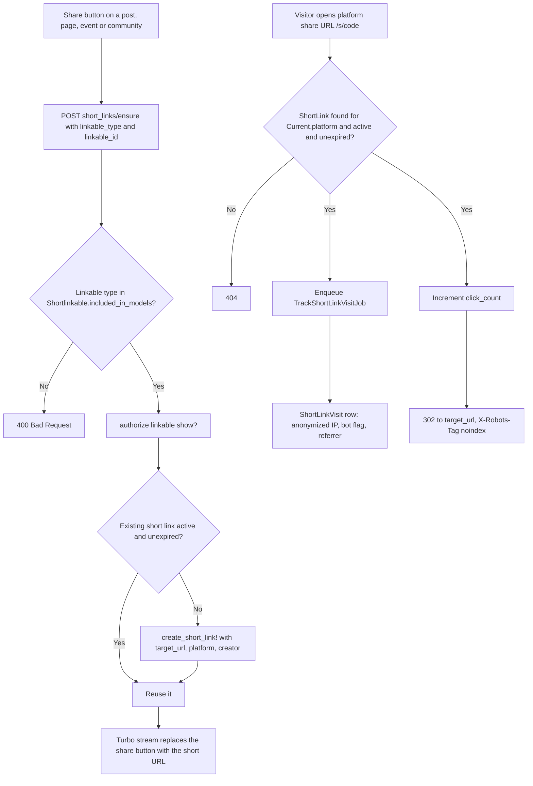

# Short Links System

Short links give posts, pages, events and communities a stable, platform-owned share URL (`https://<share domain>/s/<code>`) with optional expiry and visit tracking, so content can be shared outside the platform without a third-party shortener. Added in 0.11.0.

**Audience:** developers. Platform managers: see [Short Links for Platform Managers](../../platform_organizers/short_links.md).

## Components

| Piece | File | Role |
|---|---|---|
| `BetterTogether::ShortLink` | `app/models/better_together/short_link.rb` | The link: `code`, `target_url`, `status`, `expires_at`, `click_count`, optional polymorphic `linkable`, `creator`, translated `title` |
| `BetterTogether::Metrics::ShortLinkVisit` | `app/models/better_together/metrics/short_link_visit.rb` | One row per redirect, written by `TrackShortLinkVisitJob` |
| `BetterTogether::Shortlinkable` | `app/models/concerns/better_together/shortlinkable.rb` | Opt a model in: `has_one :short_link`, `ensure_short_link!`, `short_link_target_url` |
| `ShortLinkRedirectsController` | `app/controllers/better_together/short_link_redirects_controller.rb` | Public redirect `GET /s/:code` |
| `ShortLinksController` | `app/controllers/better_together/short_links_controller.rb` | Platform-scoped CRUD plus `ensure` for the share button |
| `ShortLinkPolicy` | `app/policies/better_together/short_link_policy.rb` | Creator or platform manager |
| `Metrics::TrackShortLinkVisitJob` | `app/jobs/better_together/metrics/track_short_link_visit_job.rb` | Persists the visit payload |

Models that include `Shortlinkable` today: `Community`, `Event`, `Page`, `Post`.

## Flow



**Diagram files:** [Mermaid source](../../diagrams/source/short_links_flow.mmd), [PNG](../../diagrams/exports/png/short_links_flow.png), [SVG](../../diagrams/exports/svg/short_links_flow.svg).

## Data model

`better_together_short_links`

| Column | Notes |
|---|---|
| `code` | Required, `/\A[a-z0-9-]+\z/`, unique per platform and case-insensitively. Generated (6 characters from `a-z0-9`) when blank, retrying until unused on the platform |
| `target_url` | Required, must parse as `http` or `https` |
| `status` | `active` (default), `inactive`, `expired` |
| `expires_at` | Optional. A save after the date flips `status` to `expired` (`auto_expire_if_past`) |
| `click_count` | Incremented on every redirect |
| `linkable_type`, `linkable_id` | Optional polymorphic target; a unique index means one short link per linkable record |
| `platform_id` | Required (`PlatformRecord`); unique index on `(platform_id, code)` |
| `creator_id` | Added by `20260514100004_add_creator_id_to_better_together_short_links` |

`better_together_metrics_short_link_visits`: `short_link_id`, `platform_id`, `referrer` (2048), `user_agent_string` (255), `remote_addr` (45), `visited_at`, `logged_in`, `potential_bot`. Both tables are in the [metrics ERD](../../diagrams/source/ce_metrics_search_ai_schema_erd.mmd) and the [DBML](../../../db/community-engine-db.dbml).

## URLs and domains

`ShortLink#url` is `"#{platform.share_base_url}/s/#{code}"`. `Platform#share_base_url` is the share platform domain's URL when one is configured, otherwise the primary domain URL or `host_url`. The redirect route is `GET /s/:code` (`short_link_redirect`), outside the locale scope, and is public (`skip_before_action :authenticate_user!`). Lookup is always scoped to `Current.platform`, so a code on one tenant never resolves on another.

The management UI is `resources :short_links` in the authenticated area; the share button posts to `short_links/ensure` (`ensure_content_short_link`).

## Behaviour to know

- **Open redirect by design.** `redirect_to target_url, allow_other_host: true` follows any `http(s)` target; there is no target-host allow-list. Only the scheme is validated. Treat who may create links as the control (below).
- **Privacy of visits.** The redirect enqueues the job with the client IP masked to /24 (IPv4) or /48 (IPv6) before it leaves the request; `potential_bot` is set by a user-agent pattern; the response carries `X-Robots-Tag: noindex`.
- **Authorization.** `index?` and `create?` need a signed-in user. `show?`, `update?` and `destroy?` need the creator or a `manage_platform` permission on the current platform. The scope shows managers every link of the platform and everyone else only their own.
- **`ensure` is gated twice.** The `linkable_type` must be a `Shortlinkable` model (`SafeClassResolver` with the allow-list built from `Shortlinkable.included_in_models`) and the caller must be allowed to `show?` the linkable.
- **Expiry.** `active_and_unexpired?` is what the redirect checks; an expired or inactive link answers 404 and records nothing.

## Adding short links to a model

```ruby
class Announcement < ApplicationRecord
  include BetterTogether::Shortlinkable

  def short_link_target_url = url  # or define it explicitly
end
```

`ensure_short_link!` raises `NotImplementedError` when neither `short_link_target_url` nor `url` exists. No gem-side list needs editing; the allow-list is the set of including models.

## Tests

`spec/models/better_together/short_link_spec.rb`, `spec/models/better_together/metrics/short_link_visit_spec.rb`, `spec/requests/better_together/short_link_redirects_spec.rb`, `spec/requests/better_together/short_link_redirects_controller_spec.rb`, `spec/requests/better_together/short_links_ensure_spec.rb`, `spec/policies/better_together/short_link_policy_spec.rb`, `spec/jobs/better_together/metrics/track_short_link_visit_job_spec.rb`, `spec/features/better_together/short_links/`, and the screenshot spec `spec/docs_screenshots/better_together/short_links_spec.rb`.

## Related

- [Metrics System](metrics_system.md)
- [View DOM Identifier Standard](../../development/view_dom_identifier_standard.md)
- [0.11.0 release notes](../../releases/0.11.0.md)
