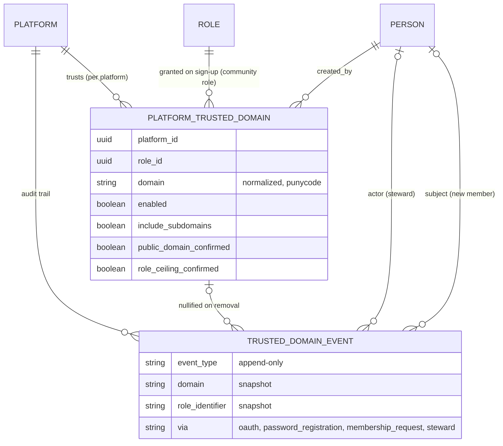

# Trusted Domains

A platform steward can trust an email domain (for example `example.org`). A person whose **verified**
address is on that domain may register on an invitation-only or membership-request platform without a
prior invitation, and joins the platform's community with the domain's role. General registration stays
closed to everyone else.

## Model

- `PlatformTrustedDomain`: one row per platform and domain. The domain is lower-cased and stored as
  punycode. A match is exact on the part after the final `@`; `include_subdomains` (off by default) also
  accepts real subdomains (`a.example.org`, never `evilexample.org`). The same domain on two platforms is
  independent.
- `role`: a community role, default `community_member`. Any other role needs `role_ceiling_confirmed`
  (the steward confirmed deliberately); management roles (governance council, organizer, coordinator,
  strategist) can never be granted by a domain.
- Public mail providers (`gmail.com` and similar) need `public_domain_confirmed`, because trusting one
  trusts every address on it.
- `TrustedDomainEvent`: append-only audit trail. It snapshots the domain and role so entries outlive the
  domain. Removing a domain never deletes accounts or memberships.

## Matching rule

`PlatformTrustedDomain.match(platform:, email:, verified:)` returns nothing unless `verified` is `true`.
Verified means the provider asserted it (Google `email_verified`) or the person confirmed the address
through Devise. Typing an address into a form never counts.

`Platform#trusted_domain_for(email, verified:)` is the entry point used by the sign-up paths.

## Access

`PlatformTrustedDomainPolicy` allows only managers of the target platform (`manage_platform` or
`manage_platform_settings`).

## Sign-in with an OAuth provider

`OmniauthCallbacksController#check_invitation_requirement` normally refuses a new OAuth sign-up on an
invitation-only platform. It now lets the sign-up through when `User.trusted_domain_for_oauth` finds a
trusted domain for the **provider-verified** email (Google `email_verified`, GitHub verified list; issuer
based providers only when that issuer opts in; Facebook never). Then `TrustedDomains::Grant` creates the
active community membership with the domain's role and writes an `account_created` or
`membership_granted` event (`via: oauth`).

- An invitation in the session wins: no domain grant is recorded and the invitation role applies.
- An unverified email never matches, so it cannot claim a trusted domain.
- `Grant` only adds the domain's role. An existing active membership is left alone.
- Google verifies the address, not that the domain is a managed Workspace tenant. Restricting by the
  Workspace `hd` claim as a second factor is a separate follow-up.
