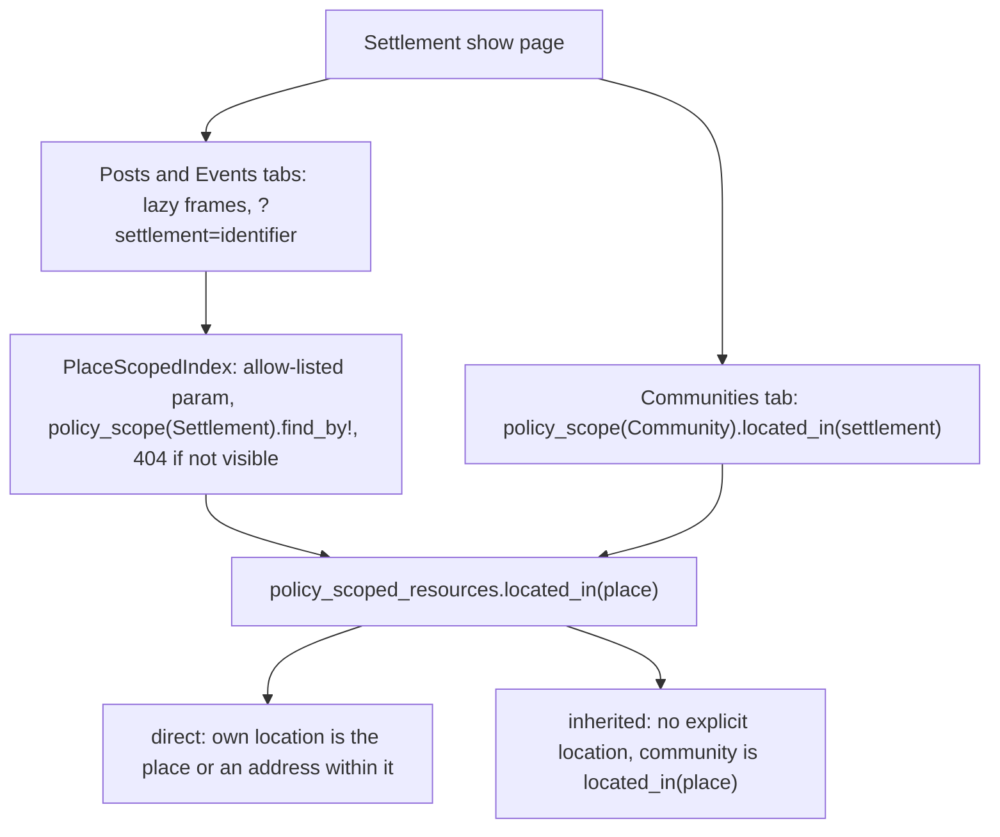

# Finding records located in a place

`Geography::Locatable::One` (events, event occurrences) now provides a `located_in(place)` scope. A host model
that keeps its own `has_one :location` (a `LocatableLocation`) can include
`Geography::Locatable::LocatedIn` to get the same scope without becoming Mappable.

```ruby
BetterTogether::Event.located_in(settlement)
```

A record is in a place when:

- its explicit location is the place itself, or
- its location is an address or building that `HierarchyResolutionJob` has already placed within the place
  (that placement is a `LocatableLocation` row of the address pointing at the settlement).

The scope is built with Arel in `Geography::LocationQueries`. It only narrows a relation, so privacy still comes from
the policy scope you start from; apply `located_in` to a policy scope, never to `Model.all` for a viewer.

## Inheriting a place

`inherit_location_from(:association)` makes a record with no location row of its own count through the record it
belongs to (a post takes its community's place). A free-text location is still the record's own, so it does not
inherit. `effective_location` returns the own place, else the inherited one.

```ruby
class Post
  include BetterTogether::Geography::Locatable::LocatedIn
  inherit_location_from :community
end
```

The inheritance target must itself respond to `located_in`.

## Models that have the scope

`Event`, `EventOccurrence` (through `Locatable::One`), `Community` (it keeps its own plain `has_one :location` and
includes `LocatedIn`) and `Post`. `Post` has no location row of its own in the engine: it includes `LocatedIn` and
calls `inherit_location_from :community`, so a post is located wherever its community is. A host that gives posts
their own location adds a `has_one :location`; the scope then prefers it and falls back to the community's.

## Place-scoped indexes

`BetterTogether::PlaceScopedIndex` (prepended in `EventsController` and `PostsController`) reads
`?settlement=<identifier>` and narrows the index to `located_in(settlement)` on top of the policy scope. This is what
the Posts and Events tabs of a settlement page load in lazy turbo-frames. An unknown or invisible identifier is a 404.
Add another level in `PlaceScopedIndex.place_classes`. See
`docs/assessments/settlement_to_town_rename_assessment.md` (section 2.8) for the settlement page hooks and tabs.

## Diagram



**Diagram files:**
- [Mermaid source](../diagrams/source/settlement_page_place_scoping_flow.mmd)
- [PNG export](../diagrams/exports/png/settlement_page_place_scoping_flow.png)
- [SVG export](../diagrams/exports/svg/settlement_page_place_scoping_flow.svg)
