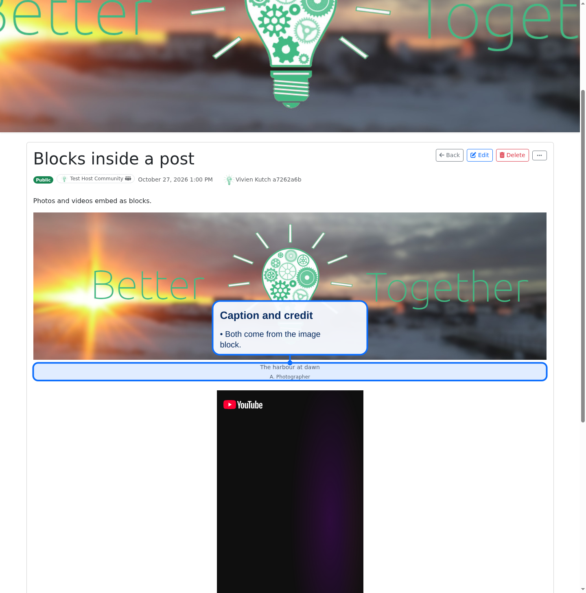
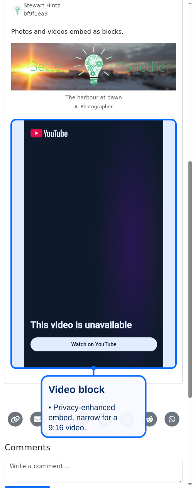

# Blocks as rich text attachments

An image or video block can be embedded in a post, event description or any other rich text as an Action Text attachment. The body stores a signed reference to the block, never pasted embed HTML, so the block stays under CE's privacy and review controls.




## What CE provides

| Piece | File |
|---|---|
| `AttachableBlock` concern (Action Text attachable and the partial paths) | `app/models/concerns/better_together/content/attachable_block.rb` |
| Included by `Content::Image` and `Content::VideoBlock` | `app/models/better_together/content/{image,video_block}.rb` |
| Display and editor-preview partials | `app/views/better_together/content/attachments/` |
| Scrubber that lets the privacy-enhanced YouTube iframe through | `app/services/better_together/content_security/video_embed_scrubber.rb` |
| Allow-list and render rule (existing) | `BetterTogether::ContentSecurity::AttachableRegistry` |

## Opting in (host app)

Nothing changes until a host opts in, so the default posture stays "rich text rejects everything except uploaded files".

```ruby
# config/initializers/better_together_models.rb
Rails.application.config.to_prepare do
  BetterTogether::ContentSecurity::AttachableRegistry.register(
    'BetterTogether::Content::Image', 'BetterTogether::Content::VideoBlock'
  )
  # Only needed for video: Action Text's sanitizer removes every iframe by default.
  ActionText::ContentHelper.scrubber = BetterTogether::ContentSecurity::VideoEmbedScrubber.new
end
```

A registered block renders only while it is public and visible; otherwise the reader sees the "held for review" placeholder. Posts and events attach existing blocks with `attachment_block_ids`.

## Notes

- `ActionText::ContentHelper.scrubber` is global to all rich text on the app. The scrubber starts from Action Text's defaults and adds one thing: an `iframe` whose `src` starts with the youtube-nocookie embed host and that sits inside an `action-text-attachment`. Any other iframe is removed.
- Vimeo and raw embed URLs are not attachable as video: only the YouTube privacy host passes the scrubber.
- The video partial extends itself with `BlocksHelper` when `iframe_embed_state` is missing, because rich text can render outside CE's controllers (for example from the API).
- Sanitizing drops `id` and `data-` attributes, so the stable hooks are classes: `.attached-image`, `.attached-image__attribution`, `.attached-video`, `.attached-video--portrait`, `.attached-video--landscape`.
- Action Text hands the image partial an attachment, not the block; the partial reads the block with `image.try(:attachable)`.
- Image blocks are created from base64 `media_data` (see `Base64ImageInput`) and need a caption.

## Adding another attachable block

1. `include BetterTogether::Content::AttachableBlock` in the block class and define `attachable_plain_text_representation`.
2. Add `app/views/better_together/content/attachments/_<element>.html.erb` and `_<element>_trix.html.erb` with `<%# locals: (<element>:, in_gallery: false) -%>`.
3. Register the class in the `AttachableRegistry`.
4. If the partial emits tags the sanitizer strips, extend a scrubber narrowly (allowed host, only inside an attachment).
5. Specs: signed id round trip, rendering, a non-public block held, sanitizer behaviour.
