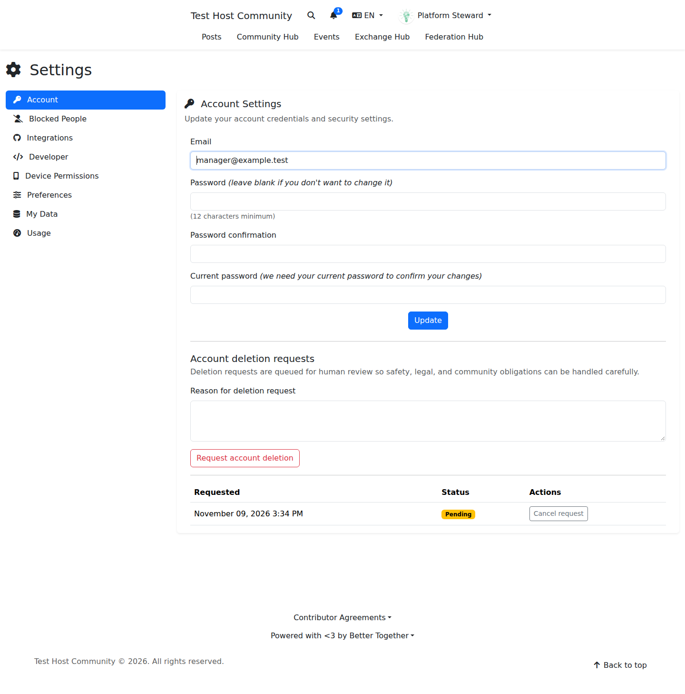
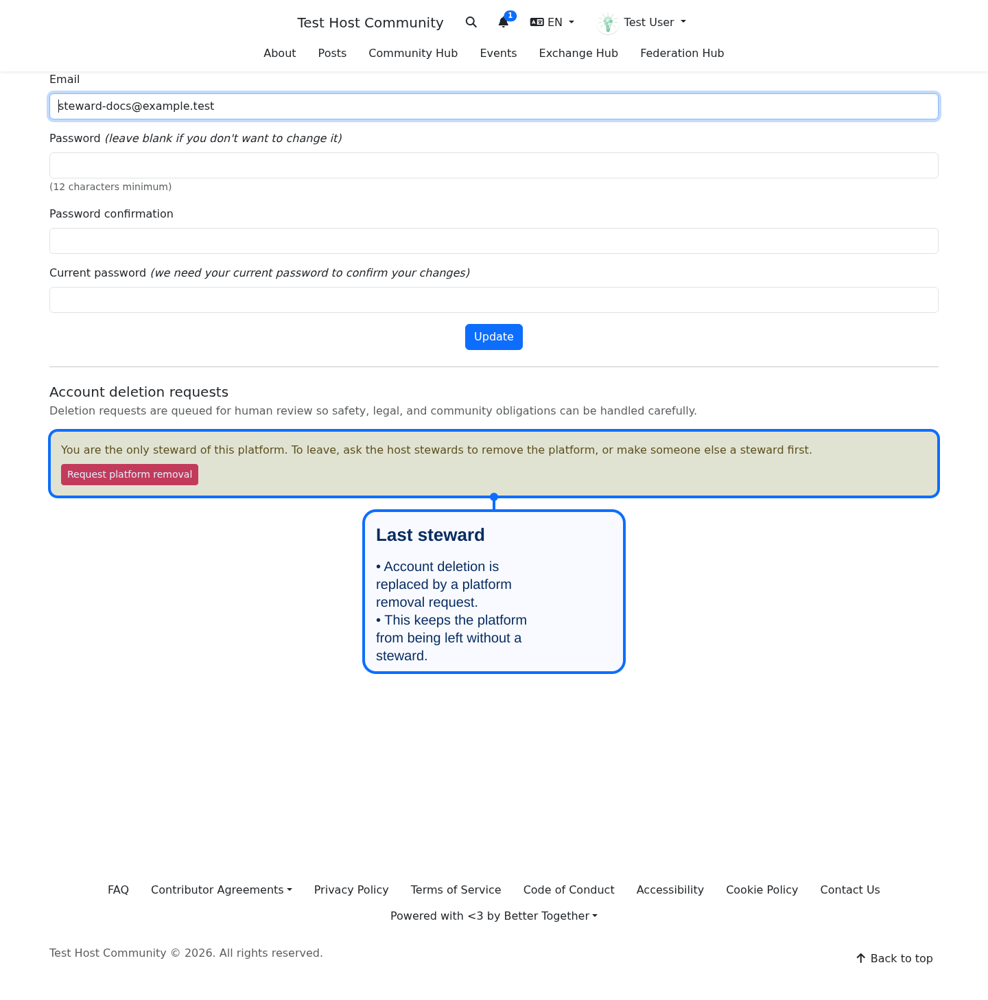
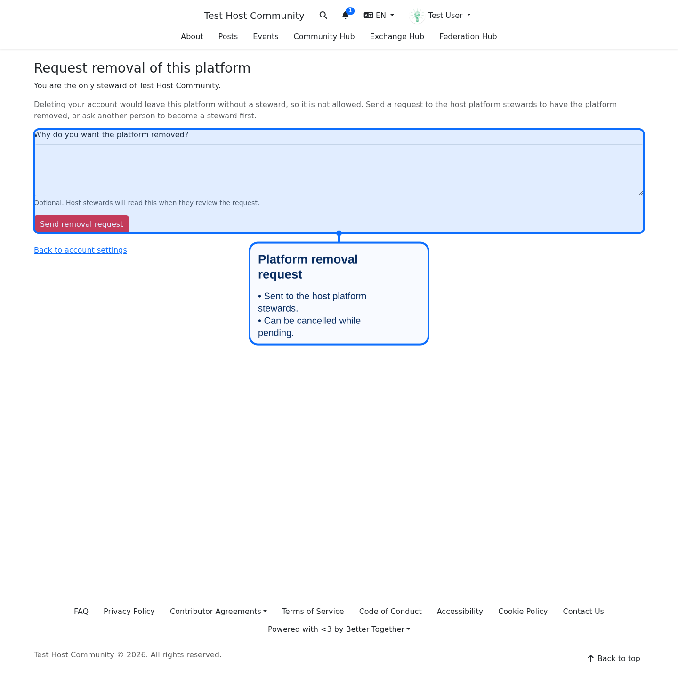
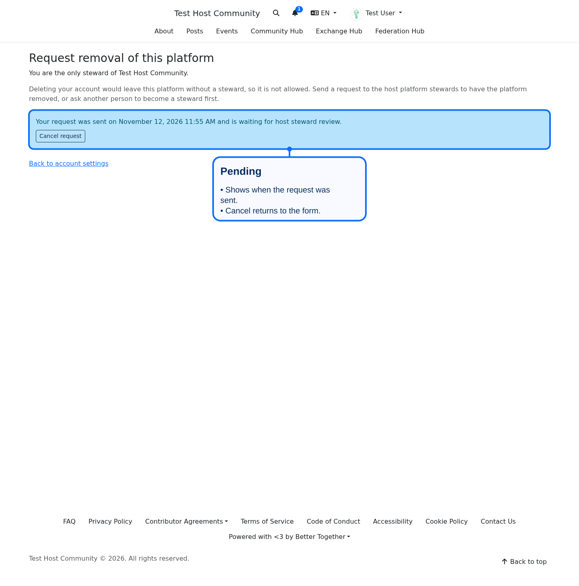
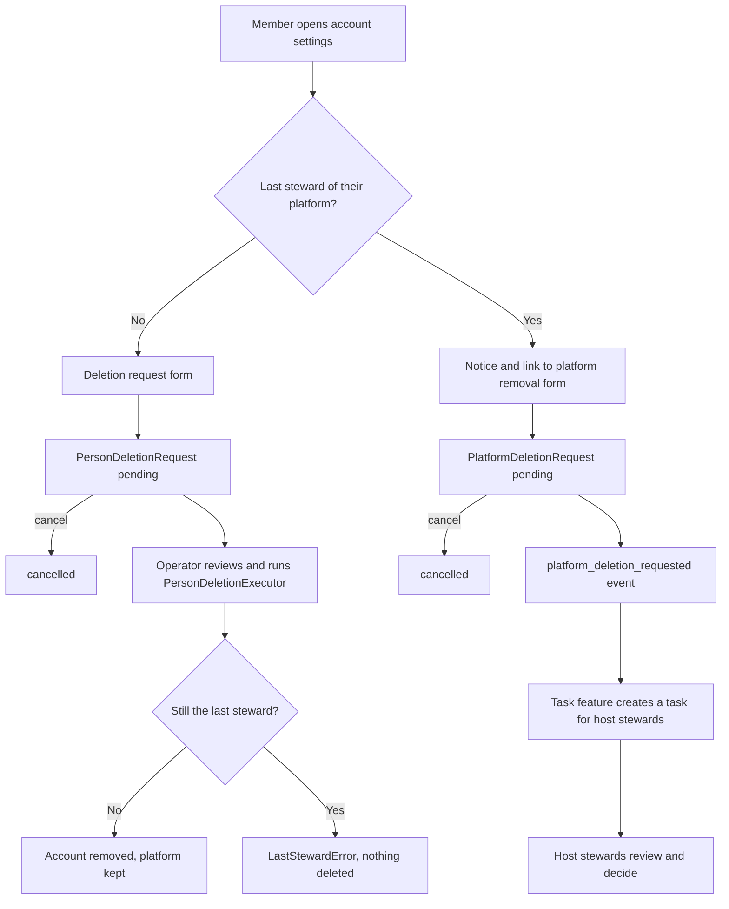

# Account Deletion Requests

**Target Audience:** All community members  
**Document Type:** User Guide  
**Last Updated:** November 12, 2026

## Overview

The account deletion request flow lets you ask the platform to begin account removal review.

In `0.11.0`, this is intentionally a review-oriented workflow rather than an instant destructive action. The platform records the request and allows you to cancel it while it is still active.

## Where It Starts

The current deletion request entrypoint is available from account settings.

The normal user-facing flow is through the main **Settings** page where the account tab contains the deletion-request controls.

## What The Current Flow Does

The current interface allows you to:

- start a deletion request
- optionally provide a short reason
- see whether a request is already active
- cancel the request if needed before the platform completes review

[Mobile screenshot of the account settings deletion-request controls](../screenshots/mobile/release_0_11_0_settings_account_deletion.png)

## How To Request Account Deletion

1. Open your account settings.
2. Find the deletion request section.
3. Review the warning or explanation text carefully.
4. Choose the action to submit the request.

If the platform requires confirmation text or review steps in a future release, follow the instructions shown on screen.

## How To Cancel A Pending Request

If your request is still active and the platform has not yet completed deletion:

1. Return to the same account settings area.
2. Find the active request state.
3. Choose the cancel action.

Cancellation is useful when:

- you submitted the request by mistake
- you changed your mind
- you need more time to download data first

## Recommended Order Of Operations

Before requesting deletion, it is usually better to:

1. request and download your data export
2. confirm you have any information you still need
3. then submit the deletion request

That order leaves you with a portable copy before the platform begins account-removal review.

## What To Expect After Submitting

The exact timing depends on platform operations, but the `0.11.0` design assumes:

- the request is recorded immediately
- platform review may happen asynchronously
- the request may stay visible as active until the platform finishes review

If you need help while waiting, contact the platform organizers directly.

## If You Are The Only Steward Of Your Platform

Each platform has its own accounts, so deleting your account only removes your account on this platform. If you are the only steward, deleting your account would leave the platform without anyone in charge. For that reason the normal deletion form is replaced by a notice and a link to **Request platform removal**.

[Mobile screenshot of the last steward notice](../screenshots/mobile/account_deletion_last_steward.png)

You have two options:

1. Make someone else a steward first, then delete your account as usual.
2. Send a platform removal request. It goes to the host platform stewards, who review it. Nothing is removed when you send it.

While a request is waiting, the page shows when it was sent and lets you cancel it. Only one request can be pending for a platform.

The same rule applies if the deletion is attempted another way: the request is refused, and the deletion executor refuses to remove the last steward.

## For Platform Operators

### Flow

Diagram files: [Mermaid source](../diagrams/source/person_deletion_last_steward_flow.mmd), [PNG](../diagrams/exports/png/person_deletion_last_steward_flow.png), [SVG](../diagrams/exports/svg/person_deletion_last_steward_flow.svg). Data model: [source](../diagrams/source/platform_deletion_request_model.mmd), [PNG](../diagrams/exports/png/platform_deletion_request_model.png).

### What is enforced

- `PersonDeletionRequest` cannot be created for the last steward of the person's platform. The settings page and both entry points (`POST /person_deletion_requests` and account `DELETE`) redirect to the platform removal form.
- `PersonDeletionExecutor` raises `LastStewardError` if the person became the last steward after the request was filed.
- `PersonHardDeletionExecutor` (the operator rake task for prelaunch purges) is not guarded on purpose, because operators use it to remove whole test accounts.
- `PlatformDeletionRequest` can only be created by an active steward of that platform, one pending request per platform.

### Task feature hook

The task feature does not exist yet. Creating a platform removal request publishes the `platform_deletion_requested.better_together` notification with `platform_id`, `request_id` and `requested_by_id`. The task feature should subscribe to it and create the host steward task. Until then, requests are stored with status `pending` and no host steward is notified.

### Tests

`spec/requests/better_together/account_deletion_flow_spec.rb` covers the whole flow for a normal member (request, cancel, approve, account removed, platform kept) and for the last steward (redirects, platform request, event, cancel, executor refusal, and a steward who is not the last one). Model coverage is in `spec/models/better_together/platform_deletion_request_spec.rb`, ids in `spec/dom_contracts/account_deletion_spec.rb`, and screenshots in `spec/docs_screenshots/better_together/account_deletion_spec.rb`.

## Related Guides

- [My Data and Exports](my_data_and_exports.md)
- [Privacy and Safety Preferences](privacy_and_safety_preferences.md)
