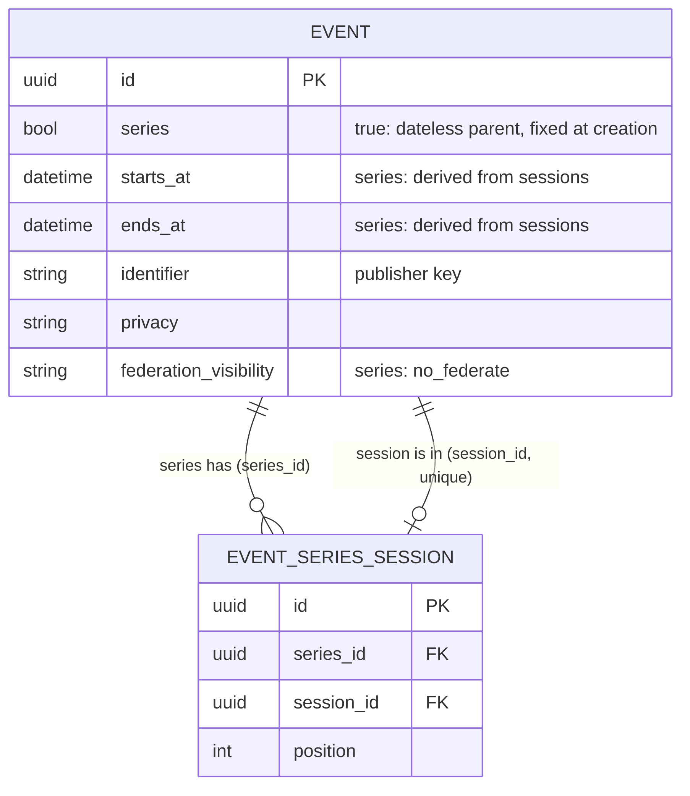

# Event series and sessions

## What it is

A ticketed run of dates, such as a play on two nights, is:

- one **series**: a parent event with no dates of its own, whose page lists its sessions;
- several **sessions**: full events (own page, hosts, RSVP, comments, ICS, categories, location, cover, registration
  url, status) that appear in event lists.

Series are separate from recurrence. Recurrence is "every Tuesday" (one page, computed dates). A series is "each
night has its own poster and ticket link" (a real event per date). A session may itself recur.

## Model

Source: `diagrams/source/event_series_model.mmd`.

- `better_together_events.series` boolean, default false, set at creation and never changed.
- `better_together_event_series_sessions` joins a series to its sessions; a session is in one series (unique index).
  Same-day sessions are fine.
- The series has no authored dates. Its span is derived from its non-cancelled sessions. A series forces
  `federation_visibility` to `no_federate`; sessions federate as ordinary events.
- Code: `EventSeries` (join, validations, `session_of`) and `EventSeriesDisposition` (the choice made when a series is
  cancelled or deleted), both included in `Event`.

### Cancelling or deleting a series

Neither action touches sessions silently. The caller chooses to cancel or delete the upcoming sessions, or to promote
them to standalone events. Past sessions are never changed.

## Surfaces

| Surface | Series | Session |
| --- | --- | --- |
| `Event.upcoming` and `Event.past`, `EventsSearchFilter`, events map | Hidden | Shown, with a "Part of <series>" mention on the card |
| Event page | Derived date range, session cards, no RSVP, attendees, invitations, calendar or tickets | Normal page plus a banner linking to the series and its other dates |
| JSON:API | Returned with `series: true` | Returned with read-only `series_identifier` |

## API

JSON:API on `Event`, with `Accept` and `Content-Type: application/vnd.api+json`. The actor must have accepted the
content publishing agreement.

- `series` (boolean, create only): creates a series.
- `session_of` (series identifier, write only): on create, links the new event to that series and fills hosts,
  categories, description, privacy and timezone from the series where none were given. On update, links an existing
  event that is in no series and changes nothing else.
- `series_identifier` (read only).

## Cancelling or deleting from the page

The series page shows a collapsed panel (`disposition_event_<id>`) with one form per action. Nothing is preselected:
cancel needs `cancel` or `promote`, delete needs `delete` or `promote`. `EventSeriesActions` (in `EventsController`)
sends the choice to `cancel_series!` or `destroy_series!` and redirects with a notice, or with the validation error
when no choice was made.
