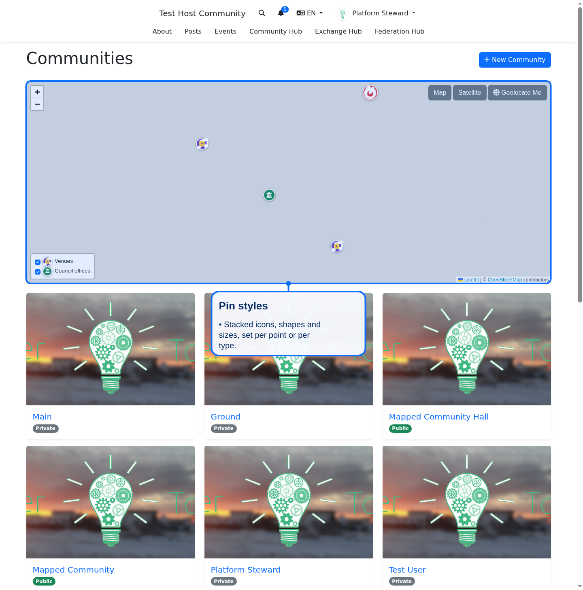

# Map pins

The shared map (`better_together/shared/_map`) draws each point as a pin. A pin can be a single icon, or a stack of Font Awesome icons, in a chosen shape, size and color. No Leaflet plugin is needed: pins are `L.divIcon` markers built from DOM nodes.



## The `pin` hash

Both a point and a type (an entry in the map legend) can carry a `pin`:

```ruby
pin: {
  color: '#6f42c1',          # background; hex, named color, rgb(a) or var(--name)
  shape: 'rounded',          # circle (default), rounded or square
  size: 'lg',                # sm, md (default) or lg
  scale: 1.1,                # optional multiplier on the icon, 0.3 to 1.5
  icons: ['fa-landmark',     # up to 4; the first is the large base icon,
          { icon: 'fa-star', # the rest are stacked on top of it
            color: '#ffd43b',
            style: 'far' }]  # fas, far, fab (or fa-solid, fa-regular, fa-brands)
}
```

Icons are Font Awesome class names (`fa-` followed by lowercase letters, digits and dashes).

## Types set the default look

When a type has a `pin`, every point of that type uses it, and the legend shows the same pin. A point's own `pin` replaces the type's. The legacy `color:` and `icon:` keys on a point still work and become a one-icon pin.

## Validation

Pin data is untrusted. `BetterTogether::Geography::MapPin` drops anything that does not match the allowed values on the server, and `map_pin.js` validates again in the browser. Values are applied as DOM properties, never as HTML strings, so pin data cannot inject markup.
