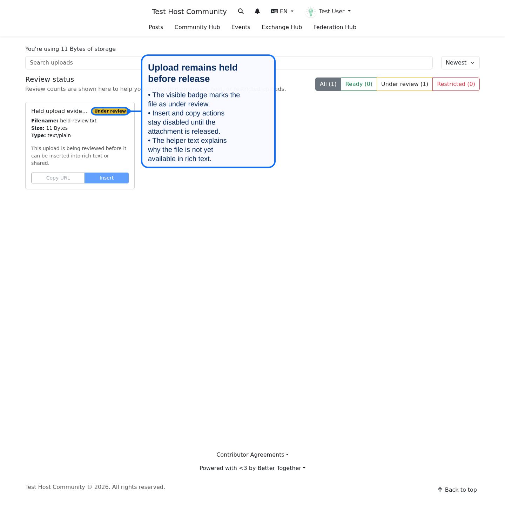
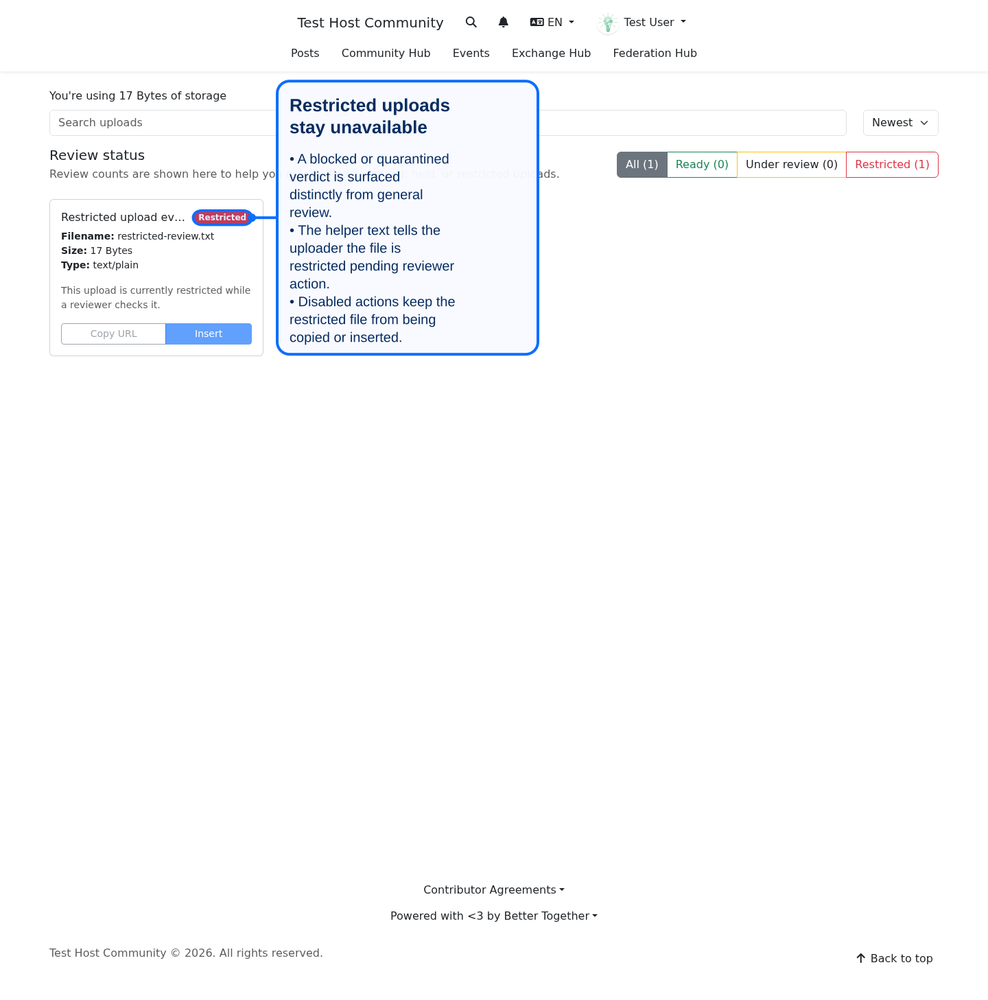
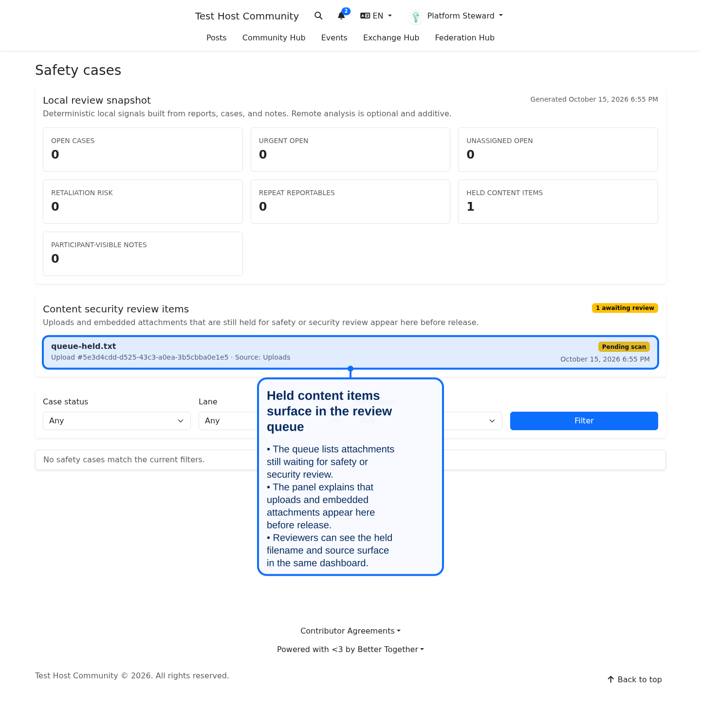

# Content Security and Malware Scanning

<!-- doc-coverage: better_together/safety/cases, better_together/uploads -->

Community Engine can hold uploaded files until they have been scanned for malware, and routes anything suspicious to your safety reviewers. Scanning is **off by default**. This guide covers turning it on, what members see, and how reviewers handle held files. Developers: see [Content Security Ingress System](../developers/systems/content_security_ingress_system.md).

## What you need

A running [ClamAV](https://www.clamav.net/) daemon (`clamd`) that CE can reach over TCP (port 3310 by default). CE streams each file to it and waits for the verdict. CE does not install or update ClamAV for you; keep its signature database updating.

## Turn it on

Set these on every web and worker process, then restart:

| Variable | Default | Meaning |
|---|---|---|
| `BT_MALWARE_SCANNING_ENABLED` | `false` | Set to `true` to enable scanning |
| `BT_MALWARE_SCANNING_HOST` | `127.0.0.1` | ClamAV host |
| `BT_MALWARE_SCANNING_PORT` | `3310` | ClamAV port |
| `BT_MALWARE_SCANNING_TIMEOUT` | `10` | Seconds to wait for ClamAV |
| `BT_MALWARE_SCANNING_MAX_STREAM_BYTES` | 25 MB | Larger files are not scanned and are treated as a scan error |
| `BT_MALWARE_SCANNING_SURFACES` | `uploads` | Where to scan: `uploads` for files uploaded to CE, add `mail` (comma separated) for inbound email attachments |
| `BT_MALWARE_SCANNING_FAIL_MODE` | `hold_until_clean` | What to do when ClamAV cannot be reached or errors (below) |

Only the ClamAV engine is supported. Files uploaded before you enable scanning are not scanned retroactively.

## What members see

- A new upload is held. Its card shows **Under review** with the note that it is reviewed before it can be inserted into rich text or shared; copy and insert actions stay disabled.
- A file found to be infected shows **Restricted**: it is unavailable while a reviewer checks it.
- Once clean, the file is released and behaves like any other upload.
- A held or restricted file embedded in a message or rich text renders as a placeholder ("Attachment under review" or "Attachment restricted") instead of the file.

## What happens when scanning fails

- **`hold_until_clean`** (default): the file stays held and CE keeps the error on its record. No safety case is opened, so a ClamAV outage does not flood reviewers. CE retries connection errors up to three times, then stops. It does not rescan automatically afterwards, so after restoring ClamAV ask a developer to re-enqueue `ContentSecurity::ScanAttachmentJob` for the held items (they show `pending_scan` with the last error recorded), or have the member upload the file again.
- **Any other value** (for example `review`): a scan error opens a safety case and marks the file **Under review** for a person to decide.

## What reviewers do

An infected file opens a safety case automatically: CE files a report on the uploader's behalf (category "malware detected", outcome "content review") and adds an internal note with the signature found. People with the `manage_platform_safety` permission see held items in the **Content security review items** panel at the top of the safety case queue.

Work the case like any other (see [Safety Reporting Operations](safety_reporting_operations.md)). The note is internal-only.

## Checking it works

1. Upload a harmless test file with scanning enabled. It should show **Under review**, then be released within moments once the worker has scanned it (make sure background workers are running).
2. Upload the standard EICAR test string as a text file. It should become **Restricted** and appear in the review queue.
3. Stop ClamAV and upload again: with the default fail mode the file stays under review and no case appears.

## Related

- [Embedded Content and CSP](embedded_content_and_csp.md)
- [Storage Configuration Guide](storage_configuration_guide.md)
- [Bot Safety Operations](bot_safety_operations.md)
