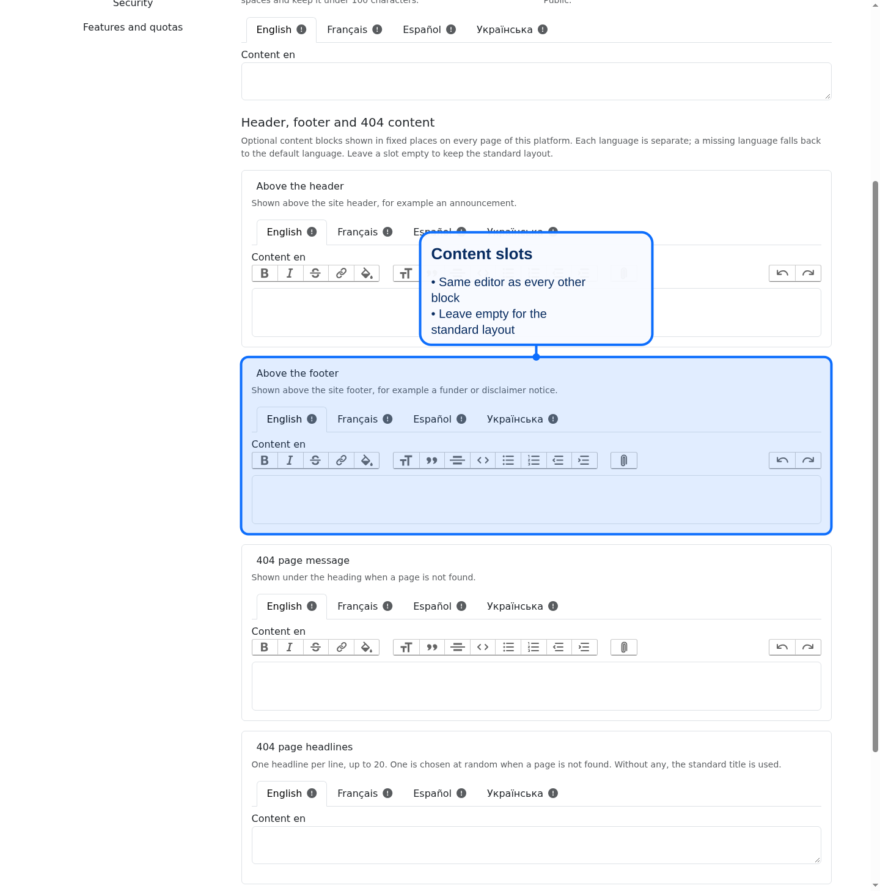
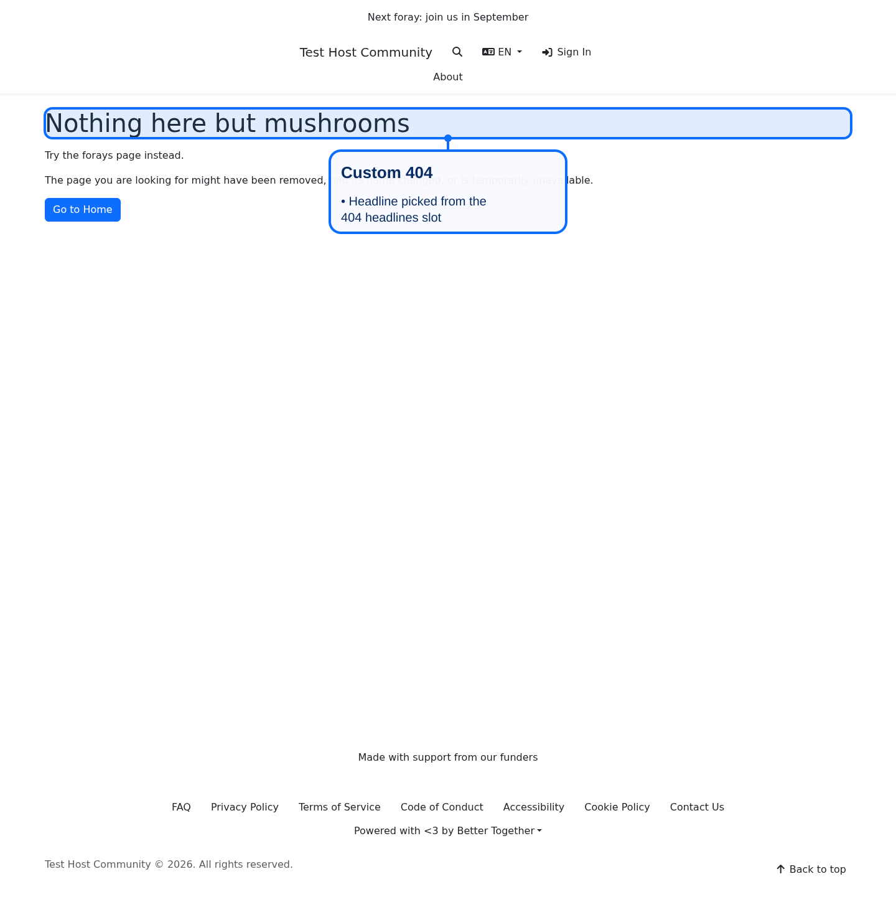

# Header, footer and 404 content

Platform stewards can add short pieces of content to fixed places on every page of their platform without changing code. Each place is called a slot, and each slot holds one ordinary content block that belongs to the platform.

## Where to edit

Open the platform, choose the **Appearance** tab, and scroll to **Header, footer and 404 content**, under the custom CSS block. You need the same permission that lets you edit the platform.

| Slot | Where it shows | Content types |
|---|---|---|
| Above the header | Above the site header on every page | Rich text, HTML, Markdown |
| Above the footer | Above the site footer on every page | Rich text, HTML, Markdown |
| 404 page message | Under the heading of the not found page | Rich text, HTML, Markdown |
| 404 page headlines | The not found page heading, one line picked at random | HTML (one headline per line, up to 20 lines of 140 characters) |

New slots are created as rich text, with the same language tabs and editor as other blocks. Leave a slot empty to keep the standard layout, or tick **Remove this content** to delete it. A language with no text falls back to the default language.

## Good to know

- Each slot is limited to 20,000 characters per language. HTML is sanitized the same way as the HTML block, so scripts are removed.
- Slot blocks take the privacy of the platform. They are listed with the other blocks under host content blocks, where they carry the reserved identifiers `slot-header-above`, `slot-footer-above`, `slot-error-404` and `slot-error-404-headlines`, and are protected from deletion there. An HTML or Markdown block can be created with a reserved identifier from the block inventory; the form creates rich text.
- Slots belong to one platform. Two platforms on the same install can use the same slot without seeing each other's content.
- Host app hook partials (`_extra_footer_info_top`, `_extra_page_content_bottom` and similar) still work. Slot content is added alongside them and never replaces them.
- Scripts and analytics are not part of this feature. Use the platform snippets feature for code.

