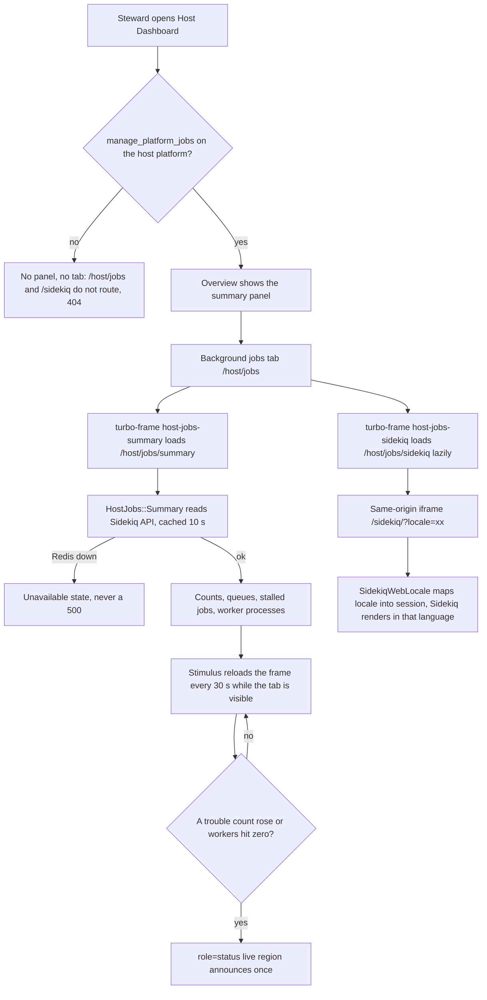

# Background jobs monitoring

The **Background jobs** tab of the host dashboard shows whether the job queue is healthy and embeds the
Sidekiq dashboard so stewards do not need to leave the platform to inspect or retry jobs.

## Who can see it

Access is the `manage_platform_jobs` permission on the **host platform**. The same check
(`BetterTogether::HostJobsPolicy`) guards:

- the summary panel on the dashboard overview,
- the Background jobs tab (`/:locale/host/jobs`) and its two frames,
- the Sidekiq web UI mounted at `/sidekiq` (route constraint `BetterTogether::HostJobsConstraint`).

A user without the permission gets no panel and no tab, and both `/host/jobs` and `/sidekiq` do not
route for them (404). Holding `manage_platform_settings` or `manage_platform` alone is not enough, and a
steward of another platform never sees the host's jobs.

### How the permission is granted

| Where | What happens |
|-------|--------------|
| RBAC seed packet (`config/seeds/better_together/rbac`) | New platforms get `manage_platform_jobs` (position 29) and it is linked to the seven platform roles that hold `manage_platform_settings`: steward, manager, infrastructure architect, tech support, developer, QA lead and accessibility officer. |
| Migration `SeedManagePlatformJobsPermission` | Existing platforms with roles get the permission, and every role on that platform holding `manage_platform` or `manage_platform_settings` (including custom roles) is granted it, so anyone who could open `/sidekiq` before keeps access. Idempotent; rollback removes the permission and its grants. |

Permission checks are cached for up to 12 hours. New grants clear the affected members' caches, so
no manual cache clear is needed after the migration.

## Summary panel

Read from the Sidekiq API by `BetterTogether::HostJobs::Summary` and cached for 10 seconds.

| Figure | Source | Notes |
|--------|--------|-------|
| Worker processes | `Sidekiq::ProcessSet` | Zero shows a red alert: jobs are queued but nothing processes them. |
| Running now | `Sidekiq::WorkSet` | Jobs currently executing. |
| Stalled | `Sidekiq::WorkSet` | Jobs running longer than the threshold (default 10 minutes, `HOST_JOBS_STALLED_AFTER_MINUTES`). |
| Enqueued, per queue, longest wait | `Sidekiq::Stats#queue_summaries` | Largest queue first. |
| Failed (all time), Retrying, Dead, Scheduled | `Sidekiq::Stats` | Each count links to its Sidekiq page with the current locale. |

The panel reloads its own turbo frame every 30 seconds (`better_together--host-jobs-summary` Stimulus
controller) and pauses while the browser tab is hidden. A visually hidden `role="status"` region
(`#host-jobs-summary-status`) announces only when failed, retrying, dead or stalled counts rise or the
worker count drops to zero, so screen reader users are not interrupted on every refresh.

If Redis cannot be reached the panel shows an "unavailable" notice instead of failing; that state is
not cached, so it clears on the next refresh.

## Framed Sidekiq dashboard

The tab holds a lazy `<turbo-frame id="host-jobs-sidekiq">` that loads `/:locale/host/jobs/sidekiq`. That
response contains a same-origin iframe (`#host-jobs-sidekiq-iframe`, with a `title`) pointing at
`/sidekiq/?locale=<current locale>`, and a button to open Sidekiq in a new tab.

- **Locale.** Sidekiq ignores a `locale` query parameter and reads `session[:locale]`.
  `BetterTogether::SidekiqWebLocale` wraps the mount and maps the parameter onto a locale Sidekiq ships
  (exact match, then case and separator insensitive such as `pt_br` to `pt-BR`, then the base language,
  then `en`). The session keeps it for later pages inside the frame.
- **Framing.** Sidekiq sends its own Content-Security-Policy without `frame-ancestors` and no
  `X-Frame-Options`, and the engine's CSP middleware leaves a response that already has a policy alone,
  so the iframe is allowed. The host page's CSP includes `frame-src 'self'`. A proxy in front of the app
  that adds `X-Frame-Options: DENY` to every response would block the iframe; the new tab button still
  works in that case.
- **Navigation.** Sidekiq links are relative to `/sidekiq/`, so clicking around stays inside the iframe.
  On the jobs tab the summary links target the iframe by name; on the overview they open the Sidekiq page
  in the whole window.

## Access flow

**Diagram files:**
- [Mermaid source](../diagrams/source/host_jobs_access_flow.mmd)
- [PNG export](../diagrams/exports/png/host_jobs_access_flow.png)
- [SVG export](../diagrams/exports/svg/host_jobs_access_flow.svg)

## Screenshots

| Screen | Desktop | Mobile |
|--------|---------|--------|
| Background jobs tab | [desktop](../screenshots/desktop/host_jobs_tab_annotated.png) | [mobile](../screenshots/mobile/host_jobs_tab_annotated.png) |
| Framed Sidekiq UI | [desktop](../screenshots/desktop/host_jobs_sidekiq_frame_annotated.png) | [mobile](../screenshots/mobile/host_jobs_sidekiq_frame_annotated.png) |
| Overview panel, no workers | [desktop](../screenshots/desktop/host_jobs_overview_no_workers_annotated.png) | [mobile](../screenshots/mobile/host_jobs_overview_no_workers_annotated.png) |

## Navigation entry

Like the other host dashboard review tabs, the "Background Jobs" item in the host navigation
(`host-dashboard-jobs`, `permission_identifier: manage_platform_jobs`) is added by
`bin/rails better_together:seed:rbac_and_navigation`; it is not part of the navigation seed packet.
Until that task runs, the overview panel's "Open background jobs" button links to the tab.

## Troubleshooting

| Symptom | Check |
|---------|-------|
| Panel says unavailable | Redis reachable from the web process (`REDIS_URL`). |
| Worker processes is 0 | The Sidekiq service on the server is stopped or cannot reach Redis. |
| Iframe is blank | Response headers of `/sidekiq/` through the proxy: `X-Frame-Options` or `frame-ancestors 'none'` added upstream. |
| Sidekiq in the wrong language | The locale is not one Sidekiq ships; it falls back to English. |
| Steward lost access after upgrade | Their role had neither `manage_platform` nor `manage_platform_settings`; grant `manage_platform_jobs` on the host platform. |
