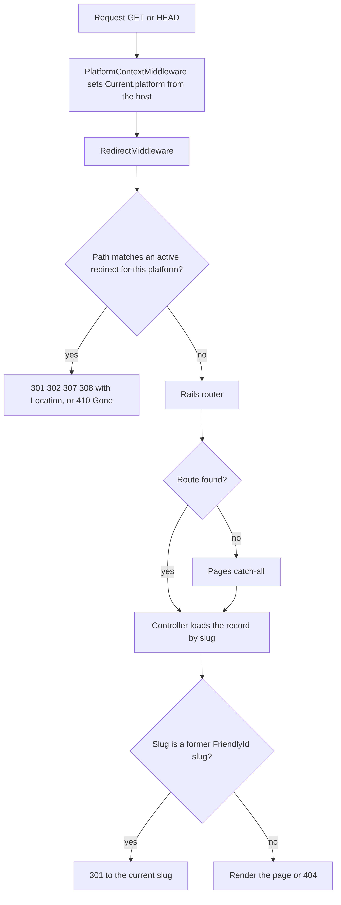
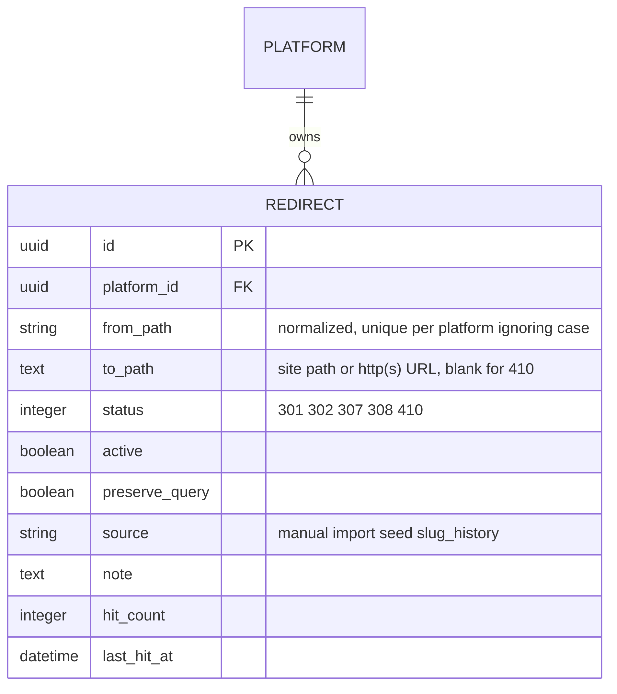

# Redirects

A platform manager can send old addresses to their new place, or mark them as gone, without editing code. Redirects belong to one platform, so two platforms hosted by the same app can each have their own `/about`.

Open **Platform > Operations > Redirects**, or go to `/host/platforms/<platform>/redirects`.

## How a request is answered



1. The request host picks the platform.
2. If an active redirect on that platform matches the path, it is answered at once with its status. This happens before routing, so it wins over the pages catch-all, and it works for paths outside the locale scope such as legacy `.html` and PDF addresses.
3. Otherwise the app routes as usual. When a page, community, person or other record is requested by a slug it used to have (FriendlyId history), the visitor gets a permanent redirect to the current slug. Only records the visitor is allowed to see are considered.

## Data



- Paths are stored decoded, with a leading slash and no trailing slash. Matching ignores letter case, a trailing slash and the query string.
- The response is 301, 302, 307, 308, or 410 Gone (no destination).
- The destination is a path on the site (starting with one slash) or a full `http` or `https` address. Other schemes and `//host` forms are refused.
- A redirect that leads back to itself, directly or through other redirects, is refused.
- By default the visitor's query string is kept; turn that off per redirect.
- Each redirect counts its visits, to help find ones that are no longer used.

## Importing many redirects

Choose **Import** and paste one redirect per line as `old path,new path[,status]`. Lines starting with `#` are ignored. **Preview** shows what would be created, updated or skipped without saving. Existing redirects are only changed if you tick the update option.

The same importer is available to code and to seed packets:

```ruby
BetterTogether::Redirects::Importer.call(
  platform: platform, rows: [{ from_path: '/old.html', to_path: '/en/new' }],
  source: 'seed', mode: :add_only, dry_run: false
)
```

`BetterTogether::Redirect::SEED_KEY` and `SEED_ATTRIBUTES` name the natural key (`platform_id`, `from_path`) and the writable attributes, so a seed registry can register the type without depending on this code.

## Operating notes

- A platform's active redirects are cached for five minutes and the cache is cleared when a redirect is saved or removed. Platforms with more than 10,000 active redirects use an indexed query per request instead.
- Redirects apply to GET and HEAD requests only, and not to assets, `/rails`, `/up` or `/cable`.
- Deleting a redirect or setting it inactive restores normal routing for that path.
