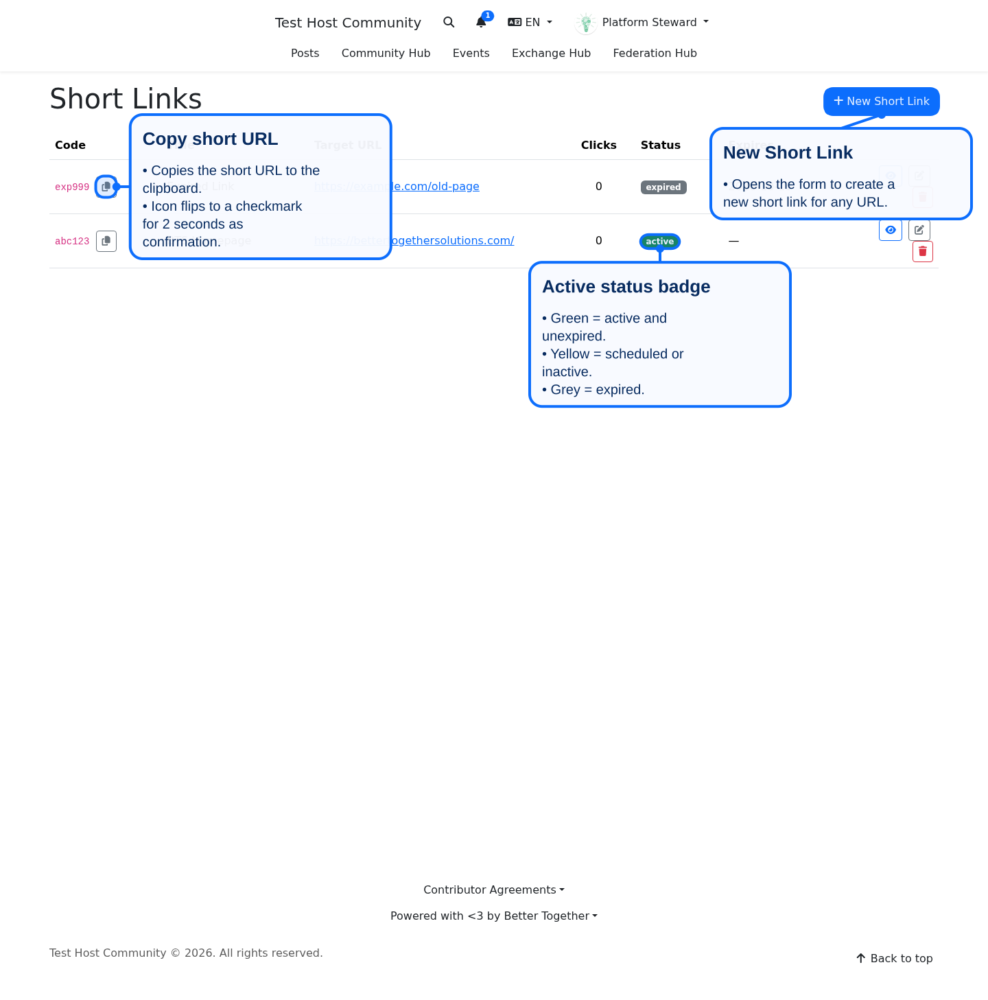
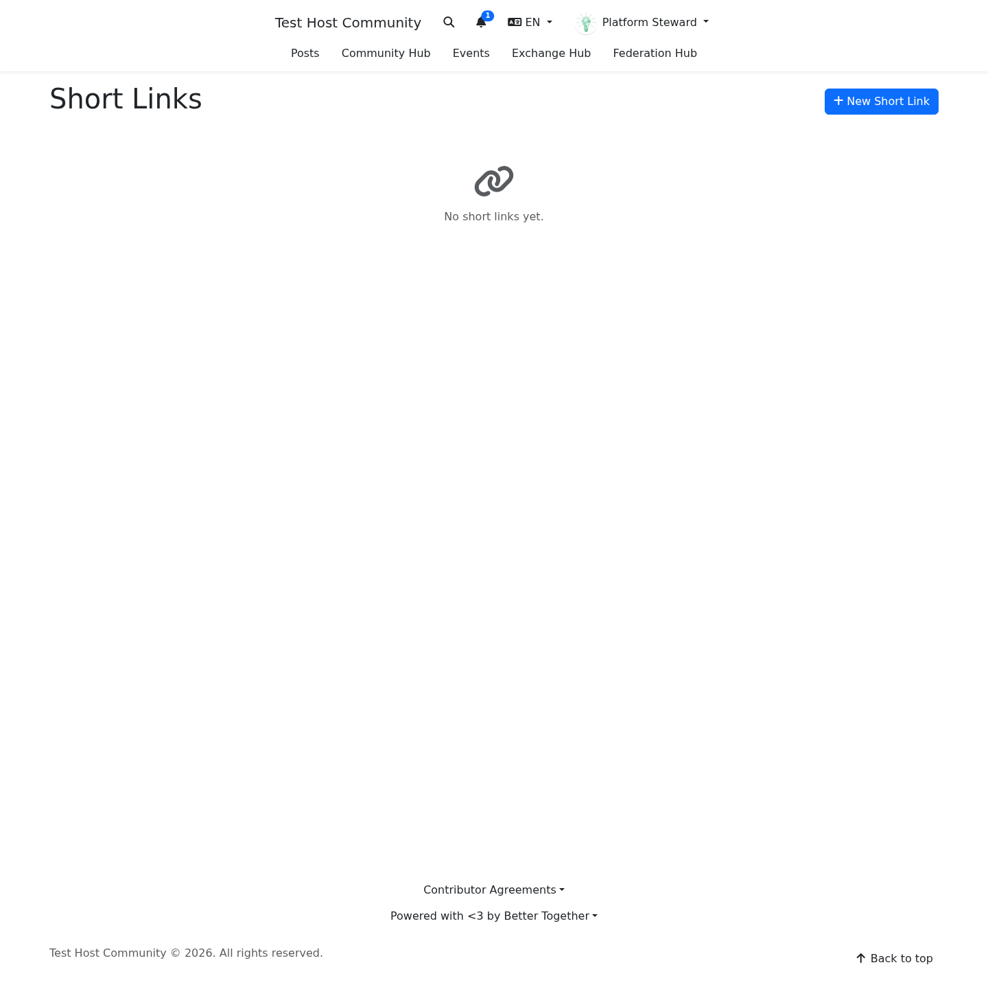
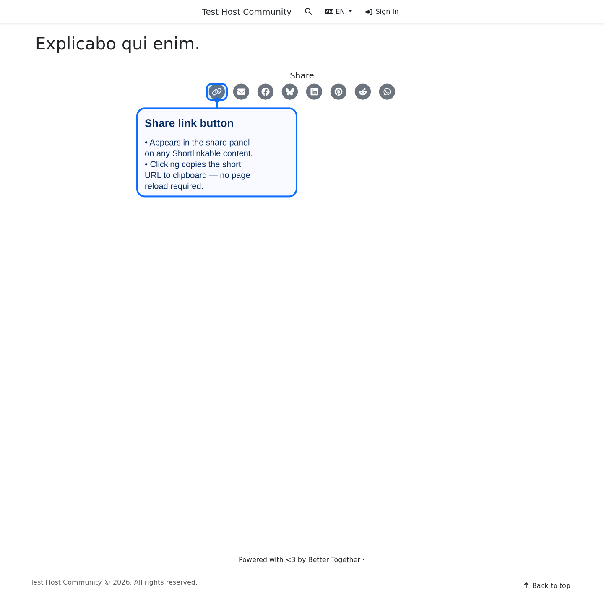
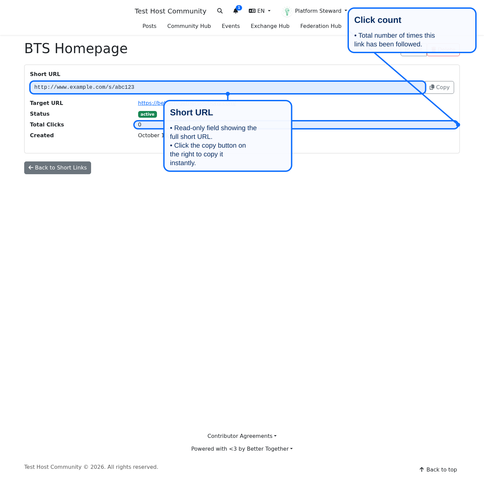

# Short Links for Platform Managers

<!-- doc-coverage: better_together/short_links -->

Short links are short, stable web addresses that point at a post, page, event, community or any other web address. They look like `https://example.org/s/abc123`, belong to your platform, and work without signing in. Visits are counted.

## Where to find them

Signed-in people open the list at `/<locale>/short_links` (for example `/en/short_links`). There is no navigation entry; add one under **Navigation** if your team uses the list often.

- A **platform manager** sees every short link on the platform.
- Anyone else who is signed in sees, and can edit, only the links they created.

The list shows each link's code, target address, status, expiry date and number of clicks. **Copy short URL** copies the full address; the status badge is green for active links, yellow for scheduled or inactive ones, and grey for expired ones.

When nothing exists yet, the page says "No short links yet." and offers **New Short Link**.

## Share buttons create links for you

On posts, pages, events and communities the **Get short link** button creates the short link the first time it is used and reuses it afterwards. If the link has expired or been switched off, pressing it creates a fresh one. You do not need to open the list for this.

## Create or edit a link by hand

Choose **New Short Link**, then fill in:

| Field | What it does |
|---|---|
| **Target URL** | Where visitors are sent. Must start with `http://` or `https://`. Any website is allowed, including other sites. |
| **Short Code** | Optional. Lowercase letters, numbers and hyphens. Leave it blank to get a random six-character code. Codes are unique on your platform. |
| **Status** | `active` links redirect; `inactive` links answer "not found" without being deleted. |
| **Expires At** | Optional. After this date the link becomes `expired` and stops redirecting. |

## What visitors and search engines see

- An active link redirects the visitor straight to the target. An inactive, expired or unknown code shows the standard "page not found" page.
- Redirect responses ask search engines not to index the short address.
- Each visit is recorded with the referring page, the browser name, whether the visitor was signed in, and whether the browser looks like a bot. The visitor's IP address is shortened before it is stored (the last part is zeroed), so full addresses are never kept.

## Good practice

- A short link can point anywhere, so a link someone shares in a message looks like it comes from your platform. Review links created by others from the list, and switch off or delete any you do not recognise.
- Prefer the share buttons for content on your platform: the link always follows the content's current address.
- Set an expiry for time-limited campaigns.
- The short address uses your platform's share domain when one is set, otherwise the primary domain. Change those under the platform's domains.

## Related

- [Short Links System](../developers/systems/short_links_system.md) for developers
- [Platform administration](platform_administration.md)
