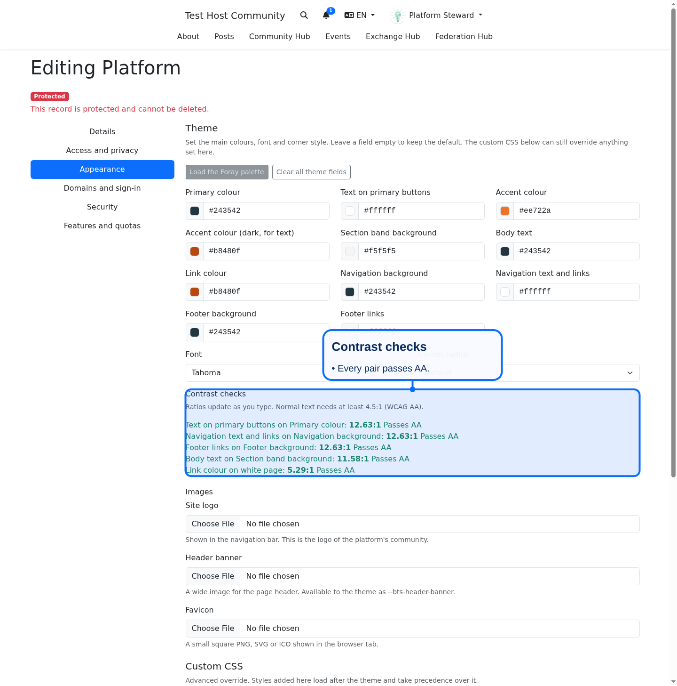
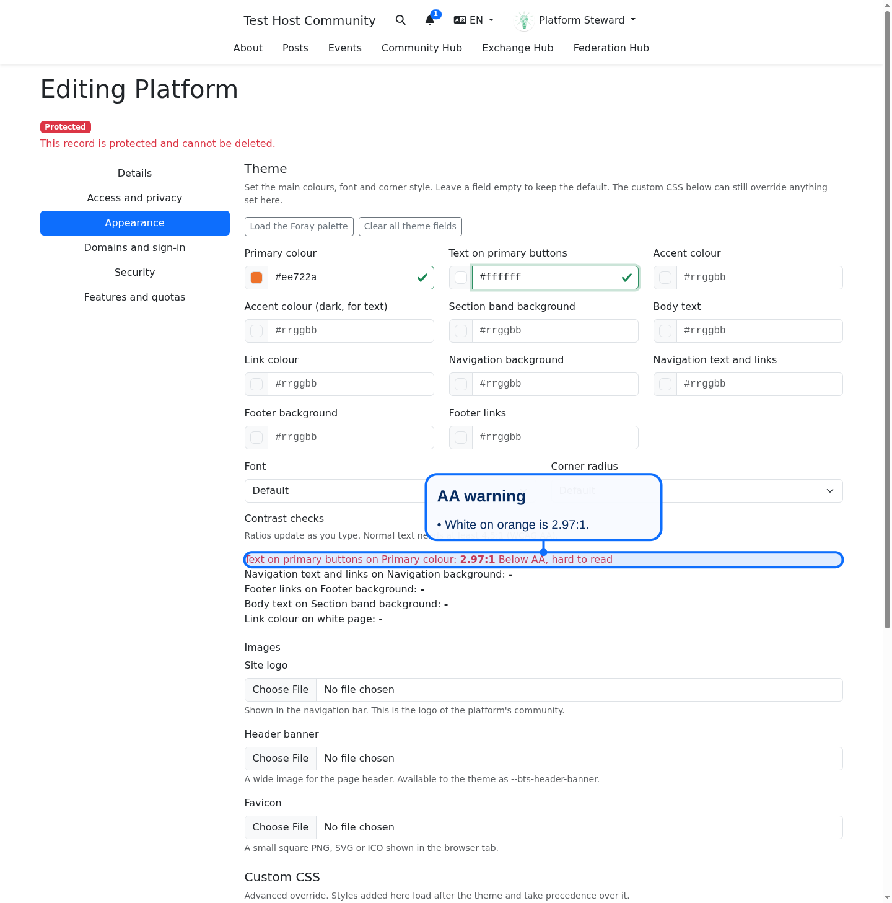
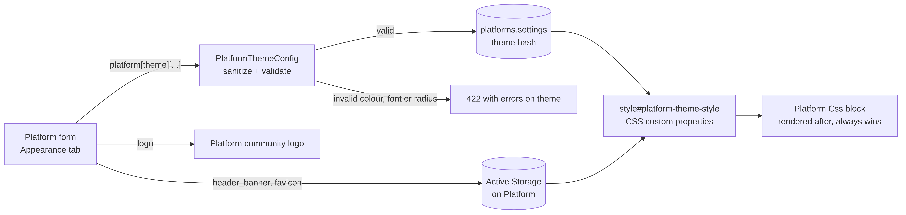

# Platform Theme Settings

Platform managers set the main look of a platform without writing CSS. Open the platform, choose Edit, then the Appearance tab.

## What you can set

- Colours: primary, text on primary buttons, accent, dark accent, section band background, body text, link, navigation background and text, footer background and links. Use six digit hex values such as `#243542`. Leave a field empty to keep the default.
- Font: system sans-serif, Tahoma, Georgia or monospace.
- Corner radius: square, small, medium or large.
- Images: the site logo, a header banner and a favicon.

## Contrast checks

Below the colour fields, each important pair shows its contrast ratio as you type: button text on primary, navigation text on its background, footer links on the footer, body text and links on the band colour or white. Normal text needs at least 4.5 to 1 (WCAG AA). A pair under that shows a red "Below AA" warning. The warning does not block saving, so you can decide, but low contrast text is hard to read for many people.

## Presets and reset

- Load the Foray palette fills the fields with navy `#243542`, orange `#ee722a`, dark orange `#b8480f`, band `#f5f5f5` and the Tahoma stack. Review the fields, then save.
- Clear all theme fields empties every colour, font and radius field. Save to return to the default theme.

## The site logo

The logo field edits the logo of the platform's own community, the same logo shown in the navigation bar. There is no second copy to keep in sync.

## How it is applied

Saved values become CSS custom properties (`--bts-primary`, `--bts-font`, `--bts-radius`, and so on) in a style element placed before the platform Css block. Because the Css block comes after, custom CSS still wins and stays the escape hatch for anything the theme fields do not cover. The header banner is exposed as `--bts-header-banner`; layouts decide where to show it.

