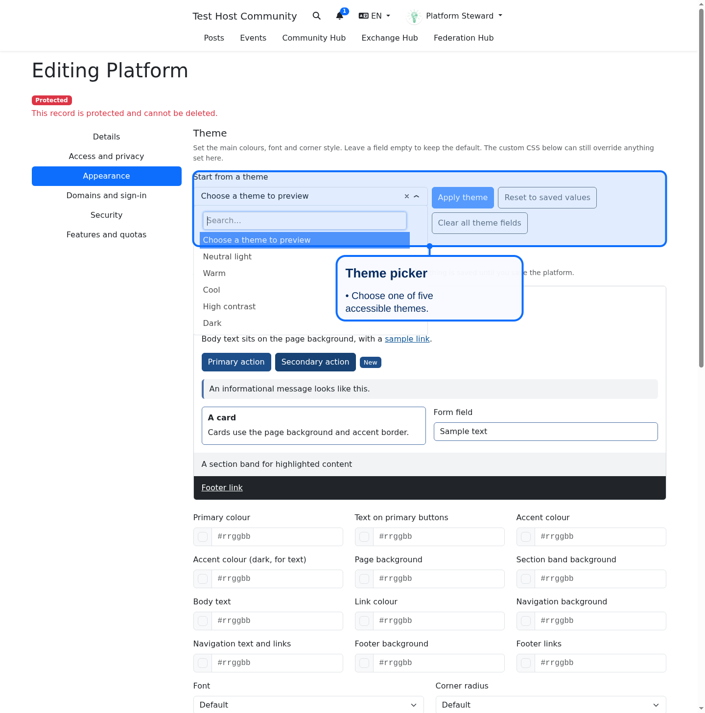
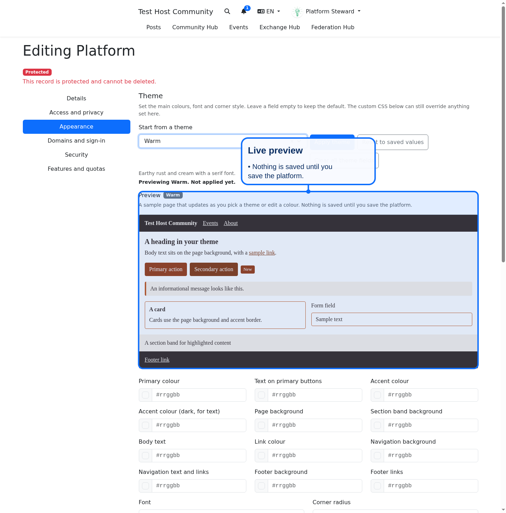
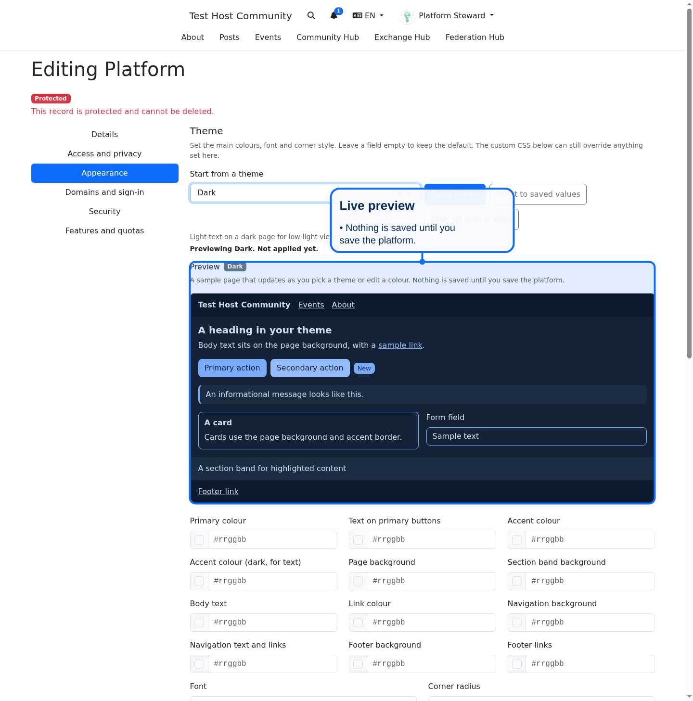

# Platform Theme Settings

Platform managers set the main look of a platform without writing CSS. Open the platform, choose Edit, then the Appearance tab.

## What you can set

- Colours: primary, text on primary buttons, accent, dark accent, page background, section band background, body text, link, navigation background and text, footer background and links. Use six digit hex values such as `#243542`. Leave a field empty to keep the default.
- Font: system sans-serif, Tahoma, Georgia or monospace.
- Corner radius: square, small, medium or large.
- Images: the site logo, a header banner and a favicon.

## Built-in themes

Five balanced themes ship with the platform: Neutral, Warm, Cool, High contrast and Dark. Every colour pair in every theme meets WCAG AA (4.5 to 1 for text, 3 to 1 for the accent outline). Pairs that also reach AAA (7 to 1) are marked "AAA" in the contrast list.

Pick a theme in the Theme dropdown. The live preview below it shows a navigation bar, headings, body text, links, primary and secondary buttons, a badge, an alert, a card, a form input and a footer in that theme. Nothing is saved yet. A status line states which theme is being previewed.

- Apply theme copies the previewed theme into the fields, where you can still adjust it.
- Reset puts the fields and preview back to the saved values.
- Clear all theme fields empties every colour, font and radius field. Save to return to the default theme.

Edit any colour, font or radius field by hand and the preview and the contrast list update at once.

## Contrast checks

Below the colour fields, each important pair shows its contrast ratio as you type: button text on primary, navigation text on its background, footer links on the footer, body text and links on the page and band colours, and the accent. Normal text needs at least 4.5 to 1 (WCAG AA). A pair under that shows a red "Below AA" warning. The warning does not block saving, so you can decide, but low contrast text is hard to read for many people.

## The site logo

The logo field edits the logo of the platform's own community, the same logo shown in the navigation bar. There is no second copy to keep in sync.

## How it is applied

Saved values become CSS custom properties (`--bts-primary`, `--bts-font`, `--bts-radius`, and so on) in a style element placed before the platform Css block. Because the Css block comes after, custom CSS still wins and stays the escape hatch for anything the theme fields do not cover. The header banner is exposed as `--bts-header-banner`; layouts decide where to show it.

