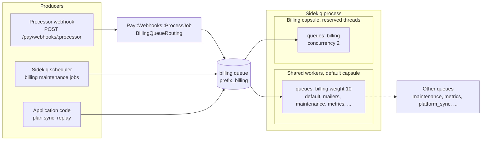

# Billing Queue Rollout

## Purpose

Payment work must never wait behind maintenance, metrics, federation or notification
jobs. Every Community Engine billing job runs on its own **`billing`** Sidekiq queue,
and a host should give that queue both a high fetch weight and, ideally, a dedicated
Sidekiq capsule with reserved threads.

## What the engine does

- `BetterTogether::Billing::ApplicationJob` declares `queue_as :billing`. Every billing
  job inherits it (event processing, dead-letter and redaction sweeps, plan sync,
  and the extension gems' jobs). A spec fails if a billing job lands on another queue
  or a scheduled billing job names another queue.
- Pay's own jobs (for example the job that delivers a processor webhook) are routed to
  the same queue by `BetterTogether::Billing::PayExtensions::BillingQueueRouting`.
- ActiveJob applies the host's `queue_name_prefix`. A host that sets
  `config.active_job.queue_name_prefix = 'better_together_production'` therefore runs
  `better_together_production_billing`, and its Sidekiq configuration must list that
  prefixed name.

## How Sidekiq treats the number in `[queue, N]`

The number is a fetch **weight**, not a rank. Sidekiq adds the queue to its poll list
`N` times, shuffles the list for every fetch, and takes the first non-empty queue. So:

- a **higher** number means the queue is checked first more often;
- plain queue names (no number) have weight `0` and count once;
- the list is *strictly ordered* only when **every** queue is a plain name.

This was checked against the Sidekiq 8.1.7 source (`lib/sidekiq/capsule.rb`,
`queues=`, and `lib/sidekiq/fetch.rb`, `queues_cmd`). It is the opposite of a
"priority 1 = most important" reading. Give `billing` a weight higher than every other
queue.

A weight only makes the queue *likely* to be served first. It does not reserve
capacity: if every thread is busy with long jobs, a billing job still waits. That is
what the capsule below is for.

## Recommended Sidekiq configuration

```yaml
default: &default
  url: <%= ENV["REDIS_URL"] || 'redis://localhost:6379' %>
  queues:
    - [billing, 10]          # heaviest queue: checked first most often
    - default
    - mailers
    # ...the host's other queues...
  capsules:
    billing:                 # reserved threads that only ever work billing jobs
      concurrency: 2
      queues:
        - [billing, 1]
```

With a queue prefix, write the prefixed names: `better_together_production_billing`.

The `billing` capsule has its own threads (and its own Redis connection pool), so it
keeps working while the shared workers are saturated. Size `concurrency` to the
expected payment volume; two is a sensible start. Keep `billing` in the shared list as
well so spare capacity on the other threads helps drain it.

The dummy app's `spec/dummy/config/sidekiq.yml` is the reference, and
`spec/config/billing_sidekiq_queue_spec.rb` loads it through Sidekiq's own config
reader and queue logic to check the weights and the capsule.

### Snippet for the production host app

For a host app that writes weighted, prefixed queues, add to **each** environment block
(the prefix applies in production only):

```yaml
queues:
  - [better_together_production_billing, 10]
  # existing entries unchanged
capsules:
  billing:
    concurrency: 2
    queues:
      - [better_together_production_billing, 1]
```

### A note about the existing host weights

The host application's current file annotates its queues as "priority 1 = default,
lower number = higher priority" (`default` is `1`, `mailers` `2`, the rest `3`). Given
how Sidekiq reads the number, `default` is actually the **least** favoured of those
queues, not the most. This document does not change that file. Choosing a billing
weight above every other queue (10 above) means billing is served first whatever the
other numbers are, but the existing numbers are worth revisiting separately.

## Scheduled jobs

`config/sidekiq_scheduler.yml` entries for billing jobs name `queue: "billing"`. Check
on the host that sidekiq-scheduler enqueues scheduled ActiveJob classes into the
prefixed queue; if a host sets a queue prefix and scheduled billing jobs appear in an
unprefixed `billing` queue that nothing subscribes to, drop the `queue:` key from those
entries so the job class decides.

## Rollout steps

1. Deploy the engine version that introduces `billing` with the queue added to the host
   Sidekiq configuration (above) **first**, so jobs enqueued on `billing` always have a
   worker.
2. Confirm in the Sidekiq web UI that the `billing` queue and the `billing` capsule
   appear, and that the capsule shows its reserved threads.
3. Enable billing (`BT_BILLING_ENABLED`) only after step 2.

## Queue topology



**Diagram Files:**
- [Mermaid source](../diagrams/source/billing_queue_topology.mmd) - editable source
- [PNG export](../diagrams/exports/png/billing_queue_topology.png) - high-resolution image
- [SVG export](../diagrams/exports/svg/billing_queue_topology.svg) - vector graphics
